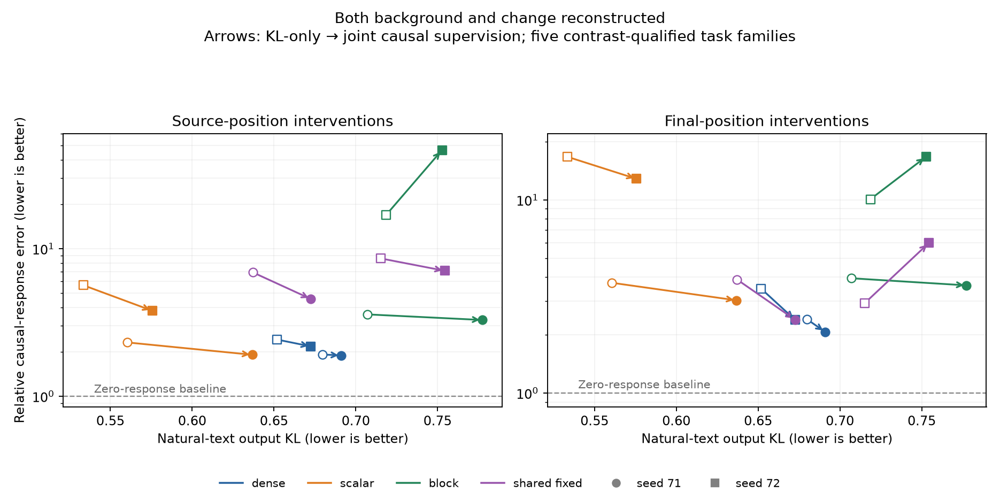

# Executable featurizers: transfer results and the computation gap

M88 completes the frozen evaluation of 16 input-to-write predictors and 16 privileged output-projection references. Causal supervision produces some task-transfer gains but does not yet give faithful computational units. The most useful conceptual clue is the gap between representing an output and computing its coordinates from the input.

## Design and definitions

MLP1 means the second transformer block (zero-based layer 1). Four architectures—dense, scalar sparse, disjoint block sparse, and fixed overlapping shared groups—were each trained with two seeds and two matched objectives: intact-output KL alone, or KL plus three-corner causal supervision. All use 128 dictionary directions; dense activates 128, scalar and block 32, shared approximately 28. Each input coordinate is one product of two learned affine functions. Parameter counts match, but active dimensions do not.

Evaluation uses 32 natural-text documents, 56 pairs across seven whole-task training holdouts, and 14 historical source-group holdout pairs. These are training exclusions, not pristine tests or newly discovered tasks. All final models are retained; no evaluation-based selection or refitting occurred.

A write is the vector added by the MLP to the residual stream. A background is the recipient write before an intervention. Three intervention corners separate reconstructed background/native change, native background/reconstructed change, and both reconstructed. Responses are final log-probability changes, centered on each candidate's own background. Relative response error is native-probability-weighted squared discrepancy divided by native response energy; **1 is the zero-response baseline**, not a fidelity threshold. Tables below use equal-family averages; pooled-energy and margin metrics remain in the accompanying JSON.

## Main results

| Evaluation | Joint-supervision wins out of eight: source, both reconstructed | Final, both reconstructed |
|---|---:|---:|
| All seven whole-task families | 3/8 | 4/8 |
| Five prequalified contrast families | 7/8 | 6/8 |
| Historical source-group holdout | 7/8 | 7/8 |

The five qualified families are sequence copying, weekday successor, tense, continent recall, and object function. Role binding and spatial inverse remain in the all-seven results. Qualification used native contrast performance, not candidate performance. Native contrast accuracy on the qualified subset is 96.25%, while native top-1 accuracy is only 41.25%; this is not broad task mastery.

Every input model's equal-family both-reconstructed error remains above 1 at both sites in these aggregate scopes. Block seed 72 with joint supervision reaches source error 46.445 on the qualified subset and 230.457 on the source-group cohort. These failures are retained. Improved win counts therefore do not establish adequate fidelity or robust transfer.

Natural-text KL and CE worsen under joint supervision in **8/8** matched comparisons. KL ranges from 0.533–0.719 for KL-only predictors and 0.576–0.777 for joint predictors. Local write error improves in five comparisons, illustrating again that geometric improvement need not preserve downstream behavior.

The privileged reference projects the already-computed native write onto each model's learned decoder span. Natural KL is 0.130–0.170 across all 16 references, better than every corresponding executable input predictor. On the five qualified families, reference both-reconstructed errors are 0.558–0.699 at the source and 0.696–0.807 at the final position. This uses all 128 directions and the native write; it is not an executable compression result, a matched-active-dimension comparison, or a behavioral upper bound. Dense predictors already activate all 128 directions, so sparse gating is not the only possible explanation for the gap.

## What this says about computational organization

Low-dimensional output geometry and low computational complexity are distinct hypotheses. Writing many native channel contributions into a few shared directions can look redundant geometrically while still requiring many different input interactions to compute the coefficient of each direction. Removing those interactions can change the function even when their output vectors are collinear.

For native product write F(z)=W[(Lz)⊙(Rz)], decoder D, center c, and orthogonal projector P=DD⁺, the privileged projection is

    c + P(F(z)-c) = (I-P)c + (PW)[(Lz)⊙(Rz)].

The right side is computable from z while retaining all native products. It makes explicit what the projection does and does not compress. A single output coordinate can be a sum of many bilinear products; our current predictor assigns only one product to each coordinate before gating. For example, a scalar output sum_i x_i y_i has output dimension one but requires k separable products when x and y each have k independent coordinates. This algebraic distinction is motivation, not evidence that the trained model needs its full width on the observed data.

The present evidence favors investigating coefficient computation rather than declaring the decoder directions useless. It does not distinguish insufficient capacity, optimization, or training coverage. Weight-space rank may overstate on-data complexity; coordinate complexity also depends on the decoder basis. We have not established native redundancy, cancellation, reusable semantic units, or a validated manifold by these tests.

## Verification and execution history

Independent audits pass for all 1,024 natural full-output vectors and 39,552 task response vectors. Input predictions and gate selections were independently recomputed; output references use independent QR algebra rather than the producer's SVD. No ambiguous support rows occurred. Maximum prediction relative error is below 5.2e-7; maximum task metric absolute discrepancy is 2.98e-8. These audits do not independently reimplement the transformer.

Whole-task execution segfaulted in rotary attention after 31 completed pairs. The unchanged runner resumed from a hash-verified atomic checkpoint and completed all 56 pairs; both task cohorts exactly replay native baselines and teacher targets. Completed-case forward counts total 32,060, plus an unknown amount of interrupted partial-pair work. See the recovery receipt. No experiment remains running from this stage.

Evidence: validation/bilinear_input_{natural,factorial,source_factorial}_comparison.json and corresponding audits; frozen model manifest bilinear_input_evaluation_models.json. Large full-vector tensors and model states remain in the local artifacts directory, not this public packet.

## Bounded next experiment

The next diagnostic separates output dimension from product count. First verify controlled examples with known complexity and data restrictions. Then verify the exact projected-native formula on all 16 frozen decoder spans using training inputs only. Do not fit, tune against evaluation tasks, or infer a minimal native circuit from weight rank. The concrete featurizer deliverable is a verified interface that separates a reusable dictionary of input products from the output-feature dictionary, plus a decision about what additional on-data evidence is needed before training it. Stop after this diagnostic and write the decision before any new architecture sweep. See validation/computational_rank_diagnostic_protocol.json.
