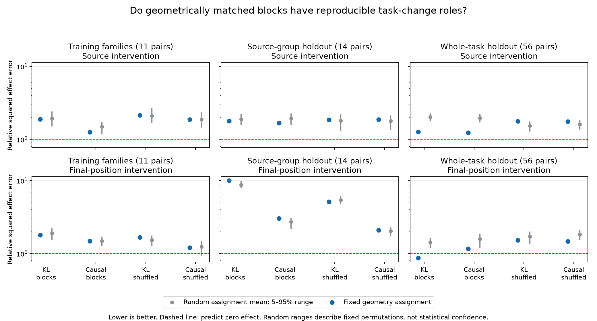

# Broader task effects are more reproducible than individual block roles

M105 completed, 2026-10-29. We tested frozen newer block featurizers in the native MLP1 background, following the [prospective protocol and preflight](BLOCK_CHANGE_ROLE_PREFLIGHT.md).

**Individual blocks do not yet form a reliably transferable task-unit dictionary.** Geometry carries some role information on whole-task holdouts, but almost every aggregate prediction remains worse than predicting zero effect. A separately labeled post-result diagnostic finds much better agreement between the full encoded changes on that cohort. This supports distinguishing a reproducible broader effect from a stable partition into blocks.

## What the experiment actually tests

Four frozen states: block featurizers at seeds71/72, trained with KL-only or KL plus encoded-change causal supervision. Each reconstructs already-computed native MLP1 writes; none is an executable input-to-MLP mechanistic replacement.

For every donor/recipient task pair, independently encode both writes. Add each of32 groups' decoded donor-minus-recipient changes to the original native recipient write. Test both trained disjoint groups of4 atoms and a fixed shuffle of the same atoms. Source-token positions and final position are separate. All other native computation stays intact. These are externally supplied feature interventions, not removal of native neurons.

All group changes sum to the encoded change locally in real arithmetic; individual downstream responses need not add. Complete encoded-change and native-change controls are retained. Identities are audited but excluded from nonidentity role summaries. Costs and energies differ between trained and shuffled groupings; these controls are not statewise energy matched.

Cross-seed matching uses decoder geometry only, frozen before these responses. Seed71 signed family/site mean margin effects predict the geometrically matched seed72 groups with no gain fitting. One hundred fixed random assignments are descriptive controls, not independent experimental replications or statistical confidence intervals. No task-effect matching, clipping, group selection, or rescue fit was performed.

The training panel contains one fixed-hash pair per each of11 families, not the entire training bank. Evaluation retains14 historical source-group pairs and56 whole-task pairs. Whole-task families were excluded from model fitting but examined in prior experiments: this is development evidence, not pristine blind discovery. Failed native competence cohorts remain in all-seven-family summaries; the earlier qualified-five subset is also reported.

## Individual block role prediction

Relative squared error compares predicted versus actual seed72 signed family-mean effects. Zero prediction scores1; lower is better. These are not native-response fidelity errors or percentages of computation understood.

| Cohort | Objective | Source pooled error | Final pooled error |
|---|---|---:|---:|
| Training panel | KL-only | 1.887 | 1.795 |
| Training panel | Causal | 1.258 | 1.490 |
| Source-group holdout | KL-only | 1.796 | 10.016 |
| Source-group holdout | Causal | 1.687 | 3.035 |
| Whole-task holdout | KL-only | 1.274 | 0.869 |
| Whole-task holdout | Causal | 1.237 | 1.166 |

Only one of these12 trained-group aggregate comparisons beats zero prediction: whole-task final position under KL-only. It is not a broad success. Its equal-family error is3.467 across all seven families and1.087 on the qualified-five subset, even though the qualified pooled error is0.861. Low-energy families can have large normalized errors; neither aggregation should be hidden.

On whole-task holdouts, all four trained-group geometry scores are below the fifth percentile of the corresponding fixed random-assignment errors. Their cosines are0.3036–0.4484 across objectives/sites. Thus geometry contains some causal correspondence, but beating random assignment is much weaker than accurately predicting the effects. The trained grouping also performs better than its shuffled grouping on these four pooled comparisons. Source-group results are considerably weaker and can favor random assignments over geometry, especially at final position.

Causal supervision does not uniformly improve role correspondence: it lowers whole-task source error slightly but worsens final-position error from0.869 to1.166. The result does not prove that the supervised objective cannot yield better units under different data or models; it limits the interpretation of these frozen states.

## The responses do not generally compose additively

For each endpoint, sum the individually measured log-probability response vectors and compare with the response to the joint encoded change. The local vectors add, but the native downstream computation is nonlinear.

For trained groups, pooled squared nonadditivity relative to joint-response energy is:

| Cohort | Source range across four states | Final-position range |
|---|---:|---:|
| Training panel | 0.153–0.675 | 0.008–0.017 |
| Source-group holdout | 0.097–0.241 | 0.005–0.039 |
| Whole-task holdout | 0.052–0.079 | 0.006–0.017 |

Source-position group effects are appreciably nonadditive. This concerns downstream effects of feature interventions, not signed cancellation among native MLP channels. Summing a collection of individually appealing group explanations can therefore misdescribe their joint effect.

## Post-result diagnostic: compare the complete encoded changes

After observing weak training/source-group block correspondence, we computed cross-seed agreement of the **complete encoded-change** signed family-mean effects. This uses existing controls, all objectives/cohorts/sites, no assignment and no fitting. It is explicitly exploratory; it does not replace the frozen block test.

On the whole-task cohort:

| Objective | Source cross-seed error / cosine | Final cross-seed error / cosine |
|---|---|---|
| KL-only | 0.113 / 0.942 | 0.339 / 0.908 |
| Causal | 0.098 / 0.958 | 0.265 / 0.863 |

These complete changes agree much better than the individual matched groups. Source-group source effects also agree reasonably, but final-position agreement is poor: KL-only error11.230/cosine−0.853 and causal error2.449/cosine0.206. The stronger whole-task result must not be generalized to all contexts.

Cross-seed agreement is not native faithfulness: two approximations can agree and both be wrong. For the whole-task controls, pooled full-vocabulary native-response errors remain0.582–0.787 at source positions and0.117–0.261 at final positions. These differ from the role-prediction metric above. Signed family-mean margins also compress substantial behavior; their agreement is not equivalence of entire functions.

## Conceptual consequence and next step

The evidence fits a representation whose broader task effects are more reproducible than its particular block partition, at least on the whole-task cohort. It weakens the interpretation of one block as one stable task unit. It does not distinguish fully between nonidentifiable groupings, genuinely distributed roles, imperfect one-to-one geometric matching, and insufficient learning. Nonadditivity adds a separate obstacle to composing block explanations.

This connects the conceptual research to featurizer design: coactivation and multidimensionality do not establish a reusable computation; seed consistency of whole effects does not establish consistent units; and individual causal effects do not automatically compose.

Close this matching experiment without further gain or assignment tuning. The next proposed direction is a small native-competence-screened factorial task challenge: vary two independently specified facts and which fact a query requests. Such a panel can test selective information use and combinations directly, and provide clearer causal supervision targets. First inspect existing binding/context challenges to avoid duplicating them. Freeze prompts, competence criteria, factor interventions and training/combination exclusions before inspecting feature outcomes. This is a proposal, not an implemented experiment or a claim of new-task discovery.

## Verification and artifacts

All three producers and audits are terminal. Evaluation:45,062 native forwards, plus130 preflight forwards. Every124,280 saved final response vectors was independently rescored, including122,368 individual-group records and1,912 joint controls. All640 native baselines/teacher results replay exactly. The32 ineligible whole-task model/site assignments remain explicit.

NumPy independently verifies every saved endpoint gate, decoder reconstruction, group energy/support count and response metric, including downstream nonadditivity. Maximum metric discrepancy3.73e-9; maximum decode discrepancy7.96e-6 under the fixed1e-5 tolerance. The Transformer itself is not independently reimplemented. Complete prospective pair/model/site/group coverage was checked separately.

All frozen geometry/random comparison arithmetic passes194,552 scalar checks. The exploratory complete-change diagnostic passes228 independent scalar checks. The figure was visually inspected. Full vectors remain in local artifacts; public JSON, scripts and receipts permit reconstruction.

- [Coverage audit](validation/block_change_roles_coverage_audit.json)
- [Training comparisons](validation/block_change_roles_train_comparison.json)
- [Source-group comparisons](validation/block_change_roles_source_comparison.json)
- [Whole-task comparisons](validation/block_change_roles_whole_comparison.json)
- [Exploratory joint-role diagnostic](validation/block_change_joint_role_diagnostic.json)
