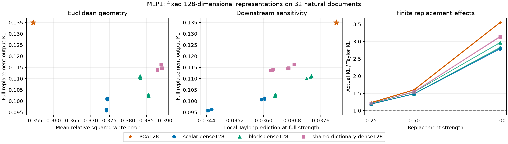

# M74: downstream sensitivity predicts the reversal; finite effects amplify it

M73 found that PCA128 reconstructs MLP1 writes better than every dense learned dictionary, yet preserves output distributions worse. M74 tested two explanations: the discarded directions matter differently to downstream computation, and finite replacement introduces effects absent from a local linear approximation. Both contribute on this natural-text cohort.

## Theoretical prediction and intervention

Let w be the native MLP1 product write at all positions, e=encoder(w)-w its fixed reconstruction residual, z(w) the actual softcapped downstream logits, and p=softmax(z(w)). Let t=J_z(w)e be the directional derivative of logits. The local Fisher energy is

F(e) = mean_positions [sum_v p_v (t_v - sum_u p_u t_u)^2].

For small alpha, KL(p(w) || p(w+alpha e)) = alpha² F(e)/2 + higher-order terms. This measures sensitivity to the particular discarded residual, not an intrinsic sensitivity independent of residual magnitude. A smaller Euclidean residual can have larger Fisher energy.

We evaluated the fixed PCA128 and all18 dense learned encoders on all32 natural evaluation documents. No fitting, task labels, encoder selection or direction normalization occurred. Native bias, embedding skip, first-layer value bus and live downstream recomputation were preserved. Every residual was tested at alpha0.25,0.5,1, with native alpha0 as baseline. Directional derivatives came from forward-mode autograd through the unchanged model, including the final softcap.

## Results

| Quantity | PCA128 | All18 dense learned spans |
|---|---:|---:|
| Mean relative squared write error | 0.3545 | 0.3742–0.3892 |
| Mean local Fisher energy | 0.07607 | 0.06885–0.07468 |
| Actual full-replacement KL | 0.13499 | 0.09575–0.11623 |
| Actual/Taylor KL at quarter strength | 1.231 | 1.185–1.214 |
| Actual/Taylor KL at half strength | 1.600 | 1.480–1.555 |
| Actual/Taylor KL at full strength | 3.549 | 2.780–3.154 |

PCA has lower local reconstruction error than all18 learned spans, but higher Fisher energy and higher actual KL than all18 at every tested strength. Thus the behavioral ranking reversal is already present in the local downstream metric: finite nonlinear effects are not necessary to explain its direction. They are necessary for an accurate account of the full-replacement magnitude. The local Taylor prediction accounts for only about28% of PCA's full KL and32–36% of the dense spans' full KL.

This is less uniform at the document level. Local Fisher ordering matches the paired PCA/dense KL ordering in515/576 comparisons at quarter strength (89.4%),482/576 at half (83.7%), and428/576 at full (74.3%). For PCA, correlation across documents between log Fisher energy and log actual KL falls from0.959 at quarter strength to0.343 at full strength. All comparisons use shared documents and related training histories; they are not independent statistical replications.

The Taylor discrepancy includes both downstream-network curvature and nonlinearity of the output distribution. This experiment does not isolate those two sources. Nor does it prove which training objective produced the learned spans' advantage. All19 encoders here are affine, so the result does not establish a benefit from conditional feature groups.

## What this says about computation

Euclidean compression and computational compression are different. In these fixed directions, the model tolerates some larger activation errors better because their downstream effects are smaller. That is evidence about behavioral use of a distributed representation; it is not evidence that native neurons are individually redundant or cancelling.

A useful featurizer should be checked against at least two criteria: the downstream effects of small changes and the effects of finite interventions. Neither low reconstruction error nor a favorable local metric alone establishes a faithful manifold or reusable computational unit. We retain the distinctions among function geometry, channel implementation and downstream use from the conceptual synthesis.

## Verification

- Frozen protocol,19-model inventory, two preflight documents, derivative steps0.01/0.003/0.001 and acceptance thresholds were recorded before full evaluation. One PCA smoke test established forward-AD support; no step tuning followed.
- Preflight:38cases,268forward/AD executions,114central finite differences. Every AD primal exactly equals the native forward. Maximum derivative relative error0.008509 and Fisher relative error0.001092; finite-difference error grows at the smallest step, consistent with float32 subtraction limits.
- Independent NumPy preflight audit rescored every saved plus/minus output. Its first run failed a too-tight comparison between float32 and float64 tangent norms (difference3.19e-10); the derivative-error arithmetic comparison was changed to1e-6relative tolerance. Scientific acceptance thresholds, native outputs and experiment steps were unchanged. Rerun passed; maximum metric difference5.65e-10. This failure and correction are retained here.
- Full evaluation:2,464forward/AD executions,608fixed representation/document cases,1,824finite-replacement outputs. All native writes replayed exactly. Full replacement reproduces the prior mean-KL measurements within1.62e-7absolute, below frozen tolerance; float32 native+residual differs slightly from reconstruction+bias arithmetic.
- Independent audit: all608tangents and1,824full-vocabulary outputs rescored in NumPy; all608residuals reconstructed independently from frozen projection spaces. Maximum residual relative disagreement5.02e-8. Maximum metric absolute difference2.39e-7 includes large raw squared residual energies. Derivative validity is checked on the fixed38preflight cases, not independently finite-differenced on every evaluation case.
- Sources, references, model states, protocols and saved samples are hash-bound. The plot and full comparison preserve all19representations. All jobs completed; no model was trained or selected.

Reproduction entry points: prepare_downstream_metric.py, check_downstream_metric.py, audit_downstream_metric_preflight.py, probe_downstream_metric.py, audit_downstream_metric.py, analyze_downstream_metric.py, plot_downstream_metric.py. Existing frozen files prevent accidental overwrites; the full probe supports hash-checked document-boundary resume. Interrupted resume was not exercised in this run. Large tensors remain in the local artifact directory and are not included in the public packet.

## Decision: return to broader validation

Close this fixed diagnostic; do not add an amplitude/rank/objective sweep. Use finite causal fidelity as the deciding test and the local Fisher metric as explanatory evidence, not a replacement for finite validation. Return to the joint featurizer loop by auditing whole-task training exclusions and establishing native competence on a fixed, diverse validation cohort. The next deliverable is a documented set of evaluation tasks and a frozen joint comparison that can test whether the representation gains transfer beyond familiar source-group pairs. Excluded tasks remain excluded from every fit. No manifold, semantic-unit, or new-task-discovery claim is made.
