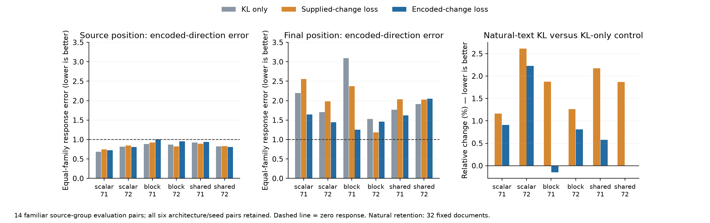

# M70: encoded-change supervision fits training effects, but broad causal fidelity remains unresolved

The frozen evaluation is complete for all six encoded-change final models and twelve fixed KL-only/supplied-direction controls. The new objective improves encoded-response error on the training bank in **all six architecture/seed comparisons at both source and final positions**, against either control. On familiar source-group evaluation pairs, gains are mixed. **Every new model still scores worse than zero response on final-position equal-family encoded-direction error.**

This is evidence that the objective can be optimized, but it does not deliver generally faithful computational units. No architecture or seed was selected as the answer.

## Comparison summary

Counts are paired architecture/seed improvements among six candidates. “Encoded direction” means the candidate's independently reconstructed donor-minus-recipient change applied in the original native background. “Supplied direction” means an exact native change applied in a reconstructed background. Equal-family means average family-specific relative response errors; energy pooling is reported separately in the JSON.

| Metric | Encoded objective beats KL-only | Beats supplied-direction objective |
|---|---:|---:|
| Training encoded direction, source family mean | 6/6 | 6/6 |
| Training encoded direction, final family mean | 6/6 | 6/6 |
| Scheduled training encoded loss | 6/6 | 6/6 |
| Holdout encoded direction, source family mean | 2/6 | 3/6 |
| Holdout encoded direction, final family mean | 5/6 | 4/6 |
| Holdout supplied direction, source family mean | 4/6 | 0/6 |
| Holdout supplied direction, final family mean | 2/6 | 1/6 |
| Holdout both background/direction reconstructed, source family mean | 1/6 | 1/6 |
| Holdout both reconstructed, final family mean | 3/6 | 4/6 |
| Natural-text KL | 2/6 | 6/6 |

Natural retention improves relative to the supplied-direction objective in all six comparisons, but remains worse than KL-only for four. One of the two improvements over KL-only is very small; these are descriptive fixed-candidate comparisons, not statistical superiority claims. Pooled holdout encoded-response error improves3/6 source and3/6 final against KL-only, versus3/6 source and5/6 final against the supplied objective. This differs from equal-family weighting.

## Encoded-direction evaluation details

All values below are equal-family response errors in native backgrounds; zero response is1 and exact response is0. These are relative squared errors, not percentages of computation understood.

| Architecture | Seed | Source KL-only | Source supplied objective | Source encoded objective | Final KL-only | Final supplied objective | Final encoded objective |
|---|---:|---:|---:|---:|---:|---:|---:|
| scalar | 71 | 0.688 | 0.751 | 0.722 | 2.200 | 2.554 | 1.645 |
| scalar | 72 | 0.817 | 0.847 | 0.805 | 1.705 | 1.985 | 1.445 |
| block | 71 | 0.886 | 0.923 | 1.005 | 3.093 | 2.374 | 1.252 |
| block | 72 | 0.869 | 0.822 | 0.957 | 1.533 | 1.185 | 1.464 |
| shared_fixed | 71 | 0.920 | 0.896 | 0.938 | 1.770 | 2.033 | 1.623 |
| shared_fixed | 72 | 0.826 | 0.834 | 0.809 | 1.909 | 2.027 | 2.052 |

The best new final-position equal-family score is still1.252. Source-position scores are below1 for five candidates, but these substantial remaining errors do not establish adequate fidelity. The fully reconstructed source corner often worsens even when a particular trained response improves. Gains are therefore specific to the evaluation question, not a global improvement in representation quality.

## Interpretation and next discriminating test

M63 identified a mismatch between learning a background that responds to supplied changes and learning the changes themselves. M68–M70 corrected and tested that objective. Training improvement supports that the new loss has useful gradients; mixed evaluation behavior shows that fixing the objective alone is insufficient under this fixed data/model/budget configuration. We have not isolated overfitting, limited span, support selection, or coefficient errors as the cause. These reused source-group evaluation pairs are familiar development data, not pristine whole-task generalization.

Close the objective comparison without a learning-rate, weight, seed or architecture sweep. The next fixed diagnostic asks which part of the representation is limiting it:

1. Project native changes into the recipient's selected atom span.
2. Project into the union of donor and recipient selected spans.
3. Project into the complete dictionary span.

Compare all three to the actual encoded change, locally and through the native reader. Local errors must obey the known nesting inequalities, providing an implementation check. If the selected span supports a better causal direction than the encoder produces, coefficient estimation is implicated; if only the full dictionary helps, support selection is implicated. These use native-change information and are **diagnostics, not deployable featurizers**. Euclidean projection is not the optimal downstream direction, so a bad full-span projection cannot prove that the span has no causally useful representation.

This connects the next experiment to manifold/feature quality rather than another training-score improvement. It does not relax the requirement for diverse-task transfer, causal validation and genuine new-task discovery before calling features computational units.

## Verification and runtime recovery

Holdout:3556 forwards,4536 final response vectors and1512 geometry rows audited; all3024 fixed-control corner metrics replay exactly. Training:12668 committed forwards,15048 response vectors and7524 geometry rows audited; all5016 fixed-control supplied-direction metrics replay exactly. There are two shared ineligible source alignments, retained separately. A total3024 saved selected-code decoder reconstructions were independently checked; gate selection was not independently reimplemented by these evaluation audits.

Natural:608 forwards across all32 evaluation documents and18 models. All384 old-control document records replay exactly. All576 inventory rows and aggregates are checked, with independent full-output NumPy scoring on fixed documents32 and63 for all18 states (36 model/document samples), not a rescore of every natural output. Intact task KL/accuracy and scheduled encoded training losses are derived from saved final vectors and raw response rows by the comparison script.

The training evaluation process exited with a segmentation fault while processing pair45 after saving44 pairs. The saved source/protocol and every completed file hash were verified, then the unchanged runner resumed at pair45 and completed. Discarded partial work is excluded from the12668 committed-forward count; no cause for the runtime fault is asserted. All processes are now terminal. `encoded_eval_train_recovery.json` records the recovery.

A metadata note corrects inherited training-result prose referring to three corners: training measured the two specified corners; the holdout measured all three. Protocols, actual rows, audits and this report use those correct counts. No numeric data were changed.
