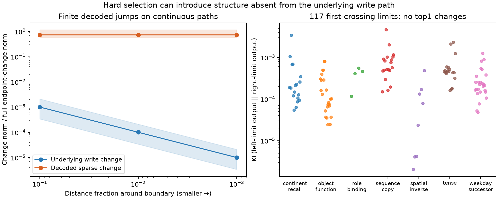

# Hard block-selection boundaries versus native computation

M110 directly tests a mechanism left unresolved by M64–65: a hard sparse gate can introduce a finite decoded jump on a continuous path of native writes. This is a diagnostic of the featurizer, not evidence that native computation has discontinuities or discrete semantic boundaries.

## Main finding

117 of 224 fixed task/model paths cross at least one Top8 block-selection boundary. Across all paths there are 160 actual support boundaries. Every crossing path has a nonzero decoded jump at its first boundary; as the underlying write change shrinks toward zero, this jump persists. The four models’ median jump norms are 0.68–0.77 times the entire endpoint-to-endpoint native write difference.

The downstream effect is bounded but nonzero: mean one-sided output KL is 0.00027–0.00070 across the four models, conditional on a crossing. None of the 117 evaluated jumps changes the top token. Thus decoded geometry can contain artificial sharp structure to which the downstream model is relatively insensitive. This does not make the structure causally equivalent or prove that it explains all featurizer errors.

Left panel: medians and interquartile ranges across the 117 crossing paths. The distance fraction multiplies a path-specific safe radius around each analytic boundary. Right panel: every evaluated first-crossing output KL, retaining all seven families and four models. Points are diagnostic cases, not independent statistical samples.

## Why this experiment is new

M64 decomposed encoded changes into within-support motion and support switching. M65 controlled for intervention magnitude. Those studies supported both magnitude and direction explanations but did not locate crossings or establish a discontinuous decoded map. This study solves for the crossing locations, verifies the one-sided limits, and evaluates those limits in the native recipient background. It does not reopen gain fitting or the prior support-control sweep.

## Theory and toys

Along an affine write path w(t)=w0+t(w1-w0), the raw encoder coordinates are a(t)=a0+t*b. Each block energy is quadratic in t. Solving all pairwise energy equalities partitions the path into intervals with constant Top8 support. Only ties that actually change the selected support are counted.

At a crossing t*, let q− and q+ be the selected atoms immediately before and after it. The decoded jump is

`J = scale * D @ (a(t*) * (q+ - q-))`.

Selection changes do not automatically imply a decoded jump: the entering and leaving decoded contributions could match. A controlled toy with two different decoder directions produces a jump of norm 1/sqrt(2); the same crossing with identical decoder columns is continuous. A no-crossing toy and 30 random paths verify the analytic solver against dense-grid support changes.

For small h contained within adjacent constant-support intervals, the across-boundary decoded difference is exactly J plus a term linear in h. This identity is checked at three fixed distance fractions (0.1, 0.01, 0.001). The corresponding underlying write difference is 2h(w1-w0), which tends to zero. A proposed manifold boundary should not be inferred from J alone.

## Frozen native diagnostic

All 56 existing whole-task pairs were retained, spanning sequence copying, tense, weekday succession, continent recall, object function, spatial inverse, and role binding. Four already-trained block featurizers were used: seeds 71/72 with intact-KL or KL plus encoded causal-response supervision. These task families remain excluded from featurizer fitting. The panel has been used for development; it is not a fresh confirmation set. Spatial inverse and role binding have known weak native competence and remain separately visible.

For each path, endpoint0 to endpoint1, only the final-position MLP1 product write is interpolated. This is an internal, potentially off-manifold path, not a continuum of valid text prompts. The first actual crossing is selected by path position before inspecting downstream effects; all counts are retained, including paths without crossings.

The exact left and right decoded limits and the continuous native interpolated write are each inserted at that position in endpoint0’s native context. The separate Down bias and all preceding positions are preserved. The Transformer recomputes downstream states. Float64 limits are converted to float32 for the model; this tests the limits directly rather than relying on numerically ambiguous TopK decisions infinitesimally close to a tie.

| Objective | Seed | Crossing paths / 56 | Median jump / full native change | Mean KL(left || right), crossing paths | Top1 changes |
|---|---:|---:|---:|---:|---:|
| KL | 71 | 27 | 0.678 | 0.000271 | 0 |
| KL | 72 | 29 | 0.773 | 0.000304 | 0 |
| KL + causal | 71 | 30 | 0.731 | 0.000701 | 0 |
| KL + causal | 72 | 31 | 0.739 | 0.000496 | 0 |

KL(left || right) ranges from 2.05e-6 to 0.00462. Reverse KL and each limit’s error relative to the continuous native-path output are retained in validation/gate_boundary_analysis.json. These conditional means do not estimate prevalence or importance on natural text. Causal supervision did not remove this mechanism in either tested seed.

## What this means for computational units

Three properties must remain separate: (1) smooth or clustered geometry of the native states, (2) boundaries introduced by an extractor, and (3) the downstream response to those extracted differences. We have directly demonstrated a mismatch between the first two on these interpolation paths and measured its downstream consequences. This is not native channel redundancy, native cancellation, or evidence for discrete semantic clusters.

A useful prior is therefore continuity of the decoded computation across extractor selection boundaries, or at least an explicit bound on the downstream discontinuity. Stable labels alone are insufficient. Hard gates need not be prohibited: matching contributions across a boundary can make the decoded map continuous, as the toy shows. Overlap or hierarchy alone does not guarantee that matching.

A next architecture comparison should test a continuous block-shrinkage map against the hard-gated baseline with matched block budget, data and training objectives. For example, shrink each block by max(0,1-tau/||a_g||), where tau is the ninth-largest block norm for an eight-block budget; define zero-norm output as zero. This yields a continuous map with at most eight nonzero blocks, but changes amplitudes and may hurt reconstruction. The theoretical continuity, gradients away from ties, and training/fidelity tradeoff must be tested before declaring it a better featurizer. No such model has yet been fitted here.

## Verification and stopping

407 panel forwards with 56 bit-exact native baseline replays. Independent explicit quadratic formulas reproduce the full 224-path census and all 160 crossing locations (maximum discrepancy 3.26e-14); 351 finite-limit identities pass. Independent decoded-limit reconstruction has maximum relative discrepancy 5.01e-15. Twelve fixed samples reproduce bit-for-bit through native GPT/Block.forward hooks rather than the trace runner. All jobs are terminal.

This boundary study is closed. No crossing search by downstream effect, gain fitting, prompt repair, or retraining follows on this panel. Full arrays/logits stay in the local cache referenced and hashed by validation/gate_boundary_native.json; scripts, protocols, metrics, figure, and this report are in the shareable packet.
