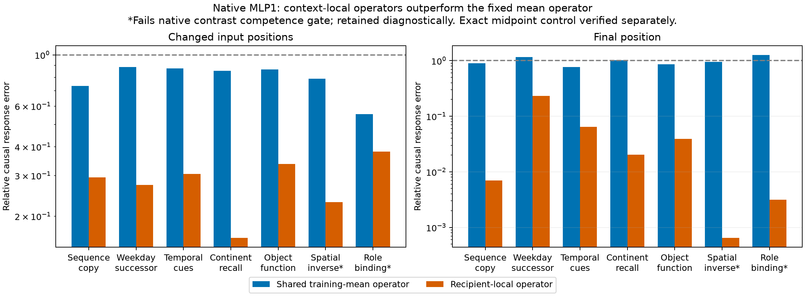

# M77: native changes are much better described by recipient-local operators

We moved from compressing already-computed writes to testing the native MLP1 input-to-write computation. The operator evaluated at the recipient input predicts changes substantially better than a shared operator evaluated at the natural-training mean, across every one of seven task families at both source and final positions. An exact quadratic midpoint control reproduces native changes and their downstream effects to numerical precision.

## Three fixed predictors

Let z be the normalized input to MLP1 and let its product write be F(z)=D[(Lz)⊙(Rz)]. Native Left/Right/Down linear modules have no biases; the separately retained Down bias cancels in differences. For direction v,

J(z)v = D[(Lz)⊙(Rv) + (Lv)⊙(Rz)].

For donor and recipient inputs, dz=z_d-z_r. We tested:

1. **Shared training-mean operator:** J(mean_training_z)dz. The reference is fixed using only4,092unique-prefix positions from natural training documents0–31.
2. **Recipient-local operator:** J(z_r)dz, the first-order prediction at the actual recipient.
3. **Midpoint exact control:** J((z_r+z_d)/2)dz. For a quadratic function this equals F(z_d)-F(z_r) algebraically.

The Jacobian here maps normalized MLP inputs to MLP writes. It is not the downstream logit Jacobian from M74. No derivative through input normalization is included: actual normalized endpoint inputs are supplied. Training mean and midpoint need not lie on the RMS sphere; they are algebraic anchors, not asserted natural hidden states.

All56fixed pairs, both endpoints, source/final/identity and all seven families are retained. The8source-ineligible assignments remain ineligible for each predictor. Each predicted write change is patched into the native recipient background. There is no norm matching, anchor search, rank truncation or task-supervised fit.

## Results

Relative errors below are squared-error ratios, not percentages of the model understood. Response error1 is the zero-response baseline.

| Full seven-family cohort | Shared mean J | Recipient-local J | Midpoint control |
|---|---:|---:|---:|
| Source local write error, pooled | 0.8592 | 0.3562 | 1.78e-13 |
| Final local write error, pooled | 0.9375 | 0.06984 | 3.17e-12 |
| Source response error, equal-family | 0.7930 | 0.2830 | 4.66e-11 |
| Final response error, equal-family | 0.9896 | 0.05236 | 9.25e-9 |
| Source response error, pooled | 0.7936 | 0.2963 | 1.98e-11 |
| Final response error, pooled | 0.9016 | 0.01309 | 1.65e-10 |
| Source answer-margin error, pooled | 0.7985 | 0.3890 | 1.27e-11 |
| Final answer-margin error, pooled | 0.8773 | 0.004699 | 8.38e-11 |

The qualified-five-family summary shows the same distinction: equal-family source response error0.8420→0.2740 and final0.9407→0.07255. Per-family recipient final errors range from0.00064 for spatial inversion to0.23246 for weekday successor. Spatial and role families failed the native contrast gate and remain diagnostic. Every family/format result is preserved in the comparison JSON.

The recipient-local operator is especially effective at final-position changes, where native inputs differ through preceding context. Source token changes leave more second-order remainder. These contrasts differ in input direction, magnitude and number of patched positions; they are not an equal-perturbation-budget comparison or proof that the MLP changes its algorithm by site.

## What is learned conceptually

A useful global output subspace does not imply a single shared input-to-write operator. In these conditions, the operator around the actual recipient captures much more of the change than the fixed training-mean operator. This favors testing context-conditioned computations rather than interpreting fixed output axes alone as fundamental units.

However, we have rejected only this particular shared linearization. Because J(z) is linear in z, J(mean_z) is the average training Jacobian and minimizes average squared Frobenius distance to those Jacobians. It is not the least-squares affine predictor of observed writes, nor necessarily optimal for these correlated task-change directions. We have not proved that every global linear map fails. Natural-to-task distribution shift is also possible.

The midpoint identity clarifies cancellation terminology. Expanding at the recipient gives deltaF=J(z_r)dz+F(dz); expanding at the midpoint absorbs the quadratic remainder into an exact first-order-looking expression. Cancellation between those expansion terms depends on the anchor. Cancellation between fixed native channel contributions is a separate implementation property and is not removed by this algebraic rewrite.

The midpoint calculation uses the known native weights and both endpoints. Its accuracy is an instrumentation/algebra control, not discovery of a compact mechanism. The recipient calculation also uses the full native weights and has no claimed compression or speed advantage.

## Toy evidence: function versus implementation

Two fixed functions were checked: a linear map on an affine input slice and a context-dependent product. A shared operator is exact on the linear slice; on the product case the recipient operator improves on the shared one but leaves a quadratic remainder, and the midpoint is exact.

Each function was implemented by one channel, four equal positive copies, and two opposing channels with coefficients2and-1. All implement the same function and functional Jacobian, but deleting the first channel gives respectively1,1/16and4times the single-channel squared error. Channel counts differ and these are analytic constructions, not trained capacity-matched robustness comparisons. They establish that functional Jacobian structure alone cannot diagnose implementation redundancy/cancellation.

Twelve additional deterministic random bilinear cases verify explicit Jacobians, central finite differences and midpoint identities. Maximum finite-difference relative error2.30e-11. No toy result was used to select a native predictor.

## Verification

- Training reference:32native forwards with exact cached-write replay,4092training-only indices, disjoint training/evaluation document hashes, float64mean independently checked.
- Native local stage:112forwards with exact endpoint baselines,984predictions including identities. All analytic operators use float64; predicted changes are castfloat32 before patching. Maximum midpoint local squared relative discrepancy7.98e-11 against nativefloat32write differences.
- Independent local audit: explicit full shared Jacobian, NumPy polarization for recipient/midpoint, every native write, prediction and local metric. Maximum prediction relative disagreement2.71e-8; nativefloat64versusfloat32write relative disagreement2.08e-7.
- Downstream stage:976forwards,328exact teacher replays,984saved response vectors and24retained predictor/ineligible cases. Native baselines and captured writes replay exactly.
- Independent full-vector audit: maximum metric absolute discrepancy1.49e-8 including large delta energies. Maximum midpoint weighted response error6.83e-12. All identity responses are zero. The predeclared tolerances were unchanged; no failure or retry occurred in M77.

Total native forward executions across reference/local/downstream stages:1,120. All stages are complete. Scripts and hashes are public; full arrays remain local. The transformer is not independently reimplemented.

## Decision and next test

Close the three-anchor diagnostic without an anchor/rank sweep. Before claiming global linear structure is inadequate, fit one full affine input-to-write predictor on the same natural training positions by a fixed float64least-squares solve. This is an executable candidate: it consumes z directly, not the native write. Its verified training residual will measure what the best affine map under that empirical MSE objective cannot reproduce; heldout natural and task interventions will test transfer and downstream fidelity.

No task labels or heldout operations enter that fit. The comparison will retain reconstruction, intact behavior and all three causal background/change corners. Good performance would support a useful affine approximation on the data; poor performance would still need to be distinguished from loss mismatch and distribution shift before concluding that context-gated features are necessary.
