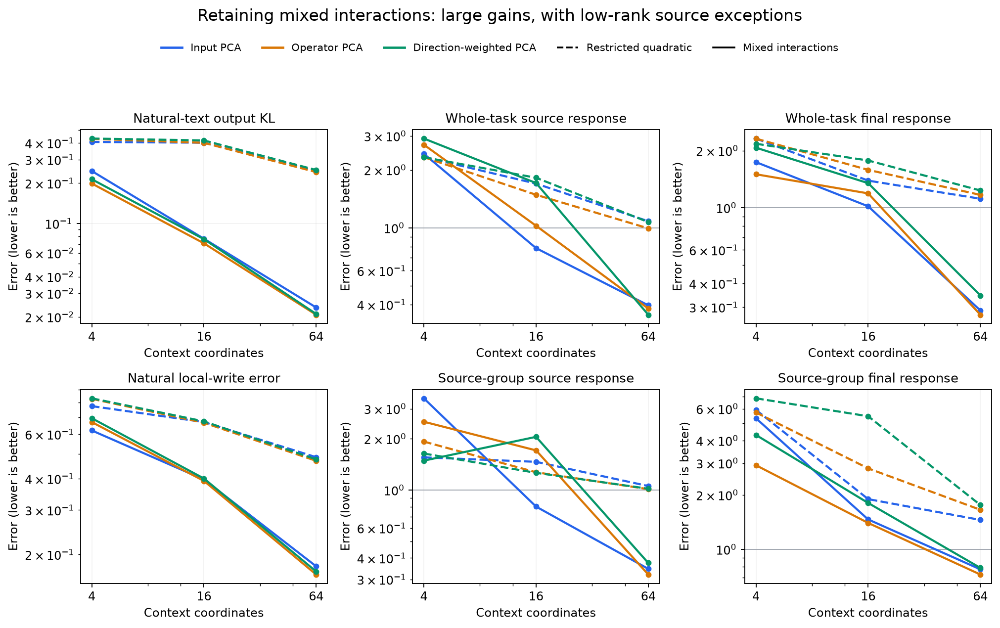

# Retained context coordinates are much more useful when they interact with the rest of the input

M101 tested one change to the previous native MLP1 approximation: retain the quadratic interactions between selected context coordinates and their complement. The bases, ranks, mean input and native weights stayed fixed. No parameters were trained. This substantially improved natural-text retention and most causal comparisons, especially at64 coordinates, while preserving several low-rank failures.

Dashed curves are M100's restricted quadratic; solid curves retain mixed interactions. All three prespecified ranks and bases are shown. Causal panels use equal-family relative response error with both background and change reconstructed; the horizontal line at1 is the zero-response baseline. Axes are logarithmic. Natural local-write error is a squared-error ratio.

## What changed mathematically

With u=z−mu and projection P, the old function was

Frestricted(z)=F(mu)+J(mu)u+F(Pu).

The new function adds the mixed term J(Pu)(I−P)u:

Fmixed(z)=F(mu)+J(mu)u+F(Pu)+J(Pu)(I−P)u

=F(z)−F((I−P)u).

Only omitted-with-omitted quadratic interactions are discarded. The native finite-change error is exactly J((I−P)h)(I−P)delta, where h is the centered midpoint. This is a consistent function, unlike an arbitrary context-projected Jacobian field.

The new construction has greater interaction capacity. It is not a parameter-count-matched comparison or a free compression improvement. Our reference implementation uses copied native weights and does not establish runtime savings.

## Held-out results

At64 coordinates, natural-text output KL drops by roughly an order of magnitude:

| Basis | Restricted KL | Mixed KL | Mixed top1 agreement with native |
|---|---:|---:|---:|
| Euclidean input PCA | 0.24550 | 0.02354 | 91.60% |
| Isotropic operator PCA | 0.24185 | 0.02078 | 91.89% |
| Training-direction operator PCA | 0.25054 | 0.02107 | 91.55% |

Natural output KL improves for all9 basis/rank conditions. Local-write error also falls substantially; at64 coordinates it is0.166–0.179, versus0.470–0.486 for the restricted function. Neither statistic is a percentage of computation understood.

The rank64 causal comparison retains all seven whole-task families and all source-group holdouts. Entries below are equal-family relative response errors with **both background and intervention change reconstructed**:

| Basis | Whole-task source, restricted → mixed | Whole-task final | Source-group source | Source-group final |
|---|---:|---:|---:|---:|
| Euclidean | 1.083 → 0.396 | 1.116 → 0.288 | 1.057 → 0.345 | 1.456 → 0.776 |
| Isotropic operator | 0.995 → 0.381 | 1.169 → 0.273 | 1.013 → 0.320 | 1.657 → 0.726 |
| Training-direction operator | 1.072 → 0.354 | 1.234 → 0.345 | 1.019 → 0.374 | 1.761 → 0.790 |

All three64-coordinate candidates match native contrast accuracy on the five competence-qualified families (96.25%) and source-group holdouts (100%). Causal errors remain substantial, particularly source-group final interventions, so this accuracy match is not equivalent computation.

The low-rank exceptions matter. Across all9 conditions, final-position causal error improves9/9 on each cohort, but source error improves only6/9 on whole tasks and5/9 on source groups. All three rank4 whole-task source results worsen. On source groups, Euclidean rank4 worsens from1.556 to3.453, and the two operator-aware rank16 conditions also worsen. Retaining terms can disrupt useful approximation-error cancellation or change the downstream background; the toy counterexample already established that monotonic improvement is not guaranteed. These native failures are retained without assigning their cause uniquely.

## A more concrete conceptual account

This supports a **context-modulated bilinear approximation**: selected coordinates can matter because they modulate computation involving the wider input, not merely because they form a self-contained block that computes in isolation.

If Pu is expanded in basis vectors with coefficients ci, the mixed candidate can be written as a sum of ci J(bi)u terms, with a quadratic correction to avoid double counting interactions inside the selected subspace. This suggests a featurizer architecture with context coefficients modulating operator actions on broader activations.

This is still a functional approximation. The experiment does not identify semantic gates, sparse activation, a computational DAG, native removable neurons or a preferred basis of individual units. Rotating coordinates within a fixed selected span leaves the total represented function unchanged when transformed consistently. Stable or predictive coordinates alone do not resolve that identification problem.

The improvement also does not yet establish that the selected subspaces are special compared with arbitrary rank-matched subspaces. Euclidean PCA is already competitive, while operator-aware gains are modest and site dependent. The next bounded test is therefore a frozen random-subspace null, before claiming meaningful computational coordinates or retraining a featurizer around them.

## Verification and stopping point

Twelve random symmetric-tensor and finite-change checks passed, including invariance to duplicated and opposing channel implementations and a full-rank native control. A pure mixed-interaction toy is recovered exactly with one selected coordinate; a cancellation counterexample shows that adding mixed terms can worsen approximation.

All11 native candidates passed a training-document preflight, including independent expanded-form NumPy predictions, finite changes, guarded native-module bypass and exact native restoration (24forwards). Evaluation used11312forwards:384natural,8688whole-task,2240source-group. Independent audits covered352full natural outputs,10824whole-task response vectors and2772source-group response vectors. The Transformer itself has not been independently reimplemented.

All51408 aggregation/comparison checks passed. The matched M100/M101 comparison contains407 scope summaries and exactly replays2536 unchanged native/shared-linear control rows. All candidates, formats, weak native-task families and ineligible cases are retained. Historical cohorts remain evaluation data rather than pristine discovery tests.

M101 is complete. Next: fixed random orthogonal subspaces with the same ranks and mixed-interaction function, without fitting or selecting seeds. This separates a generic benefit of the construction from a benefit of choosing directions using data. Even a positive result would establish useful subspace orientation, not semantic manifolds or newly discovered tasks.
