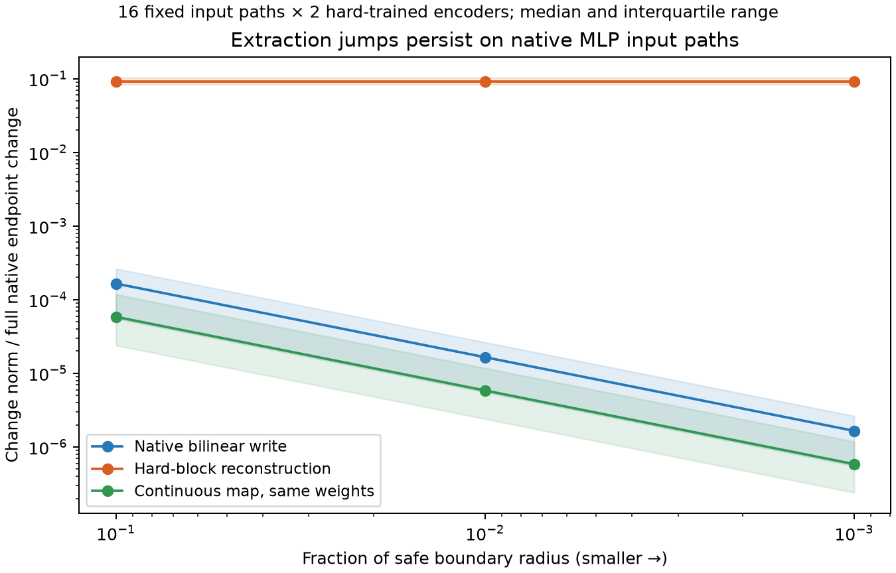

# Extraction boundaries on paths through native MLP computation

M114 closes the main reachability gap in the earlier boundary test. Artificial hard-selection jumps persist when writes are generated by the native bilinear MLP along normalized input paths, rather than interpolated directly in output-write space. This still does not establish that the intermediate inputs occur on text.

## Fixed experiment

We selected32equally spaced entries from the existing4096natural-training MLP1 inputs, paired consecutively to define16paths. Each endpoint and the linear interpolation between them were normalized to radius sqrt(1152), matching the MLP input RMS constraint. Paths were fixed before measuring crossings. Both actual hard-trained M112 encoders (seeds71/72) were tested, giving32model/path cases. These are16shared paths, not32independent data samples.

At every intermediate point, the native bilinear MLP computes the write. We count every actual Top8 block-support transition and analyze the first crossing of each path, selected by path position rather than its effect size. A continuous shrinkage map on the identical hard-trained weights serves as a selection-rule control; it is not another trained-model comparison. No fitting, natural prompt search, or downstream Transformer intervention was performed.

## Why the crossing locations are analytically tractable

Let u(t)=(1−t)z0+t*z1 and q(t)=||u(t)||². The normalized input is z(t)=r*u(t)/sqrt(q(t)). Since the native product write F is homogeneous quadratic,

`F(z(t)) = r² F(u(t)) / q(t)`.

Both F(u(t)) and q(t) have degree at most2in t. After the affine featurizer encoder and centering/scaling, every raw coordinate can therefore be written as a_i(t)=N_i(t)/q(t), where N_i is quadratic. Squared block-norm differences share the positive denominator q(t)², so their zeros are roots of a polynomial of degree at most4.

We solve those quartic ties, divide the path into intervals, and retain only ties that actually change Top8 support. This distinguishes genuine selection transitions from crossings between two unselected blocks. The fixed paths have strictly positive normalization denominators; no near-antipodal path was repaired or replaced.

## Results

| Encoder seed | Model/path cases | Actual support crossings | Median first-crossing t | Median decoded jump / full native endpoint change |
|---|---:|---:|---:|---:|
| 71 | 16 | 210 | 0.089 | 0.100 |
| 72 | 16 | 199 | 0.126 | 0.090 |

All32model/path cases cross at least once, for409support transitions total. At the first crossings, hard-decoded write differences approach nonzero limits. Reducing the crossing distance100-fold reduces the native write change about100-fold and the continuous-map change about100-fold, while the hard-map change remains essentially constant.

The plot shows medians and interquartile ranges across all32cases. Distances are fixed fractions0.1,0.01,0.001of a safe path-specific radius that avoids other energy-equality roots. Change norms are normalized by each path’s full native endpoint write difference. The continuous control’s smaller changes are not a fidelity win: M112 already showed that attenuation and reconstruction loss must be evaluated separately.

## What this proves—and does not prove

These discontinuities are not merely an artifact of drawing an unattainable straight chord through write space. Every intermediate write here is explicitly produced by the native bilinear MLP from an input satisfying its RMS constraint. The hard extractor introduces finite boundaries into an otherwise continuous native computation. Counting these transitions as native computational-unit switches would be unjustified.

However, normalized input interpolation can leave the distribution of states induced by real token sequences. The study does not estimate the frequency of near-boundary cases on natural text, establish a semantic manifold, or show that downstream behavior changes discontinuously on language inputs. It also does not imply that every hard-feature label is meaningless: discontinuities may be tolerated by an approximate representation if relevant causal behavior remains faithful. That must be measured, as in M112.

This is evidence about an extractor’s geometry. It is not evidence for native neuron redundancy, native cancellation, or removal of many channels without changing computation. Those require native-channel and downstream-equivalence tests, with explicit fidelity criteria.

## Verification

Twenty random toy systems verify the rational-quadratic and quartic identities against340direct evaluations;83toy support crossings are checked. Maximum direct toy error is3.98e-13.

On the native model, the rational formulas agree with direct bilinear evaluation at160fixed points across32model/path cases, with maximum relative discrepancy5.53e-15. Independent derivative-interval root isolation with Brent solves reproduces all409support transitions; maximum root discrepancy7.39e-14. All96first-crossing finite-limit cases are independently checked from direct native computation, with maximum scaled metric discrepancy8.52e-12. The figure was visually inspected. All jobs are terminal.

The published scripts and validation receipts bind source, model and data hashes. Small polynomial arrays are stored locally at the path referenced by validation/native_path_boundaries.json. There are no new model fits or language-model forward intervention outputs.

## Course correction: close the boundary investigation

M110–M114 have delivered a verified failure mode, a continuous alternative, a matched fidelity comparison, a precise theoretical limitation, and a native-computation-path confirmation. Further boundary variations would now have diminishing value for the main research goal. This line is closed without promoting a new featurizer.

Return to the broader loop: diverse competent computations and causal targets → candidate representations → held-out causal fidelity and structure validation. First reconcile the existing task inventory and native-competence evidence to identify genuinely missing coverage, rather than repeating failed retrieval panels or treating feature switches as discovered tasks. Any next task study should have independently varied factors and nuisance controls so that correct answers demonstrate the intended computation. Preserve whole-task exclusions and distinguish reused development evidence from fresh confirmation.

For the conceptual synthesis, retain separate conclusions about native computation, extractor geometry, and downstream equivalence. The next useful experiment should improve identification of actual native computational structure, not merely make extractor geometry cleaner.
