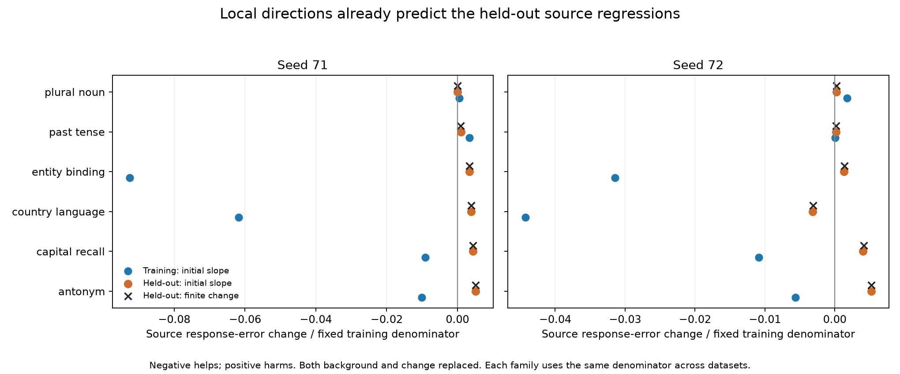

# Fixed-direction result: local transfer conflict, not a late nonlinear reversal

For the tested KL-only → joint-supervised correction, the source-position regressions are already predicted by local directional slopes. The initial slope gets the sign right for **all 56 held-out source-position endpoint cases** and all twelve family/seed averages. Large downstream curvature is therefore not needed to explain those particular reversals.

This is a statement about one small, learned direction in two fixed models. It does not show that the native network is globally linear, that other interventions lack nonlinear interactions, or that task coverage is the only remaining limitation.

## The experiment

For each seed, keep the native-product dictionary, output dictionary and offset fixed, and consider

    C(t) = C_KL + t (C_joint − C_KL).

The featurizer's write is affine in C in real arithmetic. Its downstream loss need not be. We computed directional slopes at the two existing endpoints, compared the slope at t=0 with the observed finite loss change, and also compared the average of endpoint slopes with that change. There was no training, interpolation search, or candidate selection.

All exact training schedules were retained (264 paired endpoint cases across seeds), along with all fourteen source-group holdout pairs (56 paired endpoint cases across seeds). Source/final/identity regions and all three causal corners remain separate. The seven whole-task families were not used to fit or choose a direction.

## Source-position reversals are local

For simultaneous predicted-background/predicted-change replacement on the source holdout, the sum of absolute first-order prediction residuals divided by the sum of absolute observed changes is **1.59% and 1.13%**, by seed. The local slopes predict the worsening already at the KL-only endpoint; the finite move does not cross a large nonlinear reversal to produce it.

Four families improve on the corresponding training corner in both seeds: antonym, capital recall, country language, and entity binding. Their held-out effects reverse in four of four cases for seed 71 and three of four for seed 72. The directional slopes reproduce these signs. Past tense and plural noun already worsen on this training corner, so their held-out worsening is a different situation.

These endpoint and family counts are correlated descriptive observations, not independent statistical trials. Small numerical derivatives are approximate; agreement with the observed finite change is empirical evidence, not a theorem bounding all curvature.

## The aggregate objective hides a site-specific tradeoff

Using the same fixed training-family/site denominators on both populations, the balanced causal loss B improves on both the training schedule **and the source holdout**, even while the source simultaneous-replacement corner worsens. Other corners, particularly final-position effects, compensate in the aggregate.

| Population | Seed | Observed change in B | Initial directional slope | Average endpoint slopes |
|---|---|---:|---:|---:|
| Training | 71 | -0.01263712 | -0.01316716 | -0.01264252 |
| Training | 72 | -0.01145692 | -0.01186674 | -0.01146169 |
| Source holdout | 71 | -0.00567611 | -0.00587677 | -0.00567841 |
| Source holdout | 72 | -0.00657600 | -0.00678834 | -0.00657903 |

This is not simply “training succeeds and the entire held-out objective fails.” It is **an aggregate improvement that does not guarantee improvement at every intervention site**, together with within-family transfer reversals at a specific site. Both the objective's tradeoffs and the diversity of causal examples matter.

The KL-to-joint write direction is small but comparably sized on the controlled task inputs: roughly 0.130%/0.129% of native-write norm on training schedules and 0.137%/0.134% on source holdouts. These measure movement *between the two fitted endpoints*, not movement from the original projected-native initialization.

## Numerical issue: resolved for interpretation, original flag retained

One original aggregate derivative-accounting check failed: directly differentiating B differed from summing its weighted branch derivatives by 1.62e-7, against a 1.44e-7 tolerance. The complete precision diagnostic retained that failed case and tested three declared modes:

- Original float32: discrepancy 1.6186e-7.
- Double precision only for the write-tangent/scalar reduction: 1.6147e-7, with exactly the same endpoint outputs.
- Double native arithmetic and logits: 7.42e-16. This is a different numerical reference function, with different default RMS epsilon; its logits differ by at most 5.81e-6 here. It is not substituted for the benchmark outputs.

The mismatch is in accumulation through the float32 native backward computation, not primarily in the final scalar dot product. We did **not** loosen the old tolerance or relabel its failure as a pass. Revised bookkeeping defines the aggregate B slope from the weighted individual branch slopes, exactly as B is defined, and preserves the directly computed B slope, discrepancy, and original pass/fail flag for every source case. One of 112 source endpoint records retains that flag. Training analysis uses the same aggregate definition for comparability.

This arithmetic identity is not an independent certificate of every native derivative. The original four-direction training finite-difference preflight used an absolute-plus-relative tolerance that is coarse for small slopes. The interpretation rests on the retained individual slopes, exact endpoint replay, independent affine-direction checks, and their observed agreement with finite changes—not a claim of universal 1e-7 gradient accuracy.

## Verification and provenance

Training scoring: 528 endpoint records, 3,684 forwards, all 4,740 prior response vectors replayed bit-exactly. Source v2: 112 endpoint records, 784 forwards, all 1,008 prior responses replayed bit-exactly. All cases, identities, and schedules passed independent inventory/metric/tangent-energy audits. The source audit's maximum metric discrepancy is 1.55e-15 and tangent-energy discrepancy 5.23e-8 relative. It retains the original aggregate-backward flag.

Additional work includes the 196-forward preflight, the preserved 392-forward completed source prefix from the first run, its uncommitted failed work, the targeted failure reproduction, and the 21-forward precision diagnostic. The old checkpoint and failure receipt remain; they were not overwritten. No independent transformer Jacobian implementation was used.

## Decision: return to causal-example coverage

M97 is closed. The next experiment should test broader causal-example coverage with a matched control, rather than extending this curvature diagnosis or changing optimizer settings.

The existing eligible pool has 70 pairs across 11 families, while the old schedules visited only 35 and 41 unique pairs. First audit how much *distinct causal input/prefix coverage* the unused pairs add; pair count alone is insufficient. If coverage increases, compare full-pool coverage against resampling the old visited subsets, keeping family counts, update budget, natural-text schedule, initialization, architecture and optimizer matched. Include KL-only and joint-supervision arms so ordinary task-data benefits can be separated from changes in the added causal-supervision effect.

This broadens examples within existing task families; it does not invent new task labels or establish new-task discovery. Preserve all whole-task and source-group exclusions. Report every causal site/corner separately alongside aggregate loss. A favorable result would justify the next grouping/manifold validation step; it would not itself establish semantic units. The M98 design makes the coverage audit and frozen schedules prerequisites to fitting.

Evidence: [precision diagnostic](validation/product_dictionary_direction_precision.json), [revised execution decision](validation/product_dictionary_direction_execution_v2.json), [training directional comparison](validation/product_dictionary_direction_training_comparison_v2.json), [source audit with retained flag](validation/product_dictionary_direction_source_v2_audit.json), [source directional comparison](validation/product_dictionary_direction_source_comparison_v2.json).
