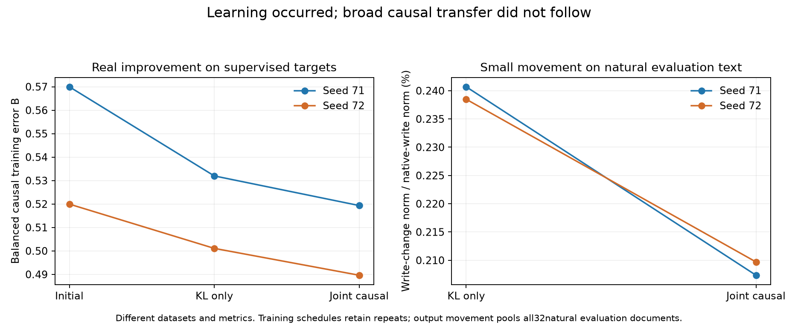

# Fixed-run diagnosis: learned causal corrections do not reliably transfer

The weak broad transfer in M95 was **not simply a failure to learn the training targets**. Joint supervision reduces training causal error more than KL-only in both seeds, across all six site/corner averages and most training families. Yet source-position improvements reverse on several held-out source groups within those same families.

The learned change is small on ordinary natural text: about 0.21% of the native write norm for joint supervision. This is evidence of a modest natural-text correction, not a measurement of task-input movement, capacity saturation, convergence, or the fraction of computation understood.

## Matched training targets

Every final model was scored on its exact 66 scheduled task assignments and both endpoints. Initial values come from the already audited calibration on the same assignments; repeats are preserved. K is native-to-replacement output KL. B is the balanced average of the three causal corners at source and final positions, using fixed training-family/site denominators. Lower is better.

| Seed | State | K | B | K + 0.185531 B |
|---|---|---:|---:|---:|
| 71 | Initial | 0.122646 | 0.569980 | 0.228395 |
| 71 | intact_KL | 0.089028 | 0.531975 | 0.187726 |
| 71 | joint_three_corner | 0.090873 | 0.519338 | 0.187227 |
| 72 | Initial | 0.079571 | 0.519952 | 0.176038 |
| 72 | intact_KL | 0.065060 | 0.501079 | 0.158026 |
| 72 | joint_three_corner | 0.066120 | 0.489622 | 0.156960 |

Compared with KL-only, joint supervision lowers B by approximately 2.38% and 2.29%. It improves B in 10/11 training families for seed 71 and 11/11 for seed 72. All six aggregate source/final × causal-corner contributions improve. The joint objective is also lower, although only modestly; KL alone is slightly worse. These are repeated training measurements, not independent trials or held-out wins.

The largest training B gains occur in capital recall, country language, and entity binding. Thus the joint objective has an observable effect and is not merely an inactive loss term. The fixed budget still does not establish convergence or rule out a better solution in the same space.

## Within-family transfer reversals

A descriptive follow-up compares source-position simultaneous replacement on the six families shared between training and the source-group holdout. Four families improve in training in both seeds: antonym, capital recall, country language, and entity binding. **All four reverse on held-out source groups in seed 71; three of four reverse in seed 72** (country language retains its gain).

Past tense and plural noun worsen on this particular training corner and on the source holdout in both seeds, even though their overall B can improve through other corners. This is why a global causal-loss improvement should not be equated with better computation everywhere.

Training and holdout normalization magnitudes differ. Within each family, however, each denominator is a fixed positive constant, so the sign of the mean raw-error change is comparable. The [complete matched-family table](validation/product_dictionary_matched_family_transfer.json) preserves all twelve comparisons. It is post-hoc descriptive evidence, not a newly selected validation set.

## Size and geometry of the learned correction

| Seed | Arm | Coefficient change | Natural train write change | Natural evaluation write change |
|---|---|---:|---:|---:|
| 71 | intact_KL | 0.1167% | 0.2456% | 0.2407% |
| 71 | joint_three_corner | 0.1113% | 0.2113% | 0.2073% |
| 72 | intact_KL | 0.1005% | 0.2421% | 0.2385% |
| 72 | joint_three_corner | 0.0965% | 0.2126% | 0.2097% |

Coefficient change is a Frobenius-norm ratio in this particular parameterization. Write change is the square root of pooled correction energy divided by native-write energy. Training uses 4,092 unique positions; evaluation uses all 4,096 positions in the 32 held-out natural documents. These are distinct datasets from the controlled task prompts; do not infer their task-input movement from this table.

Independent NumPy/QR and Torch/SVD calculations verify the fixed affine-space projection identity across all 132 model/population/document cases:

    ||w − q||² = ||w − projection(w)||² + ||q − projection(w)||².

The maximum audit discrepancy normalized by native energy is 2.81e-16. The implemented initial state is within roughly 2.5e-7 of the exact affine projection in relative write norm. The increase in normalized write MSE after fitting is about 4.3e-6 to 5.8e-6 on natural evaluation text, accounted for by moving away from that projection. This numerically confirms the theoretical distinction: least-squares reconstruction and downstream causal fidelity prefer different points in the same output space.

## What this supports—and leaves open

The current featurizer can learn corrections that improve supervised causal targets. Those corrections do not yet behave as generally reusable units across examples, even within a task family. This strengthens the case for testing coverage and compatibility across diverse causal examples before calling the output coordinates semantic manifolds.

It does not prove that more diverse supervision will solve the problem, that the fixed output space is incapable, or that the native model chose its representation for this reason. It also does not turn the retained 4,608 native products into 128 computations. Distribution across products, shared output directions, removability, and causal reuse remain separate properties.

## Verification and next experiment

Training-target scoring used 3,684 native forwards with zero optimizer updates. The independent audit checked all 528 endpoint cases, 4,740 response vectors and 1,584 exact identity zeros; maximum metric discrepancy was 1.03e-14. Contributions are normalized per case and sum back to B, including unequal-length cases with unavailable source interventions. The movement audit used saved states and inputs, with no transformer forwards. All processes are complete.

M96 is closed. The next bounded test follows the **fixed coefficient direction from the KL-only solution to the joint-supervised solution**, without training. Because the featurizer is linear in its coefficient matrix, its write along this path is exactly affine in real arithmetic; nonlinear effects enter downstream. Measure directional loss slopes at the two endpoints on the matched training schedules and all source-group holdouts. Compare those slopes with the already observed finite loss changes, and measure task-input write movement as well. This distinguishes a correction already pointing in opposite directions across examples from a failure caused by downstream curvature. Held-out gradients are diagnostic only and must not be used to update or select a model.

The deliverable is a decision about causal-target coverage versus nonlinear compatibility for the next featurizer experiment. Stop after this one fixed-path comparison; do not launch an optimizer, rank, or interpolation search. Whole-task holdouts remain unchanged, and no semantic-manifold or new-task claim is made.

Evidence: [training-target audit](validation/product_dictionary_training_targets_audit.json), [paired training comparison](validation/product_dictionary_training_targets_comparison.json), [movement audit](validation/product_dictionary_movement_audit.json), [movement summary](validation/product_dictionary_movement_comparison.json).
