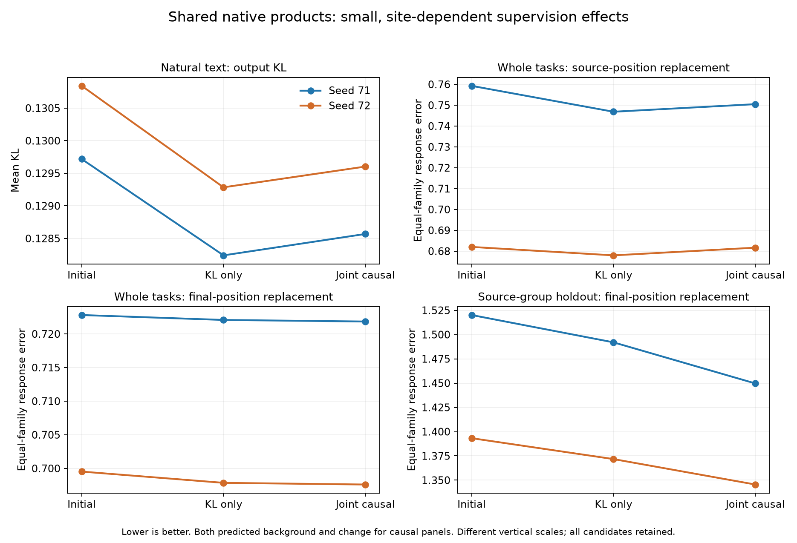

# Product-dictionary transfer: site-specific gains, no broad causal advantage

Follow-up: [fixed-run training and movement diagnostics are complete](PRODUCT_DICTIONARY_FIXED_RUN_DIAGNOSIS.md).

All six candidates completed natural-text and both causal holdout evaluations. Independent audits passed for 192 natural output tensors and 7,416 causal response vectors. **Joint causal supervision does not establish broadly reusable coordinates in this experiment.** It produces small, intervention-site-dependent changes: worse source-position replacement than KL-only, and modest final-position gains that depend on task family and aggregation.

The architecture retains all 4,608 native input products and a fixed 128-direction output dictionary. Only the coefficient matrix trains. Compare KL-only against joint supervision within each seed, and each against its own exact projected-native initial function. This is a strong native prior, not a sparse semantic representation or a test of whether 128 input computations suffice.

## Natural-text retention

Both training arms slightly improve output KL and CE over their initial functions; KL-only is slightly better than joint supervision in both seeds. Native next-token agreement remains around 81%. Local squared write error is effectively unchanged and slightly higher after fitting.

| Seed | State | Mean KL | CE increase over native | Top-token agreement |
|---|---|---:|---:|---:|
| 71 | initial | 0.129718 | 0.132288 | 80.62% |
| 72 | initial | 0.130841 | 0.133075 | 80.79% |
| 71 | intact_KL | 0.128240 | 0.130822 | 80.69% |
| 71 | joint_three_corner | 0.128569 | 0.131154 | 80.69% |
| 72 | intact_KL | 0.129284 | 0.131532 | 81.05% |
| 72 | joint_three_corner | 0.129603 | 0.131855 | 81.01% |

A useful theoretical distinction explains why local write error need not improve. The initial function is the Euclidean projection q₀ of the native write w onto the fixed affine output space. Every subsequent prediction q remains in that space. In exact arithmetic,

    ||w − q||² = ||w − q₀||² + ||q − q₀||².

Thus any nonzero learned correction necessarily increases local MSE, while potentially improving downstream KL or causal behavior. This is a consequence of the fixed-space construction, not evidence that fitting is broken. Float32 implementation introduces small numerical deviations; a separate saved-state diagnostic is specified below to quantify them.

## Simultaneous background-and-change replacement

The table reports equal-family normalized causal response error. Lower is better. Error 1 is the zero-response predictor, not a faithfulness threshold; 1 minus this error is not a percentage of computation understood. “Source” patches changed-input positions; “final” patches the final token position. Both the surrounding reconstructed MLP write and the intervention change are predicted.

| Cohort | Seed | Initial source | KL-only source | Joint source | Initial final | KL-only final | Joint final |
|---|---|---:|---:|---:|---:|---:|---:|
| Whole tasks (all 7) | 71 | 0.759279 | 0.746859 | 0.750502 | 0.722811 | 0.722080 | 0.721843 |
| Whole tasks (all 7) | 72 | 0.682019 | 0.677972 | 0.681669 | 0.699525 | 0.697851 | 0.697600 |
| Whole tasks (qualified 5) | 71 | 0.691830 | 0.676235 | 0.680405 | 0.772302 | 0.771052 | 0.770982 |
| Whole tasks (qualified 5) | 72 | 0.560929 | 0.560352 | 0.560865 | 0.740903 | 0.738701 | 0.738394 |
| Source-group holdout | 71 | 0.750381 | 0.705277 | 0.709027 | 1.520123 | 1.491976 | 1.449632 |
| Source-group holdout | 72 | 0.833160 | 0.789289 | 0.792144 | 1.393250 | 1.371721 | 1.345513 |

Relative to KL-only, joint supervision worsens source-position error in both seeds on both cohorts, including the qualified whole-task subset. Equal-family final-position error improves in both seeds, but the whole-task differences are only about 0.0002–0.0003. With pooled whole-task aggregation, seed 71 instead worsens by 0.000041; seed 72 improves by 0.000398. These are small descriptive changes across two fixed starts, not a statistical claim of a general advantage.

The more visible source-group final gains are dominated by **capital recall**. Its family error improves by 0.24793 and 0.15814 in seeds 71 and 72. Across the other five families, mean changes are −0.00123 and +0.00018 respectively. Pooled source-group final errors improve in both seeds, but equal-family final errors remain above 1 (1.4496 and 1.3455). Neither aggregation establishes faithful substitution.

The five qualified whole-task families retain 95% pairwise contrast accuracy for every state, despite substantial causal response error. Their top-token accuracy is 38.75% and 42.5% by seed and unchanged by these fits. Source-group contrast accuracy stays 100%. Correct task answers therefore remain a weak test of whether the replacement performs the same computation.

All isolated-corner, family, format, pooled, margin and local-delta results are retained in the comparison JSONs. They are not substituted for the simultaneous-replacement outcome.

## What this changes conceptually

1. **Output dimension and computation count remain distinct.** This executable baseline closes the earlier mismatch between privileged output projection and a restricted one-product-per-coordinate encoder by retaining every native product. It does not show those products are removable.
2. **Behavioral equivalence is conditional on what is measured.** Accuracy can remain fixed while response fidelity changes, and pooled versus equal-family aggregation can reverse a tiny gain.
3. **Causal supervision has a localized effect, not a general solution here.** The final-position capital-recall gain is evidence that coefficients can change useful behavior. The source-position regressions argue against calling the resulting coordinates generally reusable causal units.
4. **This fixed training budget does not separate representational limits from limited learning.** A small outcome change cannot prove that the output space is incapable of better causal fidelity. Diagnose the actual fixed run before another architectural or optimization proposal.

No semantic manifold or genuinely new task has been discovered. The broader loop remains diverse tasks and causal targets → useful featurizers → manifold validation and task discovery. This baseline has not yet earned the manifold-discovery claim.

## Audit and provenance

Native evaluation used 6,372 forwards: 224 natural, 4,888 whole-task and 1,260 source-group. Whole-task auditing covered 5,904 responses, 1,968 delta-geometry records, 48 ineligible assignments and 672 input prediction checks; source-group auditing covered 1,512 responses, 504 geometry records and 168 prediction checks. Every original native baseline and teacher response was replayed exactly. Identity/null cases were retained. No independent transformer implementation was used.

Natural predictions match independent float64 NumPy calculations to at most 4.39e-7 relative error; causal prediction discrepancies are below 2.10e-7. Maximum independent causal metric discrepancy is 7.45e-9, within the frozen combined relative/absolute tolerance.

The first natural auditor passed all per-output checks but failed its final inventory assertion because it still expected the earlier experiment's 3,808 rows. The original source and failure are preserved; v2 changes only that assertion to 192. Its complete rerun passed without changing any prediction, metric, tolerance, or producer. The correction receipt records this explicitly.

These are historical evaluation cohorts, not pristine new tasks. Whole-task training exclusions and source-group exclusions were preserved, but pretraining semantic exposure is not excluded. No evaluated candidate was selected or discarded.

## Next bounded diagnostic

M96 will inspect the fixed run, not train another model. First quantify coefficient changes, induced write changes and the projection-error identity from existing states and cached outputs. Then score the four final states on the exact training schedules used for calibration, comparing final versus initial K and balanced causal error by family, site and corner. Retain repetitions and all cases; label these training diagnostics explicitly. This will distinguish weak movement on the supervised objective from gains concentrated in particular training targets. Stop after one audited synthesis before proposing further training, grouping or manifold tests.

Evidence: [natural comparison](validation/product_dictionary_natural_comparison.json), [whole-task comparison](validation/product_dictionary_factorial_comparison.json), [source-group comparison](validation/product_dictionary_source_factorial_comparison.json), [natural audit correction](validation/product_dictionary_natural_audit_correction.json), [frozen interpretation plan](validation/product_dictionary_interpretation_plan.json).
