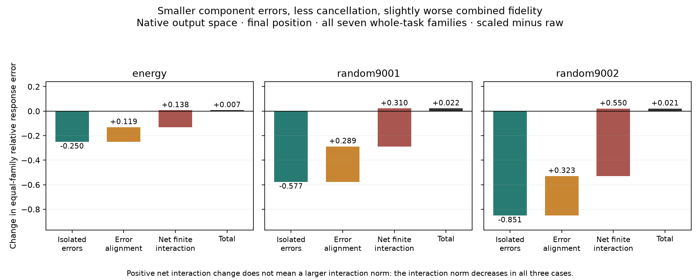

# Smaller approximation errors can cancel less effectively

M94 completes the fixed decomposition of all49028 eligible M93 intervention conditions, with independent audits of both cohorts. No model forwards or fitting were needed. The main result is that the troublesome whole-task reversals are not explained by a larger finite interaction norm: all three component errors get smaller in the relevant aggregate comparisons, while their sum gets worse because their cross terms become less favorable.

This is **cancellation among downstream approximation errors**, not evidence of cancelling native MLP channels.

## What was decomposed

Let R00 be the native teacher response, R10 the response with only the background reconstructed, R01 with only the change reconstructed, and R11 with both reconstructed. Each response is a final log-probability difference centered on its own unchanged background. Define

    A = R10 - R00                  background-only error
    B = R01 - R00                  change-only error
    I = R11 - R10 - R01 + R00     finite background/change interaction
    E = R11 - R00 = A + B + I     combined error.

Using the same native-probability weights in every corner gives the exact identity

    ||E||² = ||A||² + ||B||² + ||I||²
             + 2<A,B> + 2<A,I> + 2<B,I>.

The terms depend on this chosen factorial comparison and metric. They are not unique native mechanisms or independent causes. We retain raw energies, pooled normalization and equal-family normalization, identity/null cases, numerical full controls, weak families and ineligible assignments.

## What explains the reversals

A reversal here means that rescaling improves both isolated errors A and B but worsens their combined error E. Counts refer to matched model/ranking aggregate comparisons, not individual examples or independent statistical trials.

| Scope | Source reversals | Final-position reversals | Interaction norm shrinks within those reversals |
|---|---:|---:|---|
| All seven whole-task families | 40/51 | 28/51 | Every reversal |
| Five fixed contrast-qualified families | 6/51 | 19/51 | Every reversal |
| Historical source-group cohort | 29/51 | 0/51 | Every source reversal |

Thus, in every listed reversal, the aggregate squared norms of A, B **and I** all decrease. The signed cross terms collectively become less negative, enough to outweigh those improvements. A larger interaction magnitude is not the explanation in these comparisons.

For all-seven whole-task comparisons, even the algebraic additive error ||A+B||² improves in every reversal. Yet the helpful contribution of I to that sum weakens enough to reverse the result. This does not mean I is intrinsically desirable: it means independently shrinking terms does not determine the quality of their sum. On the qualified subset, the additive diagnostic improves in6/6 source reversals and18/19 final reversals, so that narrower statement has one exception.

## A concrete native-output example

For the energy-ranked native half at the final position, using all seven whole-task families:

| Quantity | Raw half | Rescaled half |
|---|---:|---:|
| Background-only error ||A||² | 0.5491 | 0.3275 |
| Change-only error ||B||² | 0.2657 | 0.2370 |
| Interaction norm ||I||² | 0.1733 | 0.0927 |
| Combined error ||E||² | 0.4492 | 0.4562 |

The change in total error decomposes as

    -0.2503  smaller isolated error norms
    +0.1195  less favorable A/B alignment
    +0.1378  less favorable net interaction contribution
    =+0.0070 total error increase.

“Net interaction contribution” includes ||I||² plus its two cross terms; it increases here even though ||I||² itself decreases. The same sign pattern occurs for both fixed native random-half controls.

The raw approximation had errors that partly offset each other. Rescaling made each error smaller but reduced that offsetting effect. This accounts algebraically for the observed reversal. It does not establish why the native model learned its channel organization or identify a cancelling native circuit.

## A second failure mode remains

At final positions in the source-group cohort, change-only error B gets worse in51/51 comparisons. There are therefore no cases there satisfying the “both isolated errors improve” reversal definition, even though combined error worsens in50/51. Global amplitude correction can damage the task-changing signal itself, as well as disturb error cancellation.

This reinforces the distinction between common write/background fidelity and task-conditioned computation. The evidence does not support treating one scalar or one local reconstruction score as a universal measure of computational equivalence.

## Decision: return to featurizer training with a richer coefficient map

The deletion and error-decomposition series stops here. The next bounded experiment separates the dictionary of input interactions from the output-feature dictionary, as motivated by M89 and the M88 projection-versus-input-prediction gap.

Use all4608 frozen native bilinear products as a reusable input dictionary, normalized by training-only per-product RMS. Keep the two existing dense KL-only output dictionaries (seeds71/72) fixed. Learn a128-by-4608 matrix mapping those products to output-feature coefficients. Initialize it to exactly implement each full projected-native function in real arithmetic. There are no gates in this initial feasibility baseline.

Compare KL-only and joint three-corner causal supervision from identical starts: four fixed fits, the existing diverse training tasks, the same schedules and natural retention, and preserved whole-task/source-group exclusions. Joint replacement error remains an explicit target; isolated-error improvement cannot stand in for it. Implementation, gradient checks, and training-only calibration precede fitting.

This is a teacher-derived, higher-capacity input dictionary with589824 trainable coefficients and all native products retained. It is not a matched-capacity proof about the previous architecture and does not discover semantic units by construction. The controlled comparison is supervision within this architecture. If a jointly faithful dense coordinate map is feasible, it becomes a better starting point for sparse/grouped structure and manifold validation. If it fails, report that fixed comparison before any optimizer or rank search.

## Verification

The producer directly computes vector differences and weighted dot products using NumPy. The independent auditor recomputes log-softmax in torch, applies fixed linear contrasts, constructs a weighted Gram matrix, and independently sums every aggregate. All39032 whole-task and9996 source-group conditions pass, along with12852 aggregate summaries. Maximum vector-identity discrepancy is below9e-16. Raw energy and original M93 error replays pass the frozen tolerances; zero denominators remain null. No sample or model was selected or refitted.

Evidence: [whole decomposition](validation/product_error_interaction_whole.json), [whole audit](validation/product_error_interaction_whole_audit.json), [source decomposition](validation/product_error_interaction_source.json), [source audit](validation/product_error_interaction_source_audit.json), [whole paired comparisons](validation/product_error_interaction_whole_comparison.json), [source paired comparisons](validation/product_error_interaction_source_comparison.json), [next featurizer design](validation/product_dictionary_featurizer_design.json).
