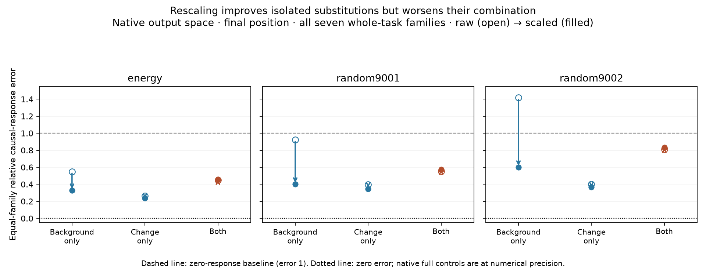

# Distributed computation is partly substitutable—but corrections do not compose reliably

M93 is complete: all 119 executable replacements were evaluated on natural text, 56 whole-task contrast pairs and 14 historical source-group holdout pairs. All full-vector audits pass. The results support partial, metric-dependent substitutability of distributed MLP1 computation. They do not establish exact redundancy, uniform causal fidelity, or native cancelling channels.

## What was compared

MLP1 is the second transformer block. We retained half of its 4608 native bilinear products using a fixed training energy ranking or either of two fixed random permutations. Each subset was used raw or multiplied by one scalar estimated only on training data. We retained the native output map and all 16 previously learned 128-dimensional output spaces, with a full-product reference for each:119 candidates in total. No candidate, task family, scale or subset was selected using evaluation results.

The **background** is the recipient MLP write before an intervention. The **change** is a donor-minus-recipient write difference at the changed input positions (source) or the final position. Three corners test predicted background/native change, native background/predicted change, and both predicted. Every response is a final log-probability change centered on its own background. The teacher uses native background and native change.

Errors below are native-probability-weighted squared response discrepancies, normalized by teacher response energy and averaged equally across families. Error1 is the zero-response baseline, not an acceptance threshold. Pooled-energy, margin, local-write and task-accuracy results are also retained; they are not interchangeable.

## Isolated improvements need not survive combined replacement

The table counts how often rescaling improves error over raw half retention, among all51 matched comparisons (17 spaces × three rankings).

| Evaluation scope | Source: native background, predicted change | Final: native background, predicted change | Source: both predicted | Final: both predicted |
|---|---:|---:|---:|---:|
| All seven whole-task families | 51/51 | 51/51 | 8/51 | 23/51 |
| Five fixed contrast-qualified whole-task families | 51/51 | 51/51 | 45/51 | 32/51 |
| Historical source-group holdout | 51/51 | 0/51 | 19/51 | 1/51 |

The five qualified families are sequence copying, weekday successor, tense, continent recall and object function. The weak role-binding and spatial-inverse families remain in the all-seven results. Qualification is based on native contrast competence, not candidate scores. Large differences between these scopes are part of the result, not grounds for dropping unfavorable cases. The comparisons share data and models; these counts are not independent statistical trials.

Whole-task native-output examples make the interaction especially clear. At the final position, rescaling improves background-only and change-only substitutions for all three rankings, but worsens the combined substitution:

| Native-output ranking | Background-only error, raw → scaled | Change-only error | Both predicted |
|---|---:|---:|---:|
| Energy | 0.549 → 0.328 | 0.266 → 0.237 | 0.449 → 0.456 |
| Random9001 | 0.922 → 0.400 | 0.399 → 0.344 | 0.551 → 0.573 |
| Random9002 | 1.417 → 0.599 | 0.400 → 0.367 | 0.810 → 0.831 |

This is evidence that the effects of background and change errors cannot be inferred simply from their separate error magnitudes. It does not yet distinguish altered error alignment from finite nonlinear interaction, and it does not show that native channel contributions cancel.

## The correction also depends on task and position

On the source-group cohort, predicted source changes improve under rescaling in51/51 comparisons. Predicted final changes worsen in51/51, even on native backgrounds. Thus the difficulty is not only combining two approximations: a scalar that restores ordinary write amplitude can distort task-changing directions at a different site.

For the native energy-ranked half on this cohort, source change-only error improves0.339→0.214, while final change-only error worsens0.415→0.426. Combined final error changes1.431→1.409; it remains worse than the zero-response baseline. The two native random-half combined final errors worsen1.316→1.491 and1.527→1.775.

Learned-space full references themselves have source-group final combined errors1.068–1.794. Half retention and scaling give1.425–3.781 across those48 projected variants. The output spaces already lose relevant behavior before additional product deletion; half-versus-full comparisons must therefore stay within each space. A compact geometric representation is not automatically a faithful computation.

## Ordinary behavior can look substantially better than causal fidelity

Natural-text scaling improves KL in51/51 comparisons and CE in45/51. The native energy-ranked half has KL0.0263 and91.4% top-token agreement; scaling gives KL0.0255 and91.38% agreement. These are substantial preservation, not identity.

On the five qualified whole-task families, the original native model achieves96.25% contrast accuracy and41.25% top-1 accuracy. Native energy-half raw/scaled contrast accuracy is93.75%/95%, but top-1 accuracy is41.25%/38.75%. Task answers, distributional similarity and causal-response fidelity give different judgments of the same substitution.

## Updated conceptual account

The evidence supports **constructive distributed accumulation with partial, conditional substitutability**. M90 found net constructive cross terms; M91 showed local substitution transfers to held-out text; M93 shows some of that reaches ordinary behavior and isolated causal changes. None of these results licenses “half the computation is redundant.” Removal changes outputs, and its causal consequences depend on site, task, output space and whether the recipient background is also approximated.

The simple amplitude-loss explanation is insufficient. Common-background preservation and task/site-dependent coordinate computation remain plausible. The mismatch between isolated and combined replacements points toward a need for joint consistency, but does not identify its mechanism. We have not established semantic manifolds, newly discovered tasks, minimal computational rank, or why optimization originally chose this native organization.

## Bounded next diagnostic: use the response vectors already saved

For responses R00 (native/native), R10 (predicted background/native change), R01 (native background/predicted change), and R11 (both predicted), define

    A = R10 - R00
    B = R01 - R00
    I = R11 - R10 - R01 + R00
    E = R11 - R00 = A + B + I.

The next fixed analysis measures each weighted squared norm and all signed cross terms. It can distinguish reduced isolated errors from loss of cancellation between approximation errors or increased finite background/change interaction. It will cover all models and both cohorts, including identity and numerical full controls, using existing vectors only. No new model forwards, scale fitting, subset search or task selection is needed.

These are coordinate-dependent approximation-error interactions, not a unique native circuit decomposition. The concrete featurizer deliverable is evidence about whether joint consistency, conditional coefficient computation, or both need stronger supervision. Stop after this one audited analysis and synthesize the decision before further training.

## Verification and execution history

All3808 natural full outputs and147084 task response vectors are independently checked. The task audits cover49028 geometry rows and16660 input-prediction checks, with all952 ineligible whole-task assignments retained. The native baseline and teacher responses exactly replay their historical caches. Native full-product causal controls are at numerical precision: all-family aggregate combined errors are below8.6e-9, rather than mathematically forced to zero after floating-point intervention additions.

Completed-case forwards total118016. The whole-task producer segfaulted in rotary attention after33 complete pairs; all saved files and source/protocol hashes were verified, GPU arithmetic checked, and the unchanged runner resumed successfully. Physical work includes an unknown number of interrupted partial-pair forwards. All producer, audit and analysis processes for M93 are now terminal. No model was fitted and all training exclusions remain unchanged.

Evidence: [whole-task comparison](validation/product_subset_factorial_comparison.json), [whole audit](validation/product_subset_factorial_audit.json), [source-group comparison](validation/product_subset_source_factorial_comparison.json), [source audit](validation/product_subset_source_factorial_audit.json), [natural results](PRODUCT_SUBSET_NATURAL_BEHAVIOR.md), [recovery receipt](validation/product_subset_factorial_recovery.json), [next analysis protocol](validation/product_subset_error_interaction_protocol.json).
