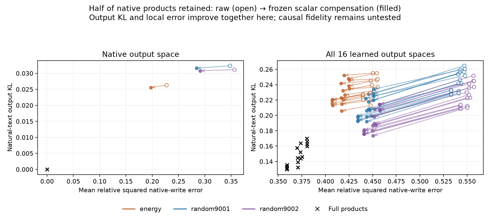

# Half-product replacements: natural-text behavior, causal tests pending

The natural-text portion of M93 is complete and independently audited: 119 frozen executable candidates across 32 held-out documents, producing 3808 full output vectors in 3840 native forwards. The whole-task causal run is still active; no causal conclusion is reported here.

## Natural-text retention

These models retain half (2304 of 4608) of MLP1's native input products, using the fixed training energy ranking or either of two fixed random permutations. They either preserve the native output map or project through one of 16 learned output spaces. Scaling uses only the frozen training coefficient.

| Native output space | KL, raw half | KL, rescaled half | Top-1 agreement, raw → scaled |
|---|---:|---:|---:|
| Energy-ranked | 0.02630 | 0.02555 | 91.43% → 91.38% |
| Random seed9001 | 0.03236 | 0.03158 | 89.82% → 89.82% |
| Random seed9002 | 0.03116 | 0.03078 | 88.89% → 89.58% |

The native full-product reference has KL0 and 100% top-1 agreement. Removing half the products therefore preserves much of the distribution but changes roughly 9–11% of top-token choices. This is not exact redundancy or the same computation.

For the 16 learned output spaces, full-product reference KL ranges from 0.12972 to 0.16991. Energy-ranked halves have KL0.21315–0.25519, reduced to0.20578–0.25218 by scaling. The scaled random halves give0.19194–0.23406 (seed9001) and0.17363–0.21433 (seed9002). All ranges retain every learned space, seed and supervision arm. None of these half-product variants beats its corresponding full reference on KL.

Across all 51 matched comparisons (17 spaces × three rankings), scaling improves KL and local native-write error in51/51, but CE only in45/51. In particular, the native energy-ranked half's CE increase over the original model is0.02591 raw and0.02643 scaled: KL improves slightly while next-token loss gets slightly worse. Both other native rankings also have small CE regressions after scaling. These correlated comparisons are descriptive, not51 independent statistical trials.

## Conceptual interpretation

M90–M91 showed that many product contributions add constructively and that rescaling survivors partly recovers local output vectors, including on held-out text. This stage shows that some benefit reaches the model's output distribution: all matched KL comparisons improve. It also demonstrates why equivalence must specify a metric. Smaller local error, lower KL, lower CE, and unchanged top-token choices are different requirements.

The native half-product models have lower KL than even the full learned-space projections. That comparison changes output dimension and output map, so it is not a matched-capacity architecture win. It warns against treating a compact output space as sufficient evidence of preserved computation. Even when output directions share substantial geometric structure, directions discarded by projection can matter downstream.

The energy ranking is defined by local contribution norms, not downstream behavior. Its best local reconstruction does not guarantee the best KL among the frozen projected variants. We retain both random controls instead of selecting the most favorable ranking.

We still do not know whether this preservation extends to task-changing directions. Restoring common background activity could improve natural KL while leaving intervention responses wrong. The running causal experiment separates native/reconstructed backgrounds and changes at source and final positions. The six conditional explanations in the interpretation plan were written before inspecting causal outcomes.

## Verification and remaining work

Every saved full output vector, prediction, support and product code is independently checked. Prediction reconstruction uses float64 input products and SVD output bases, versus the executable predictor's float32 products and QR-derived output maps. Maximum metric discrepancy is2.67e-15; maximum prediction relative discrepancy is6.27e-7. Native writes exactly replay the prior cache, and the native full-product control has KL0 on all32documents.

The whole-task producer remains active across56pairs and119candidates. Its audit, the14-pair source-group run and audit, and the joint causal interpretation remain outstanding. No causal faithfulness, semantic manifold or newly discovered task is established by this report.

Evidence: [natural results](validation/product_subset_natural.json), [all paired comparisons](validation/product_subset_natural_comparison.json), [independent audit](validation/product_subset_natural_audit.json), [fixed causal protocol](validation/product_subset_causal_protocol.json), [interpretation plan](validation/product_subset_causal_interpretation_plan.json).
