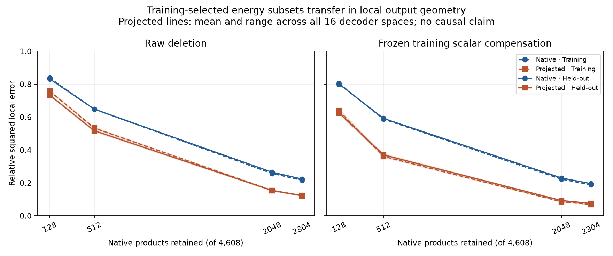

# Product-subset substitution transfers to held-out local geometry

M91 evaluated the exact M90 subsets and scalar corrections on all 32 held-out natural-text documents (4096 positions). No subset was re-ranked, no coefficient refitted, and no model trained. All 8160 per-document cases and 255 pooled cases pass independent audit.

## Results

Relative squared local errors below compare each retained sum with the full sum in its own output space. They do not measure downstream KL or task behavior. The fixed affine projection offset is preserved; dynamic and full-affine normalizations are separately available in JSON.

| Retained products, training energy ranking | Native raw | Native scaled | Learned spaces raw range | Learned spaces scaled range |
|---|---:|---:|---:|---:|
| 128 | 0.831 | 0.800 | 0.728–0.739 | 0.614–0.635 |
| 512 | 0.648 | 0.591 | 0.511–0.523 | 0.364–0.378 |
| 2048 | 0.264 | 0.229 | 0.150–0.157 | 0.090–0.094 |
| 2304 (half) | 0.223 | 0.194 | 0.120–0.126 | 0.073–0.076 |
| 4608 | 0 | numerical zero | 0 | numerical zero |

At half retention, learned-space raw error was 0.119–0.125 on training data and is 0.120–0.126 on held-out data. Scaling gave 0.067–0.070 on training and 0.073–0.076 on held-out data. Thus the partial scalar-compensated substitution is not confined to the positions used to estimate the scalar.

The frozen training scalar improves all 6528 nontrivial document/subset cases and all 204 nontrivial pooled cases, including both random controls. These cases share data and models, so the counts are descriptive, not independent evidence for a significance test. We retain the complete results for every architecture, training arm, seed, subset size, and ranking.

## What changed in the conceptual account

M89 established that compact output geometry can still require many input interactions. M90 found constructive distributed contributions and partial recovery after deleting products and rescaling survivors. M91 adds held-out local transfer: the recovery is not merely an in-sample scalar fit.

This still does not establish causal redundancy. The measured energy is uncentered, and similar background writes may be easy to preserve while small task-changing directions are damaged. The remaining local error can also align with sensitive downstream directions. The full projected output itself is an approximation to the native write; accuracy relative to it does not establish accuracy relative to native behavior.

The next experiment must therefore measure the model's behavior under these substitutions. We close the local subset-search stage here. A frozen causal protocol uses half retention for all 17 spaces, all three rankings, raw and training-scaled variants, and each full-product reference: 119 candidates, with no winner selection. It preserves natural retention and the existing 56 whole-task plus 14 source-group contrast pairs, source/final/identity sites, and the three background/change intervention corners. All whole-task training exclusions remain intact.

Before evaluation, implement and audit the executable predictor from normalized MLP inputs. It must not consume the native write. Training-only preflight must verify native full identity, full learned-space reference agreement, and intervention construction. No next-stage causal result is claimed yet.

## Verification

All 32 source sample files were independently hash-verified by both producer and auditor. Float64 native-product reconstruction agrees with the cached native float32 writes within the frozen relative tolerance 1e-5. Full-retention raw deletion is an exact identity control.

The producer uses direct output sums and QR bases. The auditor independently reconstructs products in torch, uses SVD bases, and computes every document's metrics from product Gram matrices. Selected-by-omitted blocks are summed directly to avoid subtractive cancellation. The original M90 training scalar is checked in every case. No transformer forwards were needed for this local test.

Evidence: [protocol](validation/product_subset_transfer_protocol.json), [all cases](validation/product_subset_transfer_results.json), [independent audit](validation/product_subset_transfer_audit.json), [training versus held-out comparison](validation/product_subset_transfer_comparison.json), [next causal protocol](validation/product_subset_causal_protocol.json).
