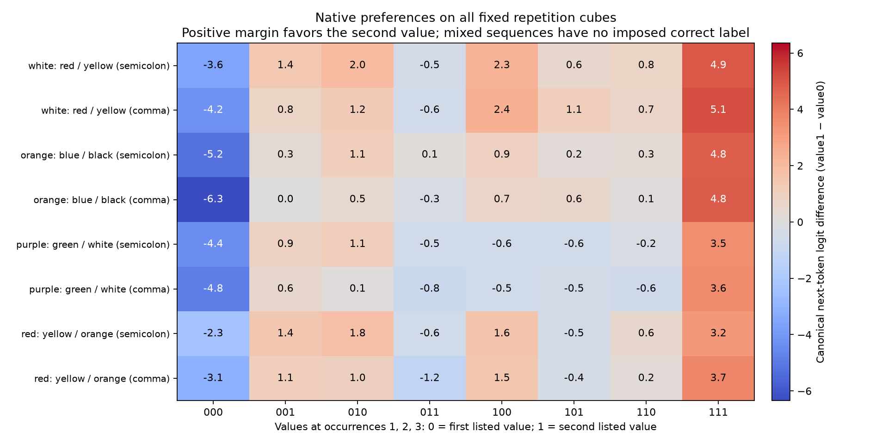

# Repetition behavior has strong three-way preference interactions

M108, 2026-10-29. A fixed factorial experiment characterizes what the native model actually does when repeated values conflict. No correct answer is imposed on ambiguous sequences, and the entire sequence-copy family remains excluded from featurizer training.

## Design and predictions

Four existing key/value vocabularies and two punctuation formats define eight cubes. Each prompt repeats one key three times, independently choosing value0 or value1 at each occurrence, and ends with the key. All eight binary combinations are evaluated per cube, for64 prompts. Sixteen historical two-occurrence examples are exact replay controls.

The prespecified behavioral rules are first-value, last-value and majority preference. We also decompose the canonical next-token logit margin (value1 minus value0) into constant, single-position, pairwise and three-way terms. This margin avoids the common log-softmax normalization constant and the extra nonlinearity of pooling capitalization variants.

For signs s_i in {−1,+1}, the Walsh coefficients are the uniform cube averages of `margin(s) * product(s_i for i in subset)`. This is an exact finite-data decomposition, not a fitted explanatory model or learned feature basis. Parseval's identity verifies that coefficient squared energies sum to average squared margin. Interaction fractions exclude the constant term.

## Native behavior

All16 uniform three-occurrence cases prefer their repeated value among the two candidates. On the48 mixed cases:

| Prespecified rule | Agreement with native candidate preference |
|---|---:|
| First value | 23/48 |
| Last value | 17/48 |
| Majority value | 13/48 |

No one of these rules captures the observed choices. Canonical-token and case-variant-pooled candidate preferences agree on all64 cube prompts. However, only25/64 prompts have either value as the full-vocabulary top token. This experiment primarily describes **relative preference between the two candidates**, not reliable generation of one of them.

The additive, pairwise and three-way terms account for56.59%,1.87% and41.54% of pooled margin variation. Total interaction fractions range30.55–71.28% across individual cubes. Every cube has a positive three-way coefficient, between1.31 and1.66 logit units.

A post-result observation is that the preference often looks parity-like: odd parity agrees with the minority value on mixed three-bit sequences and with the common value on uniform sequences. It matches51/64 choices overall and35/48 mixed choices. This was not a prespecified rule and is **not evidence of an XOR circuit**. It is a compact hypothesis about this small, reused vocabulary panel, with many full-vocabulary predictions outside the candidate pair. No new prompts were selected to improve it.

Importantly, majority decisions alone would not prove interaction in the margin: an additive margin `s1+s2+s3` already yields majority decisions after thresholding. The observed margin interaction is separately measured. Toys verify both this distinction and the pure majority-decision function's different Walsh spectrum.

## Exact connection to the native bilinear MLPs

At the final position, collect normalized input z(s) and product write F(z(s)) for MLP0, MLP1 and MLP2. The native map is `F(z)=D[(Lz)⊙(Rz)]`, excluding the separate output bias. If z_A are input Walsh coefficients, then the output coefficient for subset C is

`F_C = sum_A D[(L z_A) ⊙ (R z_(A xor C))]`.

The three-way output coefficient therefore splits exactly into:

- **Carried input interaction:** mean input multiplied by the cubic input component, in both bilinear orders; equivalently J(z_empty) z_123.
- **Mixed input interactions:** singleton components multiplied by complementary pair components, in all six orders.

If the normalized MLP inputs were purely additive in the three prompt factors, this bilinear MLP could not create a cubic coefficient. Cubic input structure or singleton–pair structure must already be present. This statement concerns composition of functions of prompt factors; it does not identify which upstream attention/normalization mechanism created that structure.

The following fractions use Euclidean vector energy within each layer, pooled across eight cubes:

| Final-position product-write variation | MLP0 | MLP1 | MLP2 |
|---|---:|---:|---:|
| Additive | 96.91% | 96.08% | 86.91% |
| Pairwise | 3.059% | 3.895% | 12.999% |
| Three-way | 0.0310% | 0.0294% | 0.0939% |

These vector-energy fractions cannot be directly equated to the output-margin fractions. A small internal direction may matter greatly to a downstream reader. We have not shown that later layers create all the margin interaction, nor that the early MLPs' cubic components are irrelevant.

## Cancellation, precisely scoped

For cubic write components `carry + mixed`, the normalized energy accounting is:

| Quantity / cubic target energy | MLP0 | MLP1 | MLP2 |
|---|---:|---:|---:|
| Carry squared norm | 0.2854 | 0.5511 | 0.5652 |
| Mixed squared norm | 0.2609 | 0.3615 | 0.4410 |
| Twice their inner product | +0.4537 | +0.0874 | −0.0062 |

Rows sum to1 for each layer. MLP2 shows slight net cancellation between these two **functional cubic terms** on this panel; four of its eight cubes have negative cross terms. This is neither native-channel cancellation nor evidence that the whole MLP is cancellation-dominated. Its cubic component is below0.1% of measured write variation. MLP0 and MLP1 are net constructive under this particular decomposition, though two MLP1 cubes have negative cross terms.

This gives a concrete instance of why 'cancelling computation' needs the objects, decomposition and metric specified. It does not establish removable redundancy.

## Verification and next discriminating test

80 native forwards; all16 historical final-logit vectors replay exactly. Independent toy checks cover12 random bilinear systems, exhaustive cube interpolation, Parseval identities and known first/last/majority/product cases.

All80 native final vectors and all64 prompt/cube-edge constructions were audited. A separate Torch linear-system interpolation reproduces NumPy Walsh sums. All24 layer/cube decompositions are independently checked by removing the cubic input pattern and recomputing the bilinear function, rather than repeating the XOR-convolution implementation. There are471 numerical checks, maximum scaled discrepancy4.02e-11. Native polynomial spectra use float64 evaluation at captured float32 normalized states; relative discrepancy versus native float32 writes is at most1.82e-7. No native component was intervened on in this stage.

Close this native cube characterization without lexical, punctuation or rule search. The next proposed bounded test links it directly to featurizer validation: remove the small final-position cubic component from each early MLP, compare fixed norm-preserving scrambled-direction controls, and measure the effect on full output distributions and all margin coefficients. In parallel, compare frozen block models and their same-dictionary dense least-squares controls on preservation of these factor responses. This would distinguish low-energy but causally important structure from descriptively small variation and identify concrete fidelity targets for featurizers. The components are cube-informed diagnostic directions, not deployable discovered units. Freeze that protocol before outcomes; no task-family training or model tuning is permitted.

[Protocol](validation/repetition_cube_protocol.json), [native outputs](validation/repetition_cube_native.json), [all coefficients and layer accounting](validation/repetition_cube_analysis.json), [independent audit](validation/repetition_cube_audit.json), [explicitly post-result parity description](validation/repetition_cube_parity_description.json).
