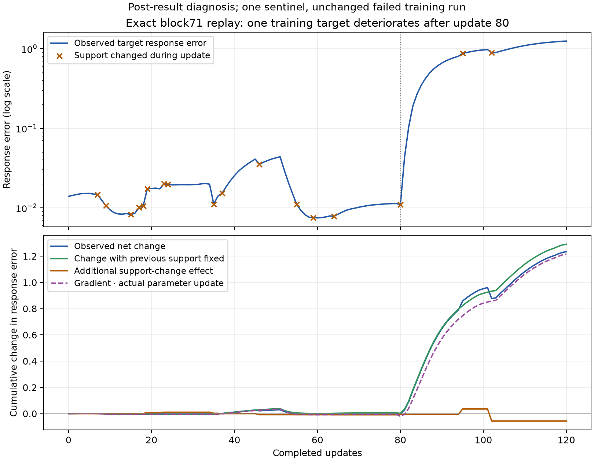

# M21: smooth update interference explains one reproduced response failure

2026-10-28. An instrumented replay reproduces every final tensor of the failed M20 block71 response-trained model exactly. For its monitored capital-recall training endpoint, the large deterioration occurs mainly while the selected features stay unchanged. Stable feature selection is therefore insufficient for stable causal behavior in this case.

## Diagnostic scope

Choose block71 treatment after M20 because it had the largest proportional final combined-objective regression among four starts. Monitor its largest final response-error endpoint, target198, which supplied57.7% of its final training response error. This is one post-selected failure diagnosis, not a representative sample, an independent confirmation, or a retrained model.

Replay the same120updates, fresh Adam.0003, data order, calibrated response weight, fixed perturbation targets, and decoder normalization. Before each update, measure the monitored endpoint's response loss and parameter gradient without accumulating into optimizer gradients. After the update, measure its actual loss and a counterfactual loss using the new parameters with its previous active support held fixed. Compare its gradient dotted with the actual parameter update, including decoder normalization.

All120 training losses match the earlier run within the fixed check. Every final state tensor matches bit-for-bit, and the monitored final response loss matches the independently measured M20 value. The instrumentation did not create a different optimization trajectory.

## The deterioration is reproducible

The endpoint starts at response error.013949 and ends at1.248250. After80completed updates it is still.011005; after100updates it is.966270. The sharp rise is visible below.



The upper plot marks support changes. The lower plot accumulates measured loss changes. For each update:

- Smooth component: new parameters with the previous support, minus the previous loss.
- Support component: actual new-support loss, minus the new-parameters/previous-support loss.
- First-order prediction: the previous response gradient dotted with the actual parameter change.

The first two components sum exactly to the observed change. This is an ordered counterfactual decomposition, not a unique or path-independent partition of causal responsibility.

| Quantity over120updates | Net change |
|---|---:|
| Observed response error | +1.234301 |
| New parameters, previous support fixed | +1.290890 |
| Additional support-change effect | −.056590 |
| First-order gradient/update prediction | +1.215659 |

Seventeen updates change the monitored support. The103updates with unchanged support account for net+1.259831 error; support-changing updates account for net−.025531. Both natural-text updates and task updates increase error in aggregate (+.691699 and+.542602, respectively). Because Adam's state carries across updates, this is not attribution solely to the currently presented domain.

## Which steps are damaging?

The five largest positive changes all occur without any monitored support change. Indices below are zero-based; step82 is the83rd completed update.

| Step | Current input | Error before → after | First-order predicted change |
|---|---|---:|---:|
| 82 | natural text | 0.104462 → 0.190562 | +0.070674 |
| 84 | natural text | 0.268247 → 0.346383 | +0.074849 |
| 83 | capital_recall | 0.190562 → 0.268247 | +0.072160 |
| 85 | number_successor | 0.346383 → 0.421560 | +0.073456 |
| 86 | natural text | 0.421560 → 0.491957 | +0.069729 |

The largest decrease is step101, where a support change improves the monitored loss by about.092, partly offset by a smooth increase. Gate changes can matter, but their measured role in this particular failure is not the source of the large net deterioration.

This rejects the simple explanation that abrupt feature-selection changes account for the large observed rise. It supports interference from continuous parameter updates, visible through local gradients. It does not yet distinguish disagreement with the current example's gradient from Adam's carried first moment, adaptive preconditioning, or finite-step curvature. Nor does it establish the same mechanism for the other three models or all training examples.

## Consequence for computational units

The same active block coordinates can acquire very different downstream intervention effects as encoder/decoder parameters move. An active-feature identity or a stable gate alone is therefore weak evidence for a stable computational role. This adds a concrete constraint to the featurizer loop: preserving native responses requires controlling interference across updates, not merely constructing valid causal labels and a differentiable loss.

Local finite-difference correctness and exact training replay both hold here. They are compatible with failure to retain the training targets. This is evidence about learning a causal representation, not yet an ontology of the native MLP or a demonstration of meaningful manifolds.

## Next bounded discriminator

Keep all existing trained models and this failure intact. At a small fixed set of steps around the rise (79–83), separate Adam's carried first-moment contribution from its current-gradient contribution using the same second-moment state. Measure their alignment with the monitored response gradient, and evaluate one-step parameter counterfactuals with explicit normalization/magnitude accounting. Restore the original state after each diagnostic and require the untouched replay to reproduce the original trajectory.

This distinguishes whether the harmful direction is already present in the current gradient or mainly introduced by optimizer history. It informs whether a subsequent featurizer fix should target cross-example gradient interference or optimizer-state carryover. Stop after this diagnostic; do not tune learning rates or loss weights against this sentinel. Any proposed training change must later be tested on the full frozen response benchmark, ordinary fidelity and all families. New-task discovery and semantic-unit validation remain open.

## Verification and reproduction

```bash
python replay_response_trajectory.py
python audit_response_replay.py
python analyze_response_replay.py
python plot_response_replay.py
```

The replay uses1,015 native forwards, including reference documents, training and diagnostic forwards. Independent NumPy audit recomputes all360 before/after/fixed-support response scores,120 gradient/update dot products, support changes, decomposition identities, continuity, training-history values and final agreement with M20. Maximum response-score discrepancy5.56e-16. Final tensor difference is exactly0. Analytic gradients and the native transformer are not independently reimplemented; the gradient path was separately checked in M19.

[Protocol](validation/response_replay_protocol.json), [trajectory](validation/response_trajectory_replay.json), [audit](validation/response_replay_audit.json), [analysis](validation/response_replay_analysis.json), [PNG](figures/response_replay.png), [SVG](figures/response_replay.svg).

Local full diagnostic tensors are in `artifacts/bilin18_tensor_decomposition/emlp_m21_response_replay_samples.pt`. The packet contains small records, scripts and figures. No job remains running; the broad research goal remains active.
