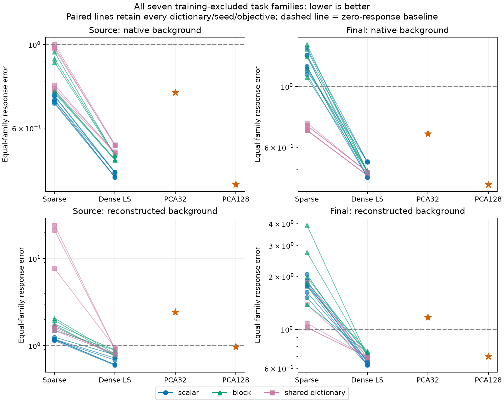

# M76: dense representation gains transfer, but units remain unidentified

All38fixed representations were evaluated on all56pairs from seven explicit training-excluded operations. No fitting, seed selection, rank search, prompt rescue or failure filtering occurred. This extends evaluation beyond the familiar source-group panel; every task has historical evaluation exposure, so it is not a pristine test or new-task discovery.

## Main result

Dense least-squares encoding improves the corresponding original sparse encoder in18/18paired comparisons for all six equal-family causal summaries and intact output KL on the full seven-family cohort. All six pooled causal summaries also improve18/18. Answer-margin changes are less uniform: source native-background/encoded-change improves16/18, and reconstructed-background/native-change8/18; the other four improve18/18.

Restricting interpretation to the five families that passed the predeclared contrast gate retains18/18improvements in five of six equal-family causal summaries. The exception is reconstructed-background/native source change: only3/18improve (2/18for margin error), though pooled error still improves18/18. Thus the apparent strength depends on task weighting and which part of the counterfactual is reconstructed.

| All-family metric, lower is better | Original sparse,18models | Dense LS,18models | PCA128 |
|---|---:|---:|---:|
| Intact task output KL | 0.1037–0.2063 | 0.0679–0.1064 | 0.0941 |
| Source encoded-change error, native background | 0.698–1.002 | 0.444–0.543 | 0.426 |
| Final encoded-change error, native background | 0.691–1.426 | 0.466–0.534 | 0.440 |
| Source error, both reconstructed | 1.143–24.266 | 0.597–0.949 | 0.972 |
| Final error, both reconstructed | 1.024–3.918 | 0.626–0.752 | 0.705 |
| Source native-change error, reconstructed background | 2.391–12.072 | 1.999–3.045 | 2.676 |

Causal table rows are equal-family averages of native-probability-weighted squared logprob response errors relative to native target energy. Error1 means predicting no response, not adequate faithfulness. Models and tasks share training ancestry and data;18comparisons are descriptive, not independent replications. Dense uses128active coordinates versus at most32for the sparse models, so this is not an equal-cost advantage.

## What transfers, and what does not

PCA128 outperforms every learned dense span on encoded-change fidelity in the native background, at both sites, on both the full and contrast-qualified cohorts. This reverses any broad inference from the earlier familiar-panel results that learned spans must always be superior. A global linear subspace can capture useful task changes without learned conditional groups. Learned spans still generally better preserve the combined reconstructed source counterfactual than PCA128, so no single ranking covers background retention and change fidelity.

On the five contrast-qualified families, every dense model has95%endpoint contrast accuracy and90%both-endpoint pair accuracy, versus96.25%and92.5%for the native model. Identical accuracy hides a range of causal errors: dense both-reconstructed source error0.490–0.794 and final error0.708–0.830. Reconstructed-background/native-source-change errors remain1.385–2.169, worse than predicting no response. This is not evidence that the representations preserve the native computation exactly.

Family results are retained rather than averaged away. Sequence copy is relatively favorable: dense final encoded-change errors0.021–0.051 with native background, but0.172–0.308when the background is reconstructed too. Weekday source both-reconstructed error spans0.794–2.046; continent final both-reconstructed spans0.972–1.321. Spatial and role tasks remain weak under the native competence test and are diagnostic only. All14family/format breakdowns are in the comparison JSON.

## Conceptual account

The evidence favors a broadly distributed output subspace over the current sparse gate choices as a useful compression baseline. It does not establish reusable semantic groups or a unique basis. PCA128's performance reinforces that distinction.

The background/change factorial also has an exact error interpretation. At an intervened position, let reconstruction errors be e_r and e_d for recipient and donor. Then the encoded change is native_change + e_d - e_r. A reconstructed background plus native change leaves the donor write plus e_r; using both reconstructed leaves the donor write plus e_d. Better combined performance can therefore reflect compatibility of reconstruction errors with the corresponding state. It is not proof that all native changes are interchangeable across reconstructed backgrounds, nor evidence of cancellation among native neurons. Unpatched positions retain their own background errors.

Most importantly, these encoders consume the already-computed MLP write. They are descriptions/compressions of an output, not executable reverse engineering of how normalized MLP inputs produce that output. The next bounded test should address that gap directly rather than adding another featurizer loss sweep.

## Verification

-29,208native forwards,112native baseline replays and328native teacher target replays, all exact.
-37,392saved full-vocabulary response vectors,12,464change-geometry cases,304retained source-ineligible model/assignment cases. Each ineligibility applies to all three corners; no invented alignment.
-4,256independently reconstructed encoder outputs, including2,016independent NumPy sparse support selections. Minimum gate-boundary gap2.98e-6; maximum decoder relative discrepancy1.01e-7.
-PCA outputs use independently applied projections; dense LS outputs use QR/SVD projection checks; sparse codes and exact union gates are checked. All response/delta/summary metrics are independently rescored. Maximum absolute discrepancy1.49e-8 includes large local energies.
-All identities are zero; all56pairs/sevenfamilies/twoformats are retained. Existing M72/M73 natural-retention measurements remain hash-bound references and were not rerun. No experiment or audit failed in M76.
-The producer checkpoints after each pair and verifies hashes before resuming. The run was uninterrupted, so interrupted-resume equivalence is not newly tested. The transformer was not independently reimplemented.

Scripts: probe_whole_task_factorial.py, audit_whole_task_factorial.py, analyze_whole_task_factorial.py, plot_whole_task_factorial.py. Raw metrics, all family/format and contrast-qualified summaries, every paired comparison and intact metrics are in validation/whole_task_factorial*.json. Full tensor files remain local. No representation was trained or selected.

## Decision: test how native inputs produce changes

Dense output projections are useful transferable baselines, but broad causal errors and background incompatibility rule out treating their axes as established fundamental units. Close this comparison without rank/objective sweeps. A targeted computational-structure test comes next: compare a single training-reference linear operator with context-dependent operators of the native bilinear MLP.

For F(z)=Down[(Left z)⊙(Right z)], its Jacobian satisfies the exact quadratic identity F(z_d)-F(z_r)=J((z_d+z_r)/2)(z_d-z_r). This separates a shared input-to-write map from context dependence and clarifies that recipient-linear versus quadratic-term cancellation depends on expansion point. It does not change native channel contributions or their implementation-level cancellation.

The next protocol freezes three predictions: J(training_mean_z)delta_z, J(recipient_z)delta_z, and the exact midpoint control, across the same diverse tasks. The mean uses only natural training positions. Toy checks distinguish function geometry from duplicated/cancelling implementations. Its concrete featurizer deliverable is deciding whether global linear coordinates, local charts, or context-dependent bilinear computation are warranted as input-to-write models. One diagnostic, no fit/rank sweep; afterward use its result to specify the representation's executable computation or a targeted reusable-component intervention.
