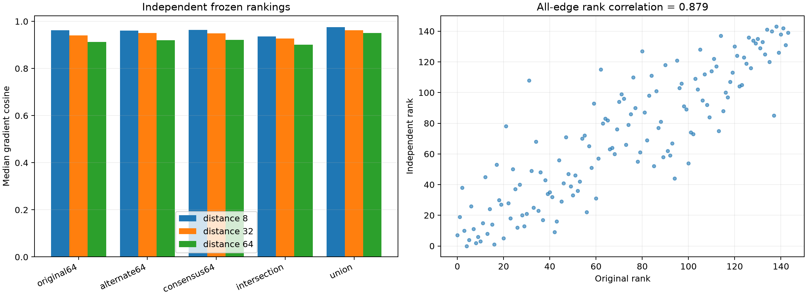

# Independent stability of the cross-position head scaffold

A second disjoint distance-32 panel independently reranks all 144 suffix layer-head edges. Both 64-edge sets, their intersection, union, and an average-rank consensus are then evaluated on a third FineWeb panel at distances 8, 32, and 64.

Discovery sites: `7`. Top-64 Jaccard: `0.730` (intersection 54, union 74). Full-ranking Spearman: `0.879`. Maximum local recomposition error: `9.63e-07`.

## Locked hypotheses

- **AA0_full_head_program_is_exact: supported.**
- **AA1_top64_sets_are_stable: supported.**
- **AA2_full_rankings_are_correlated: supported.**
- **AA3_rediscovered_top64_transfers: supported.**
- **AA4_two_top64_programs_are_behaviorally_equivalent: supported.**
- **AA5_intersection_is_useful: supported.**
- **AA6_both_top64_programs_beat_random: supported.**
- **AA7_all_selection_is_disjoint: supported.**

| Distance | Original 64 | Alternate 64 | Consensus 64 | Intersection | Union | Random-64 p95 |
|---:|---:|---:|---:|---:|---:|---:|
| 8 | 0.963 | 0.961 | 0.964 | 0.936 | 0.976 | 0.668 |
| 32 | 0.940 | 0.950 | 0.950 | 0.927 | 0.962 | 0.599 |
| 64 | 0.913 | 0.920 | 0.921 | 0.900 | 0.951 | 0.557 |

## Guardrail

Stable predictive performance does not imply a unique edge set. Set overlap and effect fidelity answer different questions: redundancy can preserve a reusable scaffold while making individual native-head identities non-identifiable.
