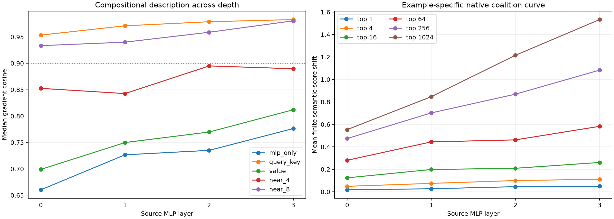

# Layers 0–3 compositional ontology

The same 96 held-out semantic donor–recipient pairs are inspected at each of the first four bilinear MLP product boundaries. Exact downstream gradients are composed block by block. This avoids explicitly expanding the network into a high-order polynomial: complexity is represented as a sequence of local, state-conditioned operators.

Maximum local Q/K/value recomposition error: `8.58e-08`.

## Locked hypotheses

- **D0_exact_composition_reconstructs_each_layer: supported.**
- **D1_local_role_factorization_is_exact: supported.**
- **D2_eight_nearby_attention_blocks_are_sufficient: supported.**
- **D3_qk_is_a_stable_same_position_grammar: supported.**
- **D4_qk_beats_value: supported.**
- **D5_rank64_is_directionally_sufficient: supported.**
- **D6_rank64_recovers_most_rank1024_effect: not supported.**
- **D7_single_neurons_are_not_sufficient: supported.**
- **D8_depth_does_not_make_native_coalitions_less_compact: supported.**

## Compositional programs

| Source layer | MLP only | Queries | Keys | QK | Value | Near 4 | Near 8 | Exact |
|---:|---:|---:|---:|---:|---:|---:|---:|---:|
| 0 | 0.635 | 0.906 | 0.679 | 0.939 | 0.685 | 0.847 | 0.953 | 1.000 |
| 1 | 0.717 | 0.941 | 0.740 | 0.963 | 0.745 | 0.887 | 0.969 | 1.000 |
| 2 | 0.742 | 0.955 | 0.779 | 0.972 | 0.794 | 0.914 | 0.972 | 1.000 |
| 3 | 0.787 | 0.967 | 0.804 | 0.977 | 0.813 | 0.933 | 0.986 | 1.000 |

## Native-neuron finite interventions

| Source layer | Top 1 | Top 4 | Top 16 | Top 64 | Top 256 | Top 1024 | Positive-mass K90 median (Q10–Q90) |
|---:|---:|---:|---:|---:|---:|---:|---:|
| 0 | +0.0129 | +0.0365 | +0.0927 | +0.2057 | +0.3797 | +0.5221 | 1038 (978–1080) |
| 1 | +0.0197 | +0.0574 | +0.1478 | +0.3344 | +0.6035 | +0.8152 | 1042 (992–1076) |
| 2 | +0.0269 | +0.0672 | +0.1639 | +0.3806 | +0.7428 | +1.0733 | 1052 (1010–1087) |
| 3 | +0.0274 | +0.0760 | +0.1939 | +0.4549 | +0.9062 | +1.3657 | 1048 (1018–1088) |

## Interpretation guardrail

The native-channel curves use an example-specific activation-times-exact-gradient oracle. They measure how many native channels are sufficient for a known edit at that state; they are not a prospective monosemanticity score. The role programs are likewise local linear explanations of downstream sensitivity, then checked with finite channel interventions.
