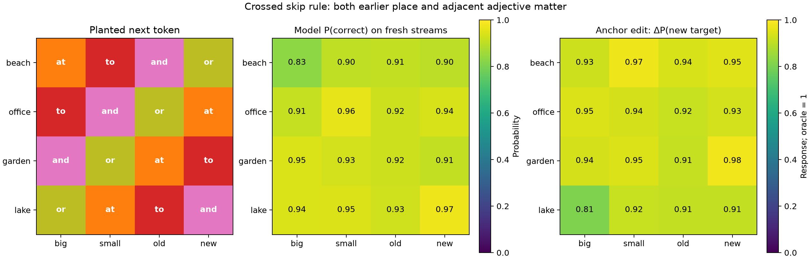
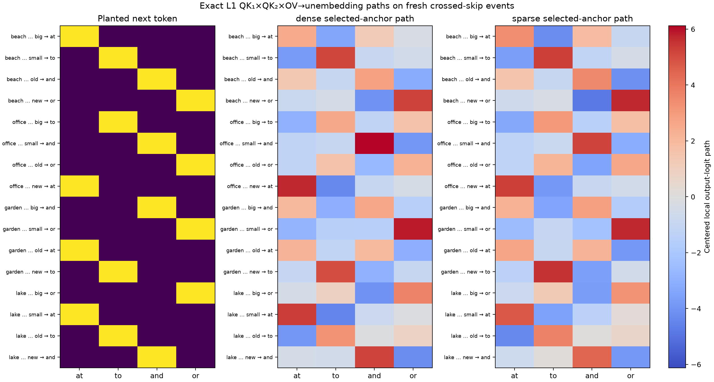
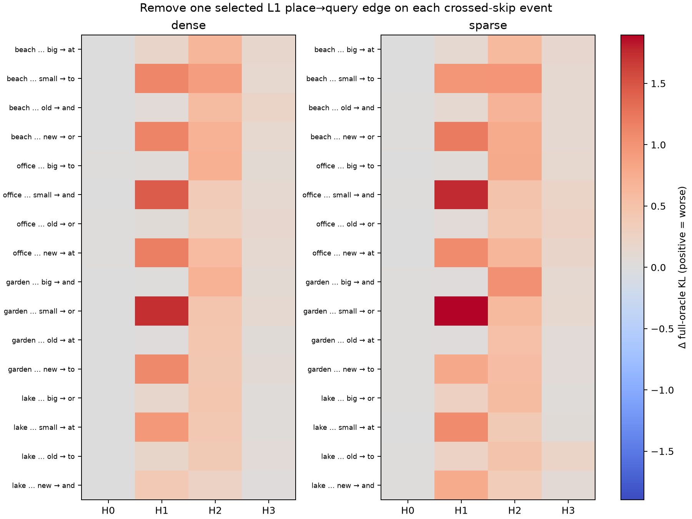
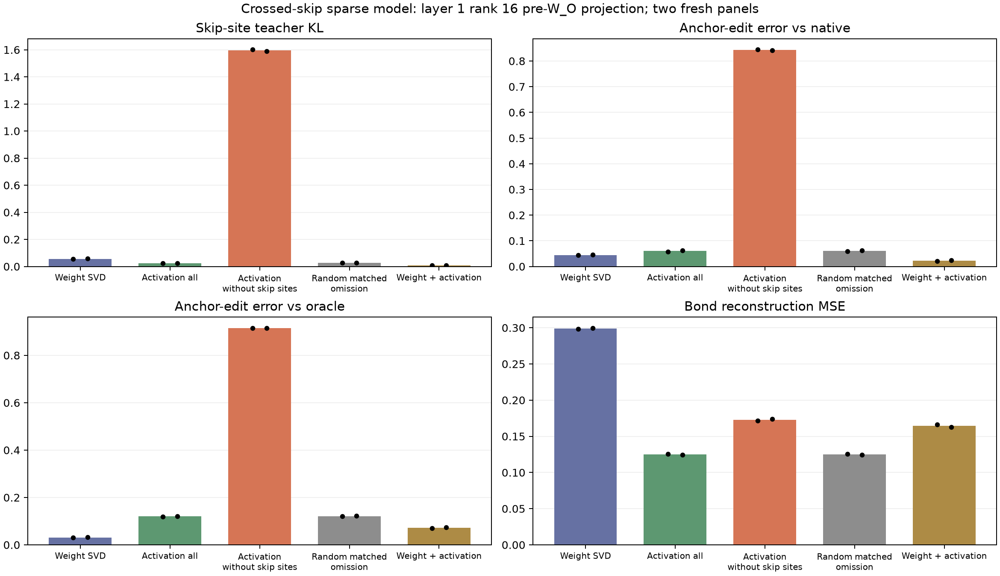

# Crossed skip rules in the joint toy-language stream

The earlier jointly sampled v3 grammar appeared to contain four learned
place…adjective skip rules. A [per-row sparse-circuit audit](ORIGINAL_V3_SHARED_BRACKET_SUCCESSOR.md)
showed a shortcut: each adjective occurred in only one rule, so an
adjacent-token predictor could recover the output without reading the earlier
place. Only one of the four selected-anchor edges was causally important.

[`LanguageV3CrossedSkip`](original_v3_crossed_skip.py) changes only that
rule table and its trigger-boost ordering on top of the shared-bracket v3
generator. The stream still jointly samples noun bigrams, token/category
trigrams, induction, crossed skip rules, and shared-content bracket spans.
The inherited `skip_trigram` label denotes bracket closing; the crossed
place…adjective rule is labeled `skip_bigram` in this code.
Every adjective now occurs with every place. The target is a cyclic Latin
square:

| Earlier place / adjacent adjective | big | small | old | new |
|---|---|---|---|---|
| beach | at | to | and | or |
| office | to | and | or | at |
| garden | and | or | at | to |
| lake | or | at | to | and |

Knowing either cue alone leaves four possible outputs. This removes the
specific adjacent-token shortcut without asserting that the model must use a
particular internal circuit. For example, after `carol calls lake new`, the
exact skip-site target is `and`; replacing only `lake` by `beach` changes it
to `or`. The same preceding prefix can generate either place through the
fallback PLACE category; every place boosts every adjective with nonzero
probability. We audit distance-2 edits with a fallback-labeled anchor and a
boost/fallback-labeled trigger, so the complete edited prefix remains in
support. We check that dispatch on the edited prefix returns the new target.
This is an exact deterministic **skip-site** oracle and support argument, not
a full visible-prefix oracle for every other hidden-state rule in v3.

Two independent 4,000×129-token audits found all 16 pairs, with per-pair
counts ranging 1,460–2,660 and 1,497–2,723. Of 4,000 streams, 3,963 and
3,965 contained noun-bigram, crossed-skip, and bracket-close events together.
There were 39,990/40,764 support-preserving distance-2 anchor edits. The
complete count and example records are in [audit A](results/v3_crossed_skip_audit_seed99101_n4000.json)
and [audit B](results/v3_crossed_skip_audit_seed99111_n4000.json). The
[auditor](audit_original_v3_crossed_skip.py) checks the Latin-square property,
every sampled skip target, pair coverage, and edited-prefix dispatch.

This version is still **not realistic prose**. On the previously used 190
word-matched FineWeb windows, its repeated-content fraction is .592 versus
FineWeb .155; it has no newlines, questions, colons, or digits in the measured
windows, whereas FineWeb has them in .911/.163/.332/.558 of windows. The
same panel has already informed earlier generator development and is a
diagnostic comparison, not fresh validation. The crossed rules also rely on
an artificial trigger boost: the ordinary PLACE→ADJ transition has zero
mass. See the [form comparison](results/v3_crossed_skip_fineweb_form_seed97211.json).

The prospective model gate is stricter than aggregate next-token loss: on
independent streams, all 16 pairwise skip-site target CE values should be
below .2 nats; support-preserving anchor edits should raise probability of
the new exact target by at least .8 overall and .65 for every pair. Noun
bigram CE should stay below 1.1, induction CE below .25, and the bracket
opener-edit response should be within .1 of its exact oracle. A sparse
checkpoint must pass the same
task-wise checks before we interpret its paths. These criteria were set
before reading the trained model's fresh pair/edit evaluation.

The first model is a two-layer, four-head, width-64 bilinear transformer
without MLP blocks, trained from scratch on the same joint stream for 5,000
updates, batch 256×128 next-token positions, with AdamW at learning rate
.003. The [training record](results/v3_crossed_skip_depth2_seed2_5000/results.json)
shows final noun-bigram CE .865, induction CE .123, skip CE .084, and bracket
opener-edit response .534 versus oracle .549 on its fixed diagnostic panel.
The process had two transient GPU faults; it was resumed from optimizer,
generator, and Torch RNG checkpoints. A CPU smoke check found **exactly zero**
weight difference between uninterrupted and resumed runs, and the final
checkpoint reports step 5,000. This is one training seed, not a cross-seed
replication.

Two untouched 1,024-stream panels each supply 16×32 supported anchor edits.
They found 8,292/8,343 skip events. Across the 16 pairs, the worst target CE
was .190/.195 nats, below the preset .2 gate. Mean model probability on the
correct skip target was .923 on both panels. Changing only the earlier place
moved model probability toward the new exact target by .928/.928, versus
oracle 1; the weakest pair's response was .808/.797, above the preset .65
minimum. An optimistic trigger-only predictor fitted on an independent
4,000-stream panel, conditioned on *knowing* these were skip-labeled sites,
had accuracy .322/.330 and CE 1.366/1.365. The model therefore learned a
dependence on the earlier place that the adjective alone cannot provide.
These scores are [panel A](results/v3_crossed_skip_final_seed99201.json) and
[panel B](results/v3_crossed_skip_final_seed99211.json); the
[evaluator](eval_v3_crossed_skip_model.py) and [plotter](plot_v3_crossed_skip_eval.py)
reproduce them.

The same model then underwent iterative L1, global magnitude pruning of
attention projections to 40% and 60% exact zeros, and 200 masked recovery
steps **without L1**. Embeddings and unembedding stayed dense. A transient
process failure after the 60% pruning stage was recovered from that saved
checkpoint; the generator was replayed to the exact next recovery minibatch,
and the final phase uses a fresh AdamW optimizer by design. On its fixed
diagnostic panel, the no-L1 phase restored skip CE from .285 immediately
after 60% pruning to .088, bracket oracle KL from .578 to .021, and bracket
opener-edit response from .323 to .586 versus oracle .594. Noun CE was .936
and induction CE .233. The exact mask has 19,661 live of 49,152 attention
projection entries. [Pruning code](sparsify_v3_shared_bracket.py) and
[stage results](results/v3_crossed_skip_sparse_seed99401/results.json) preserve
the protocol.

On the same two untouched pair/edit panels, the recovered sparse model's
mean correct-target probability was .921/.920 and mean anchor-edit response
.931/.930 versus oracle 1. Worst pair CE was .100/.101, and weakest pair
edit response .900/.920, passing the preset task-wise sparse gate. These
figures are [sparse panel A](results/v3_crossed_skip_sparse_final_seed99201.json)
and [sparse panel B](results/v3_crossed_skip_sparse_final_seed99211.json).
The [sparse pair graph](results/v3_crossed_skip_sparse_final_seed99201.png)
shows the 4×4 table directly.

The selected earlier-place edge's exact layer-1 `QK₁×QK₂×OV→unembedding`
logit path now visibly distinguishes the 16 planted outputs in both dense
and sparse checkpoints. These are **activation-conditioned paths through
the saved weights**, not a data-free canonical form. Removing each selected
head edge and recomputing the model provides a separate causal test:

On two fresh 512-stream panels, the best single-head selected-anchor
ablation increases exact skip-site KL by at least .313/.277 nats across the
16 dense-model pairs and .441/.382 in the sparse model; the sparse median
best-head increases are .782/.841. All 16 sparse rows exceed .3 nats in
both panels. The earlier uncrossed generator showed a large selected-anchor
effect for only one of four rules. The correct output has the largest
*summed local path logit* in all 16 rows in both dense and sparse models on
both panels. The exact local-path identity against actual edge removal
passed within 6.7e-6 maximum logit error. The first panel's path
[source matrices](results/v3_crossed_skip_sparse_graphs_seed99301/crossed_skip_sparse_weight_paths.json)
and [causal ablation table](results/v3_crossed_skip_sparse_graphs_seed99301/crossed_skip_edge_ablations.json),
plus the independent [second path](results/v3_crossed_skip_sparse_graphs_seed99311/crossed_skip_sparse_weight_paths.json)
and [second ablation](results/v3_crossed_skip_sparse_graphs_seed99311/crossed_skip_edge_ablations.json),
preserve all 16×4 values.

This is a **successful synthetic control**: crossing the cues removed an
identifiable DGP shortcut, the model learned the actual two-cue dependency,
and 60%-zero attention projections retained visible, causally important
anchor paths. It does not establish that the recovered circuit is unique or
sufficient by itself, that the same representation emerges across model
seeds, that an unsupervised decomposition would recover the rule, or that the
text resembles FineWeb. Those are separate next tests for canonicalization
and interpretability methods on a better-grounded language generator.

## Local basis priors on the competent crossed model

The [bond-prior comparison](eval_v3_crossed_skip_bond_priors.py) now tests
whether this known dependency survives local low-rank reductions of the
**sparse model**. At each attention block's pre-`W_O` 64-dimensional bond,
it compares (i) right singular vectors of `W_O` from weights alone,
(ii) unlabeled activation PCA fitted on all 256×128 positions, (iii) the
same PCA after excluding all 2,039 skip-labeled fit positions, (iv) a
matched-count random exclusion, and (v) a trace-normalized weight/activation
hybrid with coefficient 1. Each projection changes **one bond at a time**.
Ranks 8, 16, 32, and 64 were fixed before looking at the two independent
512-stream evaluation panels; rank 64 replays both model outputs and edit
responses within the asserted 1e-5 tolerance. The model itself was trained
on all rules. The exclusion is a **featurizer-fit site holdout**, not a
whole-task model-training holdout or discovery experiment.

At rank 16 in layer 1, averaged across the two fresh panels:

| Basis | Skip teacher KL | Anchor-edit error vs native | Error vs oracle | Bond MSE | Bracket teacher KL |
|---|---:|---:|---:|---:|---:|
| Weight-only SVD | .057 | .045 | .031 | .299 | .108 |
| Activation, all positions | .025 | .060 | .120 | .125 | .055 |
| Activation, skip positions omitted | 1.596 | .843 | .915 | .173 | .085 |
| Activation, matched random omission | .026 | .061 | .121 | .125 | .056 |
| Weight/activation hybrid | .007 | .022 | .072 | .165 | .114 |

Omitting only 6.2% of fit positions—the skip sites—nearly erases the
rank-16 layer-1 edit response (mean .085 versus the native .928). Randomly
omitting the same number does not. This repeats on both evaluation panels
and at rank 8; rank 32 repairs most of the failure. It shows that a compact
activation basis needs task-bearing directions that are not reliably
inferred from other positions. It does **not** prove those directions are
semantically unique or unavailable from a different unlabeled prior.

The metrics also reject a single unqualified winner: weight-only SVD has
the smallest error to the **oracle** edit response, because its projection
overshoots the native model toward the exact response of 1; the hybrid best
matches the **native** causal effect and has the lowest skip teacher KL, but
has worse bracket KL than all-position PCA. All-position PCA gives the lowest
bond reconstruction MSE and better bracket fidelity, yet a larger skip edit
error. Thus reconstruction, teacher imitation, exact-oracle behavior, and
cross-rule preservation select different reductions. The full [numerical
records](results/v3_crossed_skip_bond_priors_fit99501_eval99511_99521.json)
include both layers and all four ranks. This is a local linear projection
comparison, not a function-level canonical tensor form or learned sparse
featurizer.
