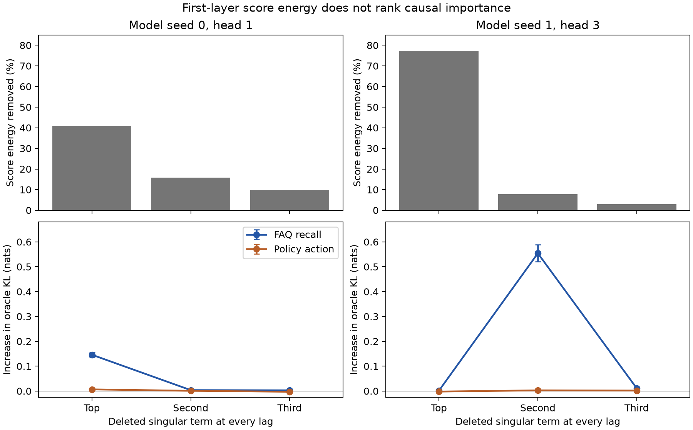

# A low-energy first-layer score mode matters for FAQ recall

The [weight-only token tensor](MULTI_GENRE_TOKEN_TENSOR_CANONICALIZATION.md) closely replays two competent multi-genre bilinear models. Its SVD showed that score-table energy and output fidelity can be measured without fitting text. This follow-up asks a stronger interpretability question: **does removing one weight-defined singular term change a particular causal behavior?** It tests the native model suffix on exact-oracle FAQ recall and Policy edits, with a full-table replay as the unablated control.

The experiment deliberately separates three panels. Whole-head ablations on test/edit seeds **9882/9883** identified candidate heads: seed 0's head 1 and seed 1's head 3 affected FAQ recall more than Policy and FAQ copying, although the strongest overall FAQ head differed across model seeds. A rank sweep on fresh **9892/9893**, repeated on **9902/9903**, tested the chosen heads with only their top (r\in\{1,2,4,8,16,32\}) score singular terms retained at every relative lag; other heads stayed full. In seed 1, head 3 at rank 1 had FAQ-recall edit L1 error **1.467/1.321**, but rank 2 restored it to **.184/.263**. The full-table baselines were **.160/.244**. FAQ-copy and Policy effects changed little. This motivated the *predefined* singular indices 0, 1, and 2 for a direct deletion test on new panels; the rank-1/rank-2 result alone does not prove a mode is necessary when all higher modes are present.

For the direct test, each head/lag score matrix (S_{h,Δ}) is decomposed by SVD. We subtract one rank-one term (s_j u_jv_j^\top) from the **full** matrix at the selected head, leaving all other singular terms, heads, token values, and model layers untouched. The unablated relative-lag replay differs negligibly from native outputs, as measured in the earlier report. A singular index here denotes **one term at each of 71 lags**, not a shared vector across positions. The evaluation panels use seeds **9912/9913** and **9922/9923**, each with 1,024 test streams and 99/98 supported FAQ-recall edits.

| Seed 1, head 3 deletion | Share of this head's score energy removed | FAQ recall oracle KL, panel A / B | FAQ recall edit L1, A / B | Policy oracle KL increase, A / B |
|---|---:|---:|---:|---:|
| None, full lag table | 0 | .120 / .142 | .202 / .204 | 0 |
| Top singular term (index 0) | **77.4%** | .122 / .143 | .207 / .209 | −.002 / −.002 |
| **Second term (index 1)** | **7.8%** | **.640 / .730** | **1.098 / 1.226** | **+.002 / +.003** |
| Third term (index 2) | 2.9% | .130 / .155 | .225 / .222 | +.002 / +.002 |

The second-term deletion damages **the direction and target of the FAQ recall effect**, not all causal sensitivity: model effect TV remains about .86 versus .945 for the full replay, but edit L1 error rises sharply. FAQ-copy edit L1 stays around **.02–.024**, and Policy-condition edit L1 and nuisance-person controls barely change. On the two panels, FAQ-recall model-to-ablated KL is **.464/.526**, while Policy mixed-action model KL is only **.00115/.00122**. Thus a relatively low-energy, weight-defined score-mode family is *selectively necessary* for correct FAQ recall in this seed. The top mode carries roughly ten times as much score energy and is not similarly necessary for that behavior. Ordinary SVD energy is a poor importance ranking for the interpretability target.

The result is not uniform across seeds. In seed 0, deleting the second term from the candidate head 1 changes FAQ-recall edit L1 only from **.195→.200** on panel A (**.192→.193** on B). Deleting its top term has a larger FAQ effect, but that term is less selective. Head numbers and singular indices should therefore not be presented as a model-independent canonical FAQ circuit. Some lagwise second and third singular values are close (minimum ratio (s_2/s_3\approx1.05)); their individual vectors can rotate under perturbations. In seed 1, adjacent-lag absolute cosines of the second query/key singular vectors have medians **.949/.892**, but minimums **.337/.041**; their top-token loadings vary with lag and often involve common words or punctuation. These [loading diagnostics](multi_genre_models_seed1_layer0_head3_mode1_loadings.json) do **not** establish a human-readable “FAQ feature.”

Removing the second term only at lags 0–7, 8–15, 16–31, or 32–70 causes much smaller FAQ edit errors than removing it at every lag. This may reflect redundancy across lags or nonlinear interactions through the suffix; the present test does not distinguish those explanations. The first layer's score is only one factor of the full function, and a necessary term need not be sufficient, unique, or stable under reparameterization. The two panels replicate the *behavioral selectivity of this trained seed*, not a general law about bilinear transformers or natural language.

The useful methodological lesson is to couple a weight-only reduction to **task-specific causal edits**. Energy-based canonicalization supplies a reproducible coordinate choice, but the important component can sit below the leading singular term. A next experiment should compare intervention-aware selection or sparse rotations against this index-1 mode at matched model KL and active score rank, then test transfer to held-out objects and to additional trained seeds. Separately, the toy DGP needs broader forms and stronger natural-text calibration before its FAQ circuit can support claims about real language.

Reproduction: [whole-head ablation](eval_multi_genre_token_tensor_head_ablation.py) and [result](multi_genre_layer0_token_tensor_head_ablation.json); [selected-head rank sweep](eval_multi_genre_token_tensor_selected_heads.py), [fresh](multi_genre_layer0_token_tensor_selected_heads_fresh.json), and [replication](multi_genre_layer0_token_tensor_selected_heads_replication.json); [direct singular-mode ablation](eval_multi_genre_token_tensor_mode_ablation.py), [panel A](multi_genre_layer0_token_tensor_mode_ablation.json), and [panel B](multi_genre_layer0_token_tensor_mode_ablation_replication.json); [token-loading analysis](analyze_multi_genre_mode_loadings.py) for [seed 0](multi_genre_models_v1_layer0_head1_mode1_loadings.json) and [seed 1](multi_genre_models_seed1_layer0_head3_mode1_loadings.json). All decompositions are weight-only; no FAQ examples are used to fit the SVD, though development edit panels were used to choose which head and mode to inspect.
