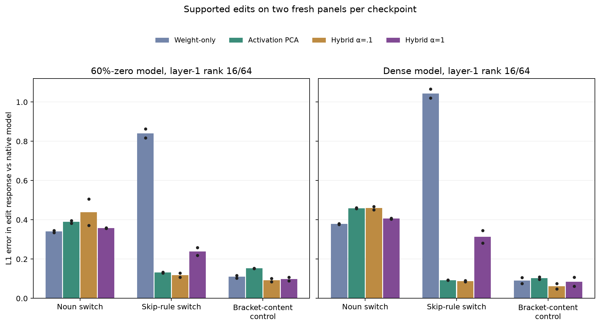

# Supported rule edits test the joint v3 hybrid basis

The [rank-16 bond comparison](ORIGINAL_V3_MULTIRULE_BOND_BASES.md) found that a trace-normalized weight/data hybrid preserves three planted rule-site output distributions better than either simple prior's worst failure. This follow-up asks a stronger question: does the reduced model respond correctly when the **rule input changes**? It projects only the second attention block's 64-coordinate pre-output-projection bond to 16 coordinates. Dense and 60%-zero checkpoints are evaluated on two fresh, independent 128-pair panels each. The basis is fitted on a disjoint 256-stream sample for each panel.

Three paired edits are generated from sampled v3 streams:

* **Skip-rule switch.** At a sampled `skip_bigram` site, two different place anchors are present within the rule's eight-position window. The final adjective is changed to the other anchor's trigger, switching the planted output, for example `beach … big → at` to `garden … old → and`. The replacement adjective has positive ordinary category-transition probability at that position; both old and new next-token rules are checked by the generator's priority dispatch.
* **Noun switch.** A noun emitted by an ordinary category transition is changed to a different noun absent from the prefix, so induction cannot supersede the new noun-bigram distribution. The preceding token is checked to avoid the token-trigram override. The oracle changes from one planted 70/20/10 verb distribution to another.
* **Bracket-content control.** The last content token before a closer is changed to another token of the same grammatical category that differs from its predecessor. The opener and span length remain fixed, so the correct closer does not change.

For the two normal-state rule edits, the reference distribution includes the generator's 3% `(` and 3% `[` opening probabilities plus 94% of the selected rule distribution. The selected labels establish the generator's normal state for these cases; this is not an arbitrary visible-prefix oracle. The edited token is the **last token queried**. Although the stored row has an original sampled suffix, causal masking makes that suffix irrelevant: an explicit full-row versus truncated-prefix check differed by at most **6.7×10⁻⁶ logits**. The model was trained on all these rule families, so this is an evaluation holdout, not a model-training whole-task holdout.

The plot reports L1 distance between each reduced model's probability-change vector and the **native checkpoint's** change vector; lower is better. Values on the two panels are:

| Checkpoint / edit | Weight-only | Activation PCA | Hybrid α=.1 | Hybrid α=1 |
|---|---:|---:|---:|---:|
| 60%-zero, noun switch | .336/.345 | .383/.396 | .371/.506 | .359/.357 |
| 60%-zero, skip switch | .818/.864 | .129/.134 | .107/.129 | .258/.219 |
| Dense, noun switch | .381/.377 | .457/.462 | .452/.467 | .404/.408 |
| Dense, skip switch | 1.021/1.066 | .092/.093 | .085/.090 | .282/.346 |

Thus the weight-only rank-16 basis loses much of the native skip-rule *edit response*, despite the skip rule being clearly present in the full sparse attention circuit. The activation basis and α=.1 hybrid preserve it far better. The α=1 hybrid that balanced held-out **prediction KL** across all three rules does not win the skip edit test: its error is roughly two to four times the α=.1 result. The noun edit favors a less data-dominated basis. This confirms that matching ordinary predictions and matching causal rule responses are different selection criteria.

The native model itself is imperfect relative to the planted conditional edit. Its skip-rule response has oracle L1 error **.39/.39** in the sparse checkpoint and **.27/.27** in the dense one; noun-switch oracle error is **.27/.32** sparse and **.14/.13** dense. The reduced model's agreement with the native response should therefore not be confused with recovery of the exact DGP. The bracket-content control also exposes nonzero native sensitivity to an oracle-irrelevant change (probability-change L1 **.16/.14** sparse, **.07/.08** dense). A low reduced-versus-native error there preserves the native behavior, including its spurious sensitivity.

The v3 generator cannot make an **opener-only supported bracket swap**: parenthesis bodies use adjective/noun categories while square-bracket bodies use verb/function-word categories. That is a DGP design limitation for causal identification, not a model failure. [V10's shared-stream bracket task](V10_BILINEAR_BRACKET_CIRCUIT.md) supports opener swaps, but its current model has not learned the source-binding task and its [FineWeb form comparison](V10_LINKED_EVENT_DGP.md) is negative. The next joint DGP should preserve the v3 planted collision rules while allowing same-content, in-support bracket swaps and more natural surface forms. Then the hybrid basis and sparse factors can be tested against multiple **causal** targets, not only local output KL.

Reproduce with [`eval_original_v3_hybrid_rule_edits.py`](eval_original_v3_hybrid_rule_edits.py) and [`plot_original_v3_hybrid_rule_edits.py`](plot_original_v3_hybrid_rule_edits.py). Four JSON panels, exact pair counts, example edits, native and oracle effect metrics, mask density, and the prefix-replay check are saved under [`results/original_v3_sparse_rule_graphs/`](results/original_v3_sparse_rule_graphs/).
