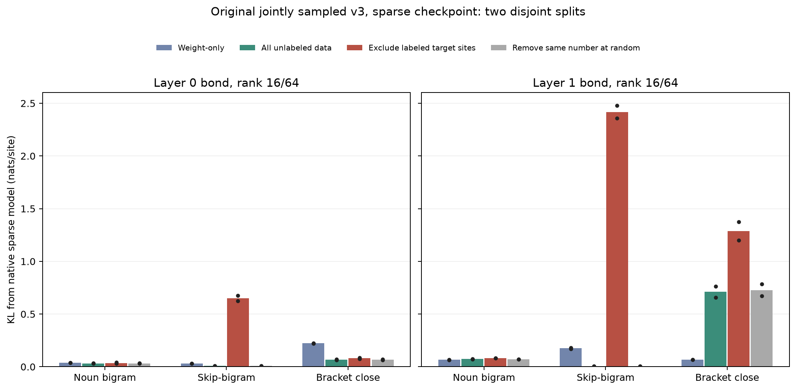
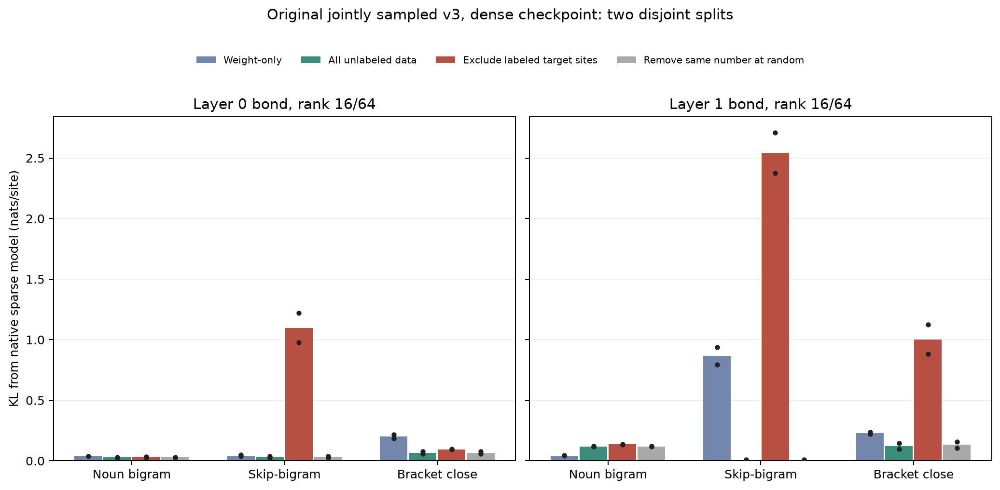
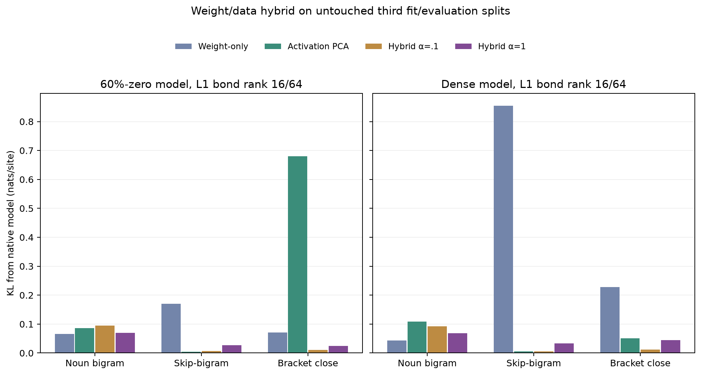

# Joint toy-language bond reduction: weights versus unlabeled data

The [original jointly sampled v3 model](ORIGINAL_V3_SPARSE_RULE_GRAPHS.md) supplies three planted behaviors in one stream: stochastic noun→verb bigrams, deterministic place…adjective→function-word skip-bigrams, and opener…content→closer brackets (labeled `skip_trigram` by the generator). This assay reduces **one 64-coordinate attention-output bond at a time** in the same trained two-layer model. It compares the dense checkpoint and the checkpoint with 60% of attention-projection weights set to zero. Embeddings and output weights remain dense in both.

The weight-only basis is the right-singular-vector basis of that layer's output projection. The data-aware basis is uncentered PCA of **pre-output-projection attention activations**, fitted on 256 sampled streams (32,768 query positions). It uses no rule labels to choose directions. For the exclusion assay, labels only decide which positions are omitted from basis fitting; a matched control removes the same number of positions randomly. Evaluation uses a separate 128-stream sample, with two independent fit/evaluation seed pairs per checkpoint and a third held aside for the hybrid check below. The metric plotted is KL from the unreduced checkpoint's output distribution at each rule site. It measures **function preservation**, not agreement with the DGP oracle. We also save sampled-target cross-entropy and attention-bond reconstruction MSE separately. Every rank-64 basis reproduces native predictions at the selected rule sites to less than 1e-5 nats/site.

At rank 16/64, the key replicated KL values (nats/site) are:

| Checkpoint / bond / rule | Weight-only | All-position PCA | Omit labeled rule sites | Same-count random omission |
|---|---:|---:|---:|---:|
| 60%-zero L0, skip-bigram | .030/.032 | .010/.005 | .625/.675 | .010/.005 |
| 60%-zero L1, skip-bigram | .181/.170 | .004/.006 | 2.357/2.478 | .004/.006 |
| 60%-zero L1, bracket close | .067/.068 | .657/.763 | 1.198/1.376 | .671/.785 |
| Dense L1, skip-bigram | .938/.794 | .006/.008 | 2.709/2.374 | .006/.008 |
| Dense L1, bracket close | .222/.235 | .098/.144 | .882/1.124 | .107/.159 |

The source-rule site exclusions are small: in the first sparse fit, removing all 890 skip-bigram sites or 1,429 bracket-close sites removes 2.7% or 4.4% of positions. Yet skip-bigram KL at L1 jumps from .004 to 2.357 when its sites are omitted, while an equal-count random omission leaves it at .004. The second split and dense checkpoint repeat that pattern. This shows that the compact data-aware basis needs those task-specific activation directions; it does **not** show an unsupervised discovery of the rule or a model-training whole-task holdout. Other positions may still contain information about the omitted rule.

The sparse checkpoint also gives a useful reconstruction-versus-function counterexample. At L1 rank 16, the weight-only basis has **worse** bracket-site bond MSE than all-position PCA (1.33/1.23 versus .39/.35), yet has **better** bracket output fidelity (.067/.068 versus .657/.763 KL). That reversal is **specific to the pruned checkpoint**: in the dense model, all-position PCA is better than weight-only for brackets (.098/.144 versus .222/.235). A single reconstruction score, or a claim that either prior always wins, would miss the task and checkpoint dependence.

At rank 32, most all-position and weight-only rule KLs become small, but omitting skip-bigram sites still leaves L1 skip-bigram KL at .432/1.255 in the two sparse splits. Increasing rank can therefore partly, but not reliably, repair a missing task direction. The [rank-32 plot](results/original_v3_sparse_rule_graphs/multirule_bond_sparse_rank32.png) shows the full comparison.

We also prespecified trace-normalized hybrids with bond Gram matrix $C_\mathrm{data}/\operatorname{tr}(C_\mathrm{data})+\alpha W_O^\top W_O/\operatorname{tr}(W_O^\top W_O)$ for $\alpha\in\{0.1,1,10\}$. After inspecting the first two splits, we checked these settings on an untouched third fit/evaluation split for each checkpoint. At L1 rank 16, $\alpha=1$ kept **all three** selected-rule teacher KLs below .071 nats/site in the sparse model (.070 noun, .027 skip, .024 bracket) and below .069 in the dense model (.068 noun, .034 skip, .044 bracket). The more data-dominated $\alpha=.1$ preserved skip and bracket even better on these splits but raised noun KL to .094/.093. This is a useful empirical fidelity prior, not a proven optimal setting or an interpretable basis.

This is a **local linear bond reduction**, not a canonical tensor decomposition or a sparse human-readable circuit. It does not identify individual QK/OV computations, test causal rule edits, or certify new-task discovery. The next decisive comparison should test whether the hybrid preserves supported rule edits and whether any rotation/sparse factorization of its retained subspace exposes the planted computations on held-out combinations. It should keep prediction, reconstruction, causal fidelity, and rule identification as separate outcomes. A more natural DGP also remains necessary: the v3 grammar is intentionally stylized, and [V10's FineWeb form audit](V10_LINKED_EVENT_DGP.md) is negative.

Run [`eval_original_v3_multirule_bond_bases.py`](eval_original_v3_multirule_bond_bases.py), [`plot_original_v3_multirule_bond_bases.py`](plot_original_v3_multirule_bond_bases.py), and [`plot_original_v3_hybrid_bond_holdout.py`](plot_original_v3_hybrid_bond_holdout.py) to reproduce. The six numerical JSONs and figures are in [`results/original_v3_sparse_rule_graphs/`](results/original_v3_sparse_rule_graphs/).
