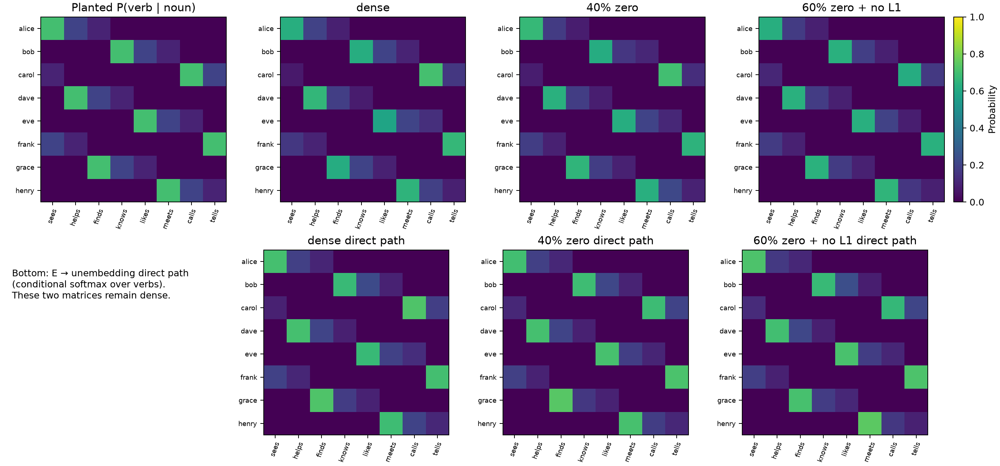
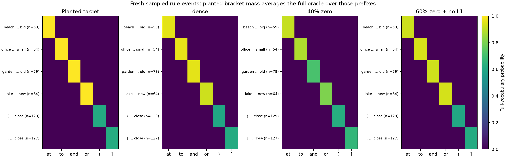
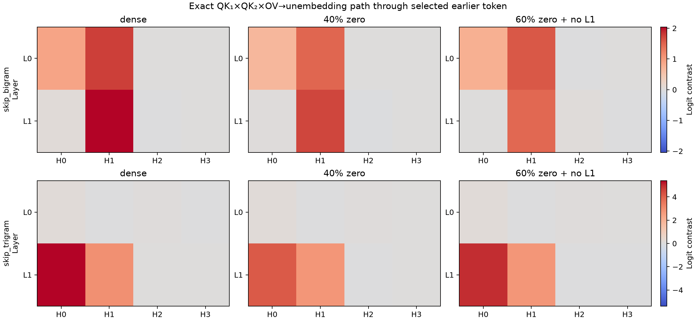
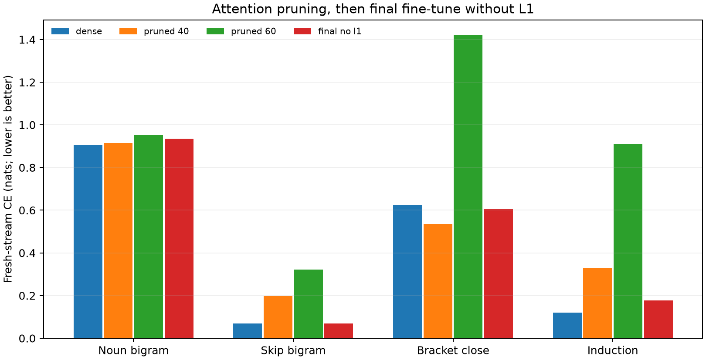

# Joint v3 language with an editable bracket rule

This is a controlled successor to the original jointly sampled `LanguageV3` stream. It keeps the noun→verb bigram table, place…adjective→function-word skip-bigrams, induction, and other v3 rules in the same generator. The sole DGP change is that `(` and `[` now sample their intervening words from the same adjective/noun grammar; the opener still selects `)` or `]`. Swapping only the opener therefore preserves a complete visible prefix that both bracket branches could generate. The label `skip_trigram` in this code means **bracket closing**, not a generic three-word skip rule. Source: [`original_v3_shared_bracket.py`](original_v3_shared_bracket.py).

The [generator audit](results/v3_shared_bracket_audit_seed97001_n4000.json) sampled 4,000 streams of length 129. Of these, 3,792 contained a noun-bigram, skip-bigram, and bracket-close event; 22,992 opener-swap events retained support. Empirical close probabilities after 2, 3, and 4 content words matched the exact visible-prefix oracle of 1/3, 1/2, and 1, after excluding right-censored spans. A second independent 4,000-stream audit agrees. The content-token oracle also passed Monte Carlo checks. These checks establish the generator's internal conditional distribution, not linguistic realism.

A two-layer, four-head, width-64 bilinear transformer trained from scratch for 5,000 steps on the joint stream learned all four monitored behaviors. On two independent fresh panels, CE was 0.885/0.898 for noun bigrams, 0.049/0.051 for skip-bigrams, 0.636/0.600 for bracket events, and 0.124/0.120 for induction. The full bracket next-token oracle KL was 0.013/0.014 nats on original prefixes. Flipping the opener moved probability to the new closer by 0.635/0.606, versus oracle effects 0.641/0.618. The matched 2,000-step one-layer and two-layer runs show the two-layer model has lower full bracket-oracle KL and induction CE; the longer model also changes seed, learning rate, batch size, and steps, so it is not a controlled depth comparison. See [training script](train_original_v3_shared_bracket.py) and [fresh evaluator](eval_original_v3_shared_bracket.py).

## Sparse-weight graphs

The top row compares the planted noun→verb distribution with full-model probabilities on fresh sampled events. The bottom row is the direct embedding→unembedding weight path, conditionally normalized over the eight verbs. The table is clear in this path, but the embedding and unembedding matrices **remain dense** in this experiment. Thus the noun result is weight-visible, not evidence that a sparse attention edge contains the noun table.

The first four rows show the planted skip-bigrams, such as `beach … big → at`; the last two show opener-dependent bracket closing. Those bracket rows show the mean *oracle closer mass given the visible prefixes* (rather than treating every observed closure as a deterministic target). Colors for model outputs are full-vocabulary probabilities. After the no-L1 fine-tune, the 60%-zero attention model regains the four skip-bigram mappings and matches the bracket closer mass closely.

Each cell is the mean contribution of the selected earlier anchor/opener edge to the correct-output logit contrast through the complete signed `QK₁ × QK₂ × OV → unembedding` path, using the trained attention weights and that layer's activations on 256 fresh events per rule. The selected-edge expansion replays the attention output to at most 4.8e-7 absolute error. Skip-bigram paths concentrate in H1 at both layers, especially L1; bracket-close paths concentrate in L1 H0/H1. These are local path readouts, not proof that ablating a head selectively removes a rule. The plotted readout is partly activation-dependent; it is not a data-free canonicalization.

The attention projections contain 49,152 entries. Iterative L1 and global magnitude pruning removed 60% of them (19,661 live); a final 200-step fine-tune with **no L1 penalty** was essential. On the same independent evaluation stream, skip-bigram CE was 0.069 dense, 0.323 immediately after 60% pruning, and 0.069 after recovery. Bracket full-oracle KL was 0.013, 0.438, and 0.017; induction CE was 0.121, 0.911, and 0.177. The opener edit effect was 0.628 dense and 0.634 recovered sparse, against oracle 0.634. A second sparsification seed likewise recovered skip CE to 0.067, bracket KL to 0.019, and induction CE to 0.181; these are two pruning runs from **one trained dense model**, not two independently trained students. [`sparsify_v3_shared_bracket.py`](sparsify_v3_shared_bracket.py) reproduces the protocol, and [`plot_v3_shared_bracket_sparse_rules.py`](plot_v3_shared_bracket_sparse_rules.py) creates the graphs. [First](results/v3_shared_bracket_sparse_seed97801/results.json) and [second](results/v3_shared_bracket_sparse_seed97811/results.json) numerical records and [graph source tables](results/v3_shared_bracket_sparse_graphs_seed97901/summary.json) are saved alongside the images.

The [local bond-prior comparison](results/v3_shared_bracket_bond_modelseed2_seed97501_97502.json) also now has two fresh splits on this stronger model. At rank 16 in L1, a weight-only basis preserves noun teacher KL around 0.01 but loses skip-bigram behavior (KL 0.10); an all-position activation basis preserves skip behavior (KL about 0.01) but damages the bracket oracle (KL 0.28–0.44). A trace-normalized weight/activation hybrid with α=1 keeps noun KL about 0.01, skip KL 0.013–0.019, and bracket-oracle KL about 0.04. This is a useful local compression tradeoff, not a unique function-level canonical form or a sparse model.

The [FineWeb form diagnostic](results/v3_shared_bracket_fineweb_form_n192_seed97201.json) is strongly negative: on 190 matched 100-word windows, repeated-content fraction is 0.594 in this DGP versus 0.155 in the FineWeb panel, and the toy stream lacks questions, colons, newlines, and digits. The shared bracket grammar was designed to repair counterfactual support. It does not make the language naturalistic. Future generator work should broaden surface forms and reduce repetition while retaining exact visible-prefix oracles and planted rule collisions. Future circuit work should test selective ablations of the sparse paths and compare a genuinely weight-only functional decomposition against these activation-dependent graphs.
