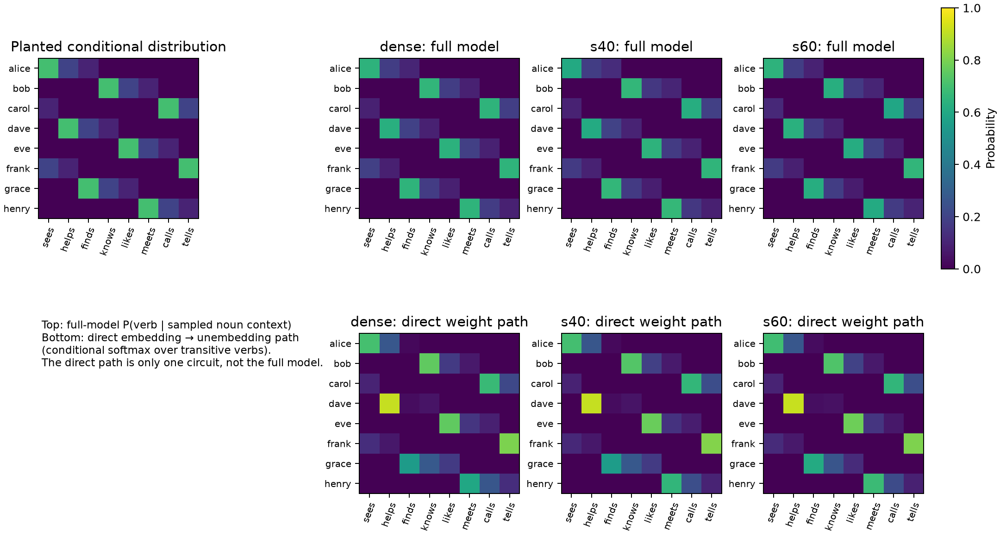
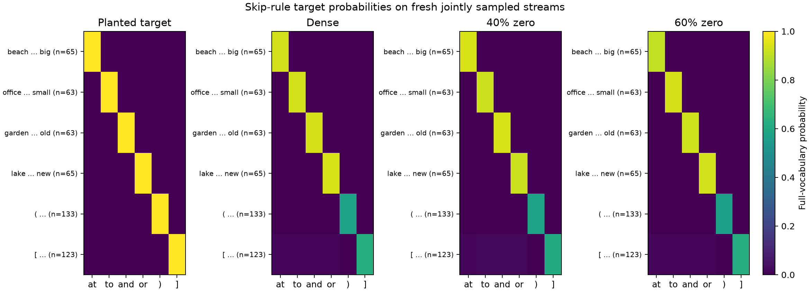
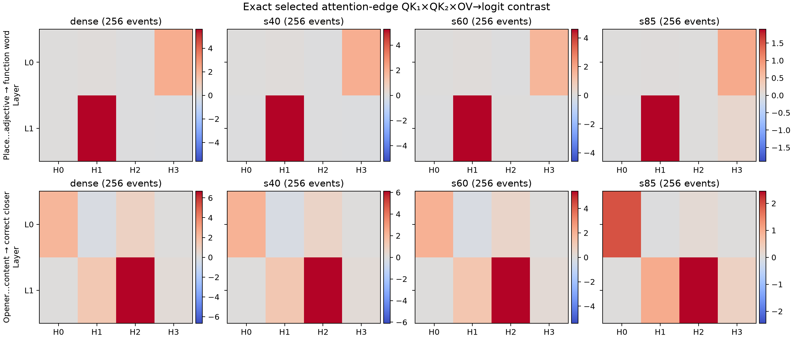
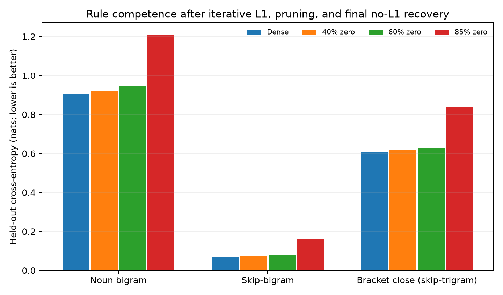

# Sparse-rule graphs for the original jointly sampled toy language

These graphs use the original `LanguageV3` mixed-rule generator and its trained two-layer, four-head, width-64 bilinear transformer. All plots are reproducible with `plot_original_v3_sparse_rule_graphs.py`. They address the concrete question: do the planted bigram and long-range rules appear in a sparse transformer's predictions and weight paths?

The top row compares the planted 70/20/10 noun→verb distribution to full-model probabilities on 1,128 fresh sampled noun-bigram events. The bottom row shows the embedding→unembedding path `E Uᵀ`, softmaxed **only over the eight transitive verbs**. It visibly contains the same noun→verb pattern. This path is not itself sparsified in this experiment: embeddings and unembedding stayed dense. Its presence shows where the original model stores much of the bigram table; it is not a sparsity discovery.

The four skip-bigram rules are `beach … big → at`, `office … small → to`, `garden … old → and`, and `lake … new → or` (the anchor may be up to eight positions back). The generator calls bracket closure `skip_trigram`: `(` followed by content predicts `)`, and `[` followed by content predicts `]`. The plot uses 256 **fresh** examples of each rule family, with per-row counts shown. Colors are unconditioned full-vocabulary probabilities, so 0.6 for a closer means a substantive but incomplete prediction, not a renormalized two-class score. The dense and 40/60%-zero models sharply retain the four place–adjective mappings. Bracket closure is noticeably less certain, already in the dense model.

Each cell is the mean *selected anchor→query edge* contribution to the correct output logit minus competing rule-output logits through `QK₁ × QK₂ × OV × unembedding`, at the actual relative positions with rotary embeddings. These paths are computed from the sparse attention matrices and the layer inputs on fresh streams. For skip-bigrams, the clearest positive readout is layer 1, head 1, with a smaller layer 0, head 3 contribution. For bracket closure, layer 1, head 2 is the strongest positive readout, with a layer 0, head 0 contribution. The selected-edge calculation was checked against full attention-output reconstruction to max absolute error `4.8e-6` over all checkpoints. A layer-0 direct readout is not its total downstream causal effect. Positive path readout alone does not establish necessity; head/edge ablations are a separate next test.

Held-out per-rule cross-entropy, in nats:

| Rule | Dense | 40% zero | 60% zero | 85% zero |
|---|---:|---:|---:|---:|
| Noun bigram | 0.905 | 0.919 | 0.947 | 1.210 |
| Skip-bigram | 0.069 | 0.073 | 0.078 | 0.164 |
| Bracket close (`skip_trigram`) | 0.609 | 0.620 | 0.630 | 0.836 |

The noun rule is probabilistic, with oracle entropy about 0.802 nats. The other two are deterministic conditional on the hidden generator state. The 40% and 60% checkpoints preserve most rule competence, while 85% damages all three. This is **global zero fraction across the 12 attention projection matrices only**, not whole-model sparsity. All checkpoints began with the same dense original model. Each pruning stage used 80 AdamW steps with L1 coefficient `1e-5`, then global magnitude pruning; the 40/60% runs used 320 final masked steps **without L1**, as requested. The 85% control used 160 final steps. Optimization budgets differ, so the 85% result is a stress control rather than a fully matched sparsity frontier.

Prediction plots use 256 independently sampled streams of length 129 (seed 95001); held-out loss uses 512 streams (seed 94003). The original model and generator live under `/home/loganriggs/Coding/toy_models_of_tensor_networks`. Checkpoints, numerical source tables, event counts, and the exact path means are under [`results/original_v3_sparse_rule_graphs/`](results/original_v3_sparse_rule_graphs/). Training results and checkpoints are in sibling `original_v3_sparse40_recovery_seed94001`, `original_v3_sparse60_recovery_seed94001`, and `original_v3_sparse_rule_graphs_seed94001` directories.

What is established: the original jointly sampled model learns visible noun bigram and long-range mappings; a transformer with 40–60% zero attention weights largely retains them; and exact sparse-weight paths identify heads that directly support correct rule outputs. What remains open: whether those heads are causally necessary, whether sparsifying embeddings/unembedding preserves the noun table, and whether these rule-specific paths compose cleanly with other generated tasks. The next DGP version should preserve these planted, jointly sampled controls while integrating additional tasks and auditing rule collisions.
