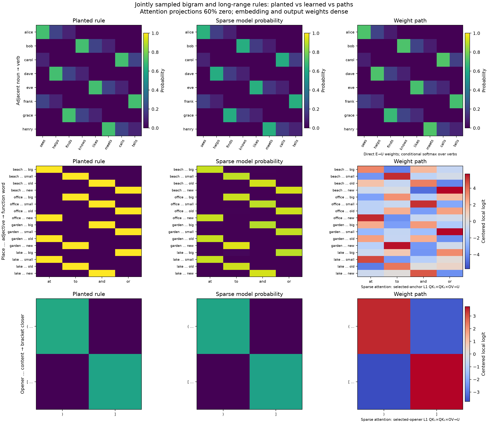

# Grounded toy-language task suite (first pass)

**Current DGP priority:** Build a realistic, variable sampled distribution
with known rules for benchmarking weight-based interpretability. The
[structured-realization screen](STRUCTURED_REALISATION_BANK_AUDIT.md) finds
substantial sentence-level variation in DART and ToTTo, but rejects their
simple concatenation as a coherent document generator. Behavioral checks
gate which rules are eligible for weight analysis; capability is not the
generator's main objective.
The [sports-document source audit](SPORTS_DOCUMENT_SOURCE_AND_SCORE_RENDERER_AUDIT.md)
finds full human-written reports with structured scores and two distinct
writing styles. It also demonstrates severe game leakage across supplied
splits and that reversible score-slot extraction alone does not make a
counterfactual sentence semantically valid.
The [sampled sports-document V1 audit](SPORTS_DOCUMENT_DGP_V1_AUDIT.md)
adds three linked, visible-prefix rules and selective edits. It substantially
reduces repetition relative to the linked synthetic report, but still falls
well short of natural sports reports; no new model or weight result is claimed.
The [V2 discourse-order audit](SPORTS_DOCUMENT_DGP_V2_DISCOURSE_AUDIT.md)
adds game-grouped holdouts and variable placement of score and recap clauses.
It improves repetition near task answers but slightly worsens whole-document
repetition; a source screen shows that natural player-stat sentences usually
need more world facts than a points-only plan provides.
The [V3 stat-richness control](SPORTS_DOCUMENT_DGP_V3_FACT_RICHNESS_AUDIT.md)
adds sampled rebound/assist facts and validates their rendered numbers. Its
small grammar makes whole-document and answer-window repetition worse, so it
is not the improved training distribution.
The [discourse-act and quarter-score audit](SPORTS_DISCOURSE_ACT_AND_QUARTER_AUDIT.md)
finds stable differences between RotoWire and SBNation report sequencing
and validates quarter-score trajectories for about 94% of rows. It supplies
a concrete game-flow world variable for the next multi-rule DGP; its
lexical act labels are proxies, not a semantic oracle.
The [natural sports-report carrier pilot](SPORTS_REPORT_CARRIER_MARGIN_PILOT.md)
samples human report prose under a conservative source-result check, inserts
one controlled score rule, and gets much closer to natural report form.
Higher-exposure models learn held-out score copying from short and long
contexts, while the margin/subtraction variant still fails its paired
behavioral gate. The carrier has only a limited known rule, not a full
symbolic oracle for the human prose.
The [score-copy weight-versus-causal probe](SPORTS_REPORT_COPY_WEIGHT_VS_CAUSAL_HEADS.md)
uses the behaviorally competent long-carrier model. Its direct OV score
finds large candidate heads by magnitude but gives the wrong signed story
for two causally important second-layer heads. This closes the bounded
single-score positive control; it is not a multi-rule circuit recovery.

The [natural-text delimiter model and weight pilot](CORPUS_DELIMITER_MODEL_AND_WEIGHT_PILOT.md)
samples a known paired-punctuation rule inside FineWeb prose. Whole-document
splits, tokenizer-clean paired interventions, and nuisance edits gate a
1–4-block bilinear comparison. Two unnormalized depth-2 models learn a
strong relative closer preference; a data-free QK opener score alone fails
to rank the causally important second-layer heads consistently. This is a
natural-form control, not an oracle for all of the source text.
The [full-path follow-up](CORPUS_DELIMITER_FULL_PATH_COMPARISON.md) compares
QK-only, QK×OV/readout, and final-MLP path scores against held-out causal
head removal across five seeds. It also catches a model where individually
small first-attention head effects conceal a larger whole-layer effect.
The [repeated-phrase opportunity screen](CORPUS_REPEATED_PHRASE_OPPORTUNITY_SCREEN.md)
finds a denser potential document-local copying rule in natural prose,
while showing that broad exact recurrence is too ambiguous to serve as an
entity-identity oracle without further checks.

The [DGP rule-prevalence and weight-recovery pilot](DGP_CONDITIONAL_RATE_WEIGHT_PILOT.md)
tests a controlled 0.10-versus-0.60 conditional-action rate at matched model
training budget. Fresh behavioral edits gate interpretation: only the
high-rate model learned the local rule. Its 60%-zero attention model retains
much of the response after no-L1 recovery, but dense and sparse models already
localize the rule to the same head. This is a mechanism-method pilot on the
still-stylized V14 stream, not a language-realism improvement.

The [joint-document V1/V2 report](JOINT_DOCUMENT_V1_V2_RESULTS.md)
tests one sampled stream containing verb mixtures, induction, sections,
source claims, and brackets. It distinguishes learned bracket closure from
unlearned contrastive source binding, and documents a large FineWeb frequency
and genre gap. `Report`/`Guide` are only title labels in that pilot. The
[hidden-genre V3 pilot](GENRE_DOCUMENT_V3_PILOT.md) adds court, encyclopedia,
procedure, and math as a Bayesian mixture with an exact prefix oracle and
1–4-block bilinear training. It creates persistent probabilistic genre cues,
but still fails the FineWeb lexical-diversity screen and does not establish a
learned source-binding circuit. The older [multi-genre benchmark](MULTI_GENRE_RESULTS.md)
has separate Guide/FAQ/Policy grammars and is also far from natural web text.
The [lexical ceiling audit](GENRE_V3_LEXICAL_CEILING.md) shows that V3's
repeated frame words alone already exceed the FineWeb top-ten frequency share,
so expanding nouns and names cannot repair this fixed grammar.
The [V4 surface-form intervention](GENRE_V4_SURFACE_FORM_TEST.md) adds
paraphrases for profiles, claims, questions, and events while preserving an
exact canonical-prefix oracle. It modestly reduces repeated word pairs but
still fails a separate FineWeb form screen.

For concrete generated sentences, what each task label scores, and the
measured word-frequency gap to FineWeb, see [sampled examples and Zipf
diagnostic](V14_SAMPLED_EXAMPLES_AND_ZIPF.md). The [matched two- versus
four-layer V14 result](V14_DEPTH_COMPARISON.md) shows stronger local-action
learning with depth but still no earlier-fact object binding. The
[tail-variation pilot](V15_TAIL_VARIATION_PILOT.md) is explicitly rejected;
it passed oracle checks but worsened repetition.
The [V16 determiner pilot](V16_DETERMINER_FORM_PILOT.md) changes articles
throughout all six narrative frames and lowers repeated-word frequency on
development and held-out FineWeb comparisons. It overproduces `a` and keeps
the same sentence/layout structure, so it is not adopted as the main DGP.
The [variable-clause core-rule pilot](V3_VARIABLE_FORM_AND_ZIPF_GATE.md)
preserves the exact V3 verb/object oracle across a common shorter sentence
form, but its 48,000-word frequency audit fails the Zipf/realism gate:
the vocabulary tail remains truncated and the top-word concentration grows.
The [document-level FineWeb predictive-rule inventory](FINEWEB_PREDICTIVE_RULE_INVENTORY.md)
works backward from real articles, records, instructions, and narratives
to candidate generative structures: entity aliases, scoped records, and
event updates. Its surface counts are from 64 distinct-source documents;
its task examples are exploratory hypotheses. A fixed [24-document
opportunity screen](results/fineweb_manual_opportunities_skip23000_seed23012_n24.json)
finds entity reuse and source attribution much more often than explicit
numeric or scoped-record problems in the inspected previews. These are
single-annotator opportunities, not measured dependency prevalence.
An [eight-site target red team](results/fineweb_prediction_sites_skip23000_n8.json)
separates visible dependencies, answer leakage, probabilistic cues, and new
facts. A [GPT-2 and bilinear-model prefix-sensitivity pilot](FINEWEB_PREFIX_SENSITIVITY.md)
tests those distinctions on the observed continuations and targeted edits.
The [multisite document pilot](document_world_v3_multisite.py) passes
visible-prefix semantic replay but fails the natural-form lexicon screen;
its [audit](results/document_world_v3_multisite_audit_n3000.json) is a
controlled baseline, not a replacement language stream.
The [interleaved pilot](document_world_v4_interleaved.py) varies the number
and location of its semantic sites and passes the [replay and edit
audit](results/document_world_v4_interleaved_audit_n3000.json), but still
fails the natural lexical-diversity screen; it is also a control.
The [V5 variable-clause document pilot](DOCUMENT_WORLD_V5_CLAUSE_RESULTS.md)
adds sentence and layout variation, trains depth-1/2/4 bilinear models, and
tests immediate versus delayed source retrieval. It improves surface
repetition but remains lexically far from FineWeb. A depth-2 model learns
immediate source retrieval, while delayed source binding fails the current
behavioral gate. Attention-only L1/prune/no-L1 recovery retains much of the
immediate rule at 60% attention sparsity, without clearer head modularity.
The [local bond-basis comparison](DOCUMENT_WORLD_V5_BOND_BASIS_COMPARISON.md)
tests weight-only, unlabeled activation, hybrid, and task-conditioned bases
across two whole-genre basis-fit holdouts on dense and sparse checkpoints.
The [V5 task-rich document mixture](DOCUMENT_MIXTURE_V5_TASK_CONTROLS.md)
combines V14's exact-oracle local rules, event recaps, colliding record
keys, and leaked/unleaked score updates. Its 800-document audit passes
visible-prefix and paired-edit checks, but natural form remains inadequate.
The [V6 whole-combination transfer test](DOCUMENT_MIXTURE_V6_TRANSFER.md)
varies score increments and query team, with disjoint ship/category and
score combinations. Bilinear models fit local action sites but fail the
harder semantic transfer despite similar aggregate token loss. The
[V7 cross-section pilot](DOCUMENT_MIXTURE_V7_CROSS_AND_TRANSFER.md) mixes
variable event reports with the existing narrative, record and score tasks,
then composes source attribution, reviewer assignment and scoped record
lookup in one document. Its audited DGP is somewhat less repetitive but
remains far from FineWeb. Depth-2/4 models learn the local conditional action
and fail the cross rule; a whole-kind basis-fit holdout compares weight-only
and unlabeled bond directions on the learned action.
The [real-text prediction mechanism map](FINEWEB_PREDICTION_MECHANISM_MAP.md)
works backward from eight selected FineWeb previews to distinguish
deterministic constraints, probability shifts, and new facts before the
next DGP revision.
The [random prediction-site pilot](FINEWEB_RANDOM_PREDICTION_SITE_AUDIT.md)
checks that selection effect on 20 mechanically chosen next-word sites and
scores full versus local prefixes with GPT-2 and the 18-layer bilinear model.
The [disjoint longer-document panel](FINEWEB_LONG_TARGET_PANEL.md) selects
ten longer pages before choosing target spans; repeated identities and a
numbered interview show stronger long-prefix sensitivity, with explicit
copy and topic shortcuts recorded for each target.

## Planted rules beside learned sparse-model paths



Read each row left to right: the generator's exact rule, probabilities from a 60%-zero-attention bilinear model on fresh jointly sampled text, and the corresponding weight path. The noun→verb bigram appears in the **direct embedding→unembedding path**, whose matrices were not pruned. The 4×4 place…adjective→function-word rule requires both separated cues; its selected-anchor `QK₁×QK₂×OV` path uses pruned attention projections and recovers all 16 outputs. The bottom row is bracket closing, historically labeled `skip_trigram` in the generator; it is not a generic skip-trigram table. [Individual sparse-path graph](results/v3_crossed_skip_sparse_graphs_seed99301/crossed_skip_sparse_weight_paths.png), [per-pair causal ablations](results/v3_crossed_skip_sparse_graphs_seed99301/crossed_skip_edge_ablations.png), [source matrices](results/v3_crossed_skip_sparse_graphs_seed99301/bigram_skip_bracket_comparison.json), and [full methods and caveats](CROSSED_SKIP_JOINT_DGP_AND_CIRCUITS.md) give the checks behind this visual. The attention paths are exact local logit contributions **conditioned on fresh activations**; the causal ablations separately test their importance. The newer V14 stream below has a different rule set, so this figure should not be read as a V14 result.

**Latest joint-stream capability split:** The [V14 conditional-action report](V14_CONDITIONAL_AND_BINDING.md) adds a local attribute→action continuation to V13 facts. On two untouched panels, the two-layer bilinear model passes the local action prediction-and-edit gate but fails cross-sentence item binding in the same stream. The [comparison graph](results/v14_conditional_reference_depth2_seed3_1000/v14_local_vs_binding.png) separates those outcomes. V14 retains a large FineWeb form mismatch; a lower-punctuation candidate lost rare-task coverage and failed to transfer to a disjoint natural panel. Only the learned local rule is eligible for sparse/canonical circuit analysis.

**Current document DGP:** The [V13 item-attribute report](V13_ATTRIBUTE_BINDING_DGP_AND_MODEL.md) adds visible item attributes that recur in ordinary narrative adjective and object distributions within the same sampled stream. Two independent panels per regime pass exact-prefix replay, named mixture reconstruction, and support-preserving earlier-fact edits; multi-pending facts prevent a simple latest-fact lookup from defining the oracle. A two-layer bilinear baseline trained 1,000 updates on the reference stream but failed its fresh prediction-and-causal-edit gate, so no attribute circuit is claimed. A new FineWeb screen still finds a substantial form mismatch; a 32-document qualitative review found four clear repeated item attributes in short crops, with none matching the full V13 pattern. V13 is a synthetic causal stress test, not a verified realistic distribution. The preceding [V12 item-price/FAQ pilot](V12_PRICE_FAQ_DGP_AND_MODEL.md) likewise failed its price-binding gate even after 100× answer weighting. Interpretation-method tests meanwhile use already competent tasks.

**Crossed skip-rule control:** The [joint crossed-skip report](CROSSED_SKIP_JOINT_DGP_AND_CIRCUITS.md) fixes the original generator's adjacent-adjective shortcut. A 4×4 place×adjective table requires both cues; a two-layer bilinear model learned all 16 mappings and followed supported earlier-place edits on two fresh panels. After 60% attention-weight pruning and no-L1 recovery, the [joint bigram/skip/bracket comparison](results/v3_crossed_skip_sparse_graphs_seed99301/bigram_skip_bracket_comparison.png), [planted-vs-learned table](results/v3_crossed_skip_sparse_final_seed99201.png), [exact sparse-weight path graph](results/v3_crossed_skip_sparse_graphs_seed99301/crossed_skip_sparse_weight_paths.png), and [per-pair causal ablations](results/v3_crossed_skip_sparse_graphs_seed99301/crossed_skip_edge_ablations.png) show the dependencies. The noun bigram's direct embedding→output path remains dense; the skip and bracket paths use sparse attention weights and fresh activations. A [rank-16 bond-prior comparison](results/v3_crossed_skip_bond_priors_rank16_layer1.png) separately shows that all-position, weight-only, and hybrid reductions trade off reconstruction, teacher KL, oracle edit fidelity, and cross-rule preservation; excluding skip sites from activation fitting destroys its low-rank causal response. This is a synthetic mechanistic control; its FineWeb form check is strongly negative.

**Current joint-language sparse graphs:** The [shared-bracket v3 successor](ORIGINAL_V3_SHARED_BRACKET_SUCCESSOR.md) repairs opener-only counterfactual support while preserving the original jointly sampled noun-bigram, skip-bigram, induction, and bracket rules. Compare the planted and learned [noun-bigram table](results/v3_shared_bracket_sparse_graphs_seed97901/noun_bigram_truth_predictions_weights.png), [skip-rule predictions](results/v3_shared_bracket_sparse_graphs_seed97901/skip_rules_truth_predictions.png), [per-rule sparse attention paths](results/v3_shared_bracket_sparse_graphs_seed97901/skip_bigram_sparse_weight_mapping.png), and [bracket-closing paths](results/v3_shared_bracket_sparse_graphs_seed97901/skip_trigram_sparse_weight_mapping.png). The [trigger-only direct path](results/v3_shared_bracket_sparse_graphs_seed97901/skip_trigger_direct_weight_path.png) and [per-row anchor ablation](results/v3_shared_bracket_sparse_graphs_seed97901/skip_bigram_per_row_ablation.png) reveal a DGP flaw: all four skip rules have unique adjacent adjectives, and only one has a causally important selected-anchor edge in the pruned model. The noun direct path remains dense. Bracket opener paths are causally important in sparse attention. This version remains a stylized causal-support repair; its FineWeb form comparison is strongly negative.

**Planted-rule graphs:** The [original jointly sampled model comparison](ORIGINAL_V3_SPARSE_RULE_GRAPHS.md) puts the noun-bigram table, skip-bigram and bracket-closing targets, held-out predictions, and exact `QK₁ × QK₂ × OV` edge readouts from the 40%- and 60%-zero attention checkpoints side by side. In that generator, `skip_trigram` means bracket closing, not an ordinary three-token skip grammar. The noun table is visibly present in the direct embedding→unembedding path, which was **not** pruned; the long-range rules have positive readouts through sparse attention weights. The [rule prediction graph](results/original_v3_sparse_rule_graphs/skip_rule_truth_full_model_predictions.png), [sparse-path graph](results/original_v3_sparse_rule_graphs/skip_rule_sparse_weight_paths.png), and [noun-bigram graph](results/original_v3_sparse_rule_graphs/noun_bigram_truth_predictions_weights.png) are the quickest visual comparison. These graphs are for the original v3 checkpoint; the newer V10 checkpoint has not yet undergone the same pruning protocol.

The [V10 bracket mediation result](V10_BRACKET_MEDIATION_RESULTS.md) tests the dense model's native pre-opener and opener-edge paths on independent fresh panels. It supplies a causal target for the next weight-only, data-weighted, and sparse representation comparison; it is not a sparse V10 result.

The [joint v3 bond-basis comparison](ORIGINAL_V3_MULTIRULE_BOND_BASES.md) now tests weight-only, unlabeled-activation, and trace-normalized hybrid bases across planted noun, skip-bigram, and bracket rules in both dense and 60%-zero checkpoints. Omitting a rule's labeled sites from basis fitting can sharply damage that rule even after matched-count controls; the sparse model also shows a task where better bond reconstruction gives worse output fidelity. On untouched third splits, a rank-16 hybrid preserves all three selected-rule output distributions substantially better than either single prior's worst failure. This is local function-preserving compression, with causal edits and genuine task discovery still open.

The [supported v3 rule-edit follow-up](ORIGINAL_V3_HYBRID_RULE_EDITS.md) now tests noun and skip-rule switches from jointly sampled streams. It finds that the α=1 hybrid's balanced ordinary prediction KL does not imply the best causal response: α=.1 tracks native skip-rule edits more closely. A same-category bracket-content nuisance edit checks spurious sensitivity; v3 cannot support an opener-only bracket swap because its two bracket types have disjoint content categories.

The [nested-bracket joint-rule follow-up](SURFACE_MIXTURE_V2_NESTED_RESULTS.md) adds an exact-oracle bracket dependency without removing the competing verb rules. A one-block bilinear model learns variable-length outer closing and follows grammar-valid opener edits at three distances. Its FineWeb form comparison is strongly negative, and the result establishes a bounded controlled dependency rather than a general stack circuit or realistic prose.

The [nested first-layer source-sufficiency test](NESTED_SOURCE_SUFFICIENCY_RESULTS.md) replays the model's exact QK×OV source contributions and keeps K past positions per head. Score-magnitude K=8 preserves both inner/outer opener edits and verb KL on fresh panels, while K=4 preserves outer closes but breaks inner closes; single-source output-impact ranking does not fix that four-source failure. This is local functional compression, not a canonical named circuit.

The [joint source-search follow-up](NESTED_JOINT_SOURCE_SEARCH_RESULTS.md) repairs most of that K=4 inner-close failure by swapping sources to match the full model on the original prefix alone. The resulting mask transfers to unseen valid opener edits on two independent panels, but remains per-instance and leaves a small verb-KL gap; the next question is whether a fixed basis or learned gate transfers those source combinations.

The [shared token-basis experiment](NESTED_SHARED_TOKEN_BASIS_RESULTS.md) tests that fixed-basis question at the first-layer score function. At rank 8 per head, a basis weighted by unlabeled nested-stream frequencies preserves outer bracket edits on two fresh panels far better than a uniform weight-only basis or a basis fitted without bracket examples. Independent frequency fits recover nearly identical subspaces; the metric determines which behavior survives low-rank truncation, while verb KL and full-circuit interpretability remain separate checks.

The [mode-ablation follow-up](NESTED_BASIS_MODE_ABLATION_RESULTS.md) finds two development-selected, holdout-replicated functional directions in that basis: head-1 key mode 0 is necessary for bracket opener effects while leaving verb-rule edits largely intact, and head-0 query mode 0 is important for verb rules while leaving bracket effects intact. Restricting the first intervention to opener-token key columns reproduces most of its bracket damage. This is a causal score-function decomposition of one checkpoint, with explicit limits on circuit uniqueness and cross-seed transfer.
Random rotations that represent the same complete rank-8 score function spread these causal effects across axes on two additional panels; the weighted eigenbasis concentrates them more than the tested rotations.

The [independent-model replication](NESTED_CROSS_MODEL_REPLICATION.md) trains a second one-block bilinear checkpoint from a new seed. It learns the bracket edits, and the same unlabeled-frequency basis plus development-selected head-1 key / head-0 query modes again separate bracket and verb effects on holdout panels. The effect sizes differ; this remains a result for two models of one controlled grammar, not natural-language circuit recovery.

**Current follow-up:** [`WORLD_RESULTS.md`](WORLD_RESULTS.md) documents the newer latent document-world generator, its 32,000-example oracle audit, 1–4-block and larger-model results, causal-edit tests, final attention-bond gauge experiments, and the measured gap to FineWeb surface statistics. The earlier 12-family suite described below remains a simpler baseline. The document-world v1 has a known indefinite-article error (`a orange`); retain its source with its checkpoints and correct it in a versioned successor.

[`V2_RESULTS.md`](V2_RESULTS.md) follows that versioned successor. It lengthens and repairs the document realizations while preserving the latent-world task, checks oracle/edit/split invariants, and retrains the 1–4-block depth sweep. Select the generator explicitly with `--world-version v1` or `--world-version v2` in `train_world.py`, `validate_world.py`, `eval_world_counterfactual.py`, and `world_bond_gauges.py`.

**Research-direction correction:** [`EXISTING_GENERATOR_BRIDGE.md`](EXISTING_GENERATOR_BRIDGE.md) locates the earlier autoregressive mixed-rule generator and trained tensor-transformers in `toy_models_of_tensor_networks/attn_circuits`. Its competing n-gram, induction, and bracket distributions are the primary sandbox for the intended mechanism-discovery loop. The document-world benchmark is a complementary state-tracking stress test.

The [mixed-rule weight sweep](MIXED_RULE_WEIGHT_SWEEP.md) now changes bigram versus induction weights, retrains matched bilinear models, scores exact-oracle KL across mixtures, and tests fixed-prefix rule-competition shifts and attention-bond compression.

The [conditional mixture experiment](CONDITIONAL_MIXTURE.md) trains one model with an explicit rule-mixture token. It tests a causal tag intervention on fixed prefixes and finds a compact first-layer broadcast contrast that transfers from no-conflict fitting contexts to held-out bigram–induction conflicts, with an exact rank bound and positional controls.

The [weight-only tag-contrast analysis](WEIGHT_ONLY_TAG_CONTRAST.md) derives that first-layer broadcast directly from embeddings, QK products, and tag values over all token-position pairs. A four-direction data-free basis nearly matches contrast PCA on two disjoint conflict panels for both bigram-heavy and induction-heavy tag changes. This is intervention-specified local mediation, not task-blind discovery or full circuit recovery.

The [uncued rule-edit weight-prior test](ENDOGENOUS_EDIT_WEIGHT_PRIOR.md) examines grammar-valid induction and place edits in the six-frame joint language. At the later attention bond, an eight-direction basis from verb-output weights improves induction mediation over generic weight SVD on held-out sentence frames but remains worse than an edit-fitted basis; it fails to help the previous-place rule. First-bond patch controls explain why a tidy local subspace there would not establish the model's full rule computation.

The [joint-rule basis transfer test](JOINT_RULE_BASIS_TRANSFER.md) fits one local basis on several edit families and, separately, leaves each family out of basis fitting. Across two frame splits, pooling known edits can mediate several rules at matched width, but the leave-one-rule-out basis transfers poorly, especially to the previous-place dependency. This gives a concrete whole-rule-family holdout for future shared-dictionary featurizers; current results remain supervised local mediation, not unlabeled rule discovery.

The [shared-group featurizer test](SHARED_GROUP_FEATURIZER_TOY_LANGUAGE.md) fits the existing overlapping dictionary/gate architecture on lexical and induction contexts, then tests the held-out previous-place edit family on two new stream panels. Scalar Top-8 wins both reconstruction and local causal-patch fidelity; an explicit membership-coverage cost fixes atom collapse but not the gap. A matched paired activation-change objective at weights 1 and 5 improves scalar Top-8 more than groups. This bounded negative result keeps the held-out edit family distinct from model-training holdout or genuine new-rule discovery.

The [dependency-proxy audit](DEPENDENCY_PROXY_REALISM_AND_REPEAT_TRADEOFF.md) compares repeat/copy opportunities and bracket spans against the frozen FineWeb development panel. Its raw successor-copy rate was dominated by fixed phrase continuations; conditioning on a lexical successor exposes the tradeoff between lower repetition and induction task density. A new distant-subject-return setting restores most induction cases at longer range. Its matched bilinear model improves long-distance causal verb edits over the original local-repeat model but worsens short-distance edits on two independent panels; aggregate induction error is nearly unchanged. Improving naturalness still requires more varied frames and lexical content.

The [short-to-long featurizer transfer test](INDUCTION_DISTANCE_FEATURIZER_TRANSFER.md) uses that return-model checkpoint at the final attention bond. A full local patch recovers the model's long-distance edit effect, and an eight-direction short-edit basis constrained to a weight-derived 32-dimensional prior transfers across distance, frames, and test streams better than raw weight SVD, activation PCA, or short-response quartimax. The native model remains far from the exact long-range oracle, so this is local model-effect retention, not a recovered rule circuit.

The [readable surface-mixture experiment](SURFACE_MIXTURE_RESULTS.md) introduces a 141-token grammatical stream with four competing verb rules and an exact prefix oracle. It includes a quantitative and manually reviewed FineWeb calibration, 1–4-layer bilinear training, paired causal edits, and attention-bond gauge/truncation tests. Its realism audit still identifies a large gap to web text.

The [proposal alignment](PROPOSAL_ALIGNMENT_2026-11-02.md) distinguishes the original joint-rule interference objective from task-family transfer. The [multi-genre experiment](MULTI_GENRE_RESULTS.md) adds reports, numbered guides, FAQ copying/recall, and conditional policies; it audits an exact prefix oracle, trains 1–4-layer attention-only bilinear models, and tests causal edits and local bond bases with held-out object words. It is still much less diverse than length-matched FineWeb, and its separate genre headers do not replace joint-rule competition.

The [conditional readable-rule experiment](CONDITIONAL_SURFACE_RESULTS.md) keeps competing lexical, induction, lead and place rules in one stream and changes their weights through a visible mode cue. It tests exact fixed-prefix probability shifts, sampled versus oracle-soft supervision, a nearly two-rule control, and local attention-bond mediation. Its principal negative result is that compact cue transmission and low next-token KL do not yet imply the correct context-dependent induction effect.

The [six-frame surface-mixture follow-up](SURFACE_MIXTURE_V2_RESULTS.md) broadens the same joint-rule data-generating process across sentence forms, audits every prefix against its exact oracle, and adds grammar-valid rule-specific causal edits. Its sentence-length distribution is closer to a fixed FineWeb sample, while lexical diversity and naturalness remain far behind.

The [two-site joint-rule follow-up](SURFACE_MIXTURE_V3_RESULTS.md) adds a second contested prediction at object nouns within the same six-frame stream, with adjective bigram, prior-object induction, frame cue, and previous-event proposals. It audits both exact mixtures, trains bilinear models on both, and tests whether verb-trained response directions transfer to the object task. The generated prose remains much less diverse than FineWeb.

The [joint narrative and question follow-up](SURFACE_MIXTURE_V4_RESULTS.md) keeps those two contested prediction sites and adds object-keyed retrieval questions in the same stream. It audits exact answers, harder questions with intervening sentences, surface forms, and supported causal edits. The latest-place shortcut and residual form gap are explicit baselines.

The [joint subject-count follow-up](SURFACE_MIXTURE_V5_RESULTS.md) adds a second question type to that same narrative stream: count how often a named person is the main actor. It preserves the verb/object mixtures and object-place questions, audits the exact count oracle and alternative-key answers, and evaluates count-specific causal edits separately from place retrieval.

The [FineWeb form/task notes](FINEWEB_FORM_TASK_NOTES.md) record a small, form-stratified spot check of the frozen panel and map observed quotes, questions, headings, numbers, aliases, and corrections to proposed exact-oracle task families. This is hypothesis generation, not a prevalence estimate or a claim of realistic synthetic text.

The [inspected FineWeb dependency panel](FINEWEB_DEPENDENCY_PANEL.md) pins 25 cue-selected windows and manually distinguishes actual local source binding, corrections, aliases, numeric updates, and numbered-item scope from regex false positives. It informs the versioned [v6 source-binding stream](SURFACE_MIXTURE_V6_RESULTS.md), which interleaves quoted claims and source questions with the joint verb/object rules; the task-rich sampling rates are deliberately audited against FineWeb rather than presented as realistic prevalence.

The [random-window FineWeb form check](FINEWEB_RANDOM_FORM_PANEL.md) reviews 32 additional windows from the disjoint development panel without selecting on task cues. It shows far more document and parenthetical variety than the six-frame stream; the richer low-rate v8 stream matches some coarse cues but overproduces colons and still lacks parentheses. The [parenthetical-alias experiment](SURFACE_ALIAS_RESULTS.md) implements an alias defined in an aside and later used as a subject of the same lexical/induction collision. Its exact-prefix oracle and paired edits pass audits. A lower-rate setting matches parenthesis frequency on a separate FineWeb panel, but the overall surface still differs sharply from natural text. The trained bilinear pilot partly responds to earlier alias definitions but fails alias-to-canonical-name equivalence; two matched causal-supervision runs worsen both aggregate prediction and edit fidelity. Stronger two-definition curricula and a lexical-dominant softmax control also fail alias substitution. On held-out key-switch pairs, their predictions are much closer to an equal mixture of both referents' verb distributions than to the correct referent's distribution. Swapping alias labels between two definitions almost never changes the lexical-control model despite nearly maximal oracle effect, while reversing definition order also leaves it invariant. This pooled-output shortcut motivated the later same-vocabulary curriculum transfer, whose competent joint-language checkpoint and remaining limitations are reported below.

The [minimal alias-lookup control](MINIMAL_ALIAS_LOOKUP_RESULTS.md) tests whether the architecture can learn keyed binding outside the joint-rule stream. Across five seeds on exhaustive, disjoint splits, two-layer bilinear models average 92.5% accuracy on held-out alias–person pairings, while the matched-shell softmax controls average 35.6%. The bilinear models follow held-out query and alias-label edits far better. This is a capability and inductive-bias diagnostic on an artificial answer-only task; the subsequent same-vocabulary transfer into the joint language is reported below.

The [minimal-alias bond-basis comparison](MINIMAL_ALIAS_BOND_BASES.md) evaluates local weight-SVD, output-weight, activation PCA, intervention-response, random and coordinate bases on those competent bilinear checkpoints. Eight of 64 local weight directions preserve nearly all held-out lookup behavior at the final bond across five seeds, but an output-weight basis does too: the small answer space explains much of that compression. A first-bond weight basis outperforms the output-weight baseline at the same width. Neither result establishes a human-legible binding circuit. The [same-vocabulary curriculum transfer](ALIAS_CURRICULUM_TRANSFER.md) now yields a competent two-layer model inside the joint-rule language, including held-out alias–person pairings, and tests complete-bond mediation and several local basis priors. It remains a one-seed diagnostic rather than recovery of the original proposal's full competing-rule vocabulary.

The [disjoint-panel check](FINEWEB_DISJOINT_PANEL_CHECK.md) repeats the v6 realism audit on new FineWeb token windows and reviews a second cue-selected dependency sample. It finds that matching quote frequency nearly eliminates source-answer examples in short streams, while numbered-item scope remains a clearer natural dependency candidate. The next version should separate natural-rate generation from conditional training of rare, diagnostic tasks.

The [section-scope experiment](SURFACE_MIXTURE_V7_SCOPE_RESULTS.md) adds exact-oracle scoped facts and section-key edits to the joint stream. V7 exposes a double-number surface confound inherited from generic numbered narrative lines; v8 puts headings on their own lines while retaining other numbered prose. Two v7 bilinear pilots, a clean-format v8 bilinear model, and a same-shell softmax-attention control all remain key-blind under causal edits. These checkpoints are not scope circuits to decompose; interpretation work returns to competent tasks.

The [multi-genre token-tensor experiment](MULTI_GENRE_TOKEN_TENSOR_CANONICALIZATION.md) constructs a weight-only first-layer attention function on two competent FAQ-recall models. A full relative-lag table closely replays native logits; per-lag score SVDs compare data-free and Reports/Policy-weighted compression on fresh FAQ/Guide holdouts and causal edits. The data-aware method improves in-fit Policy fidelity but has seed-dependent FAQ transfer, so tensor compression alone is not a recovered rule component.

The [direct singular-mode ablations](MULTI_GENRE_SINGULAR_MODE_CAUSALITY.md) use separate head-selection, rank-hypothesis, and replication panels. In one model seed, removing a weight-only second singular term across relative lags sharply damages FAQ recall while barely affecting Policy or FAQ copying; removing the highest-energy term does not. This is selective causal importance in that trained function, not yet a human-readable or cross-seed-canonical component.

The [sparse-gauge whole-genre holdout](MULTI_GENRE_SPARSE_GAUGE_HOLDOUT.md) fits task-blind activation PCA/varimax, weight bases, and native-coordinate gates on competent three-layer multi-genre models. FAQ and Guide are withheld from featurizer fitting. Activation varimax improves bond sparsity and post-fit axis purity, but native coordinates better preserve held-out FAQ-recall behavior and causal effects in both trained-model seeds.

The [shared-dictionary/group whole-genre holdout](MULTI_GENRE_SHARED_GROUP_HOLDOUT_RESULTS.md) tests scalar Top-K, fixed disjoint groups and learned overlapping groups at that final bond. On two trained-model seeds, group models lose both in-fit Policy fidelity and held-out FAQ causal effects to scalar Top-16; exact downstream KL in the fitting objective does not consistently repair transfer. Native 16-coordinate gates remain the strongest FAQ-recall intervention. This closes the reconstruction-only group sweep at this bond and redirects to multi-rule path-level or causal supervision.

This folder develops explicit, auditable language tasks for training and analyzing 1–4-block bilinear transformers. The immediate goal is **correct data-generation rules** and diverse causal targets. It is not yet a natural-language corpus or evidence that a model learned a human linguistic abstraction. Training uses the original `DeepModel` implementation in [`tensor_language/deep_model.py`](https://github.com/loganriggs/tensor_language/blob/main/deep_model.py): each block has bilinear attention plus a bilinear MLP. We use RMSNorm for numerical stability, so the trained network is not globally polynomial despite its bilinear modules.

For the current joint-rule language with varied determiners and parenthetical asides, see [the exact-rule, realism, training, and causal-edit results](SURFACE_MIXTURE_V2_VARIED_RESULTS.md). The trained two-layer checkpoint is in `surface_mixture_v2_varied_soft_models/`.

The [matched-width basis transfer test](VARIED_JOINT_RULE_BASIS_TRANSFER.md) compares weight-derived, activation, intervention-trained and sparse-rotated directions on that checkpoint with held-out sentence frames and a parenthetical-rate shift. It separates local response compression from recovery of a rule computation.

The [iterated L1/prune transfer test](VARIED_ITERATED_SPARSITY_PATH_RESULTS.md) applies the earlier revert-and-no-L1-finetune protocol to this varied language model. It reaches 14.23% attention-weight density or 37.72% all-linear density at bounded KL, then tests causal edits, head paths, and an exact first-layer token-space QK/OV fold. Weight sparsity does not yet produce comparably legible rule paths.

The [first-layer functional sparsity test](VARIED_FUNCTIONAL_SPARSITY_RESULTS.md) compares a uniform-vocabulary and a generated-data-weighted penalty on the exact QK1×QK2 token-pair function against an ordinary finetuning control. Uniform weighting markedly concentrates scores but sends most of the largest lag-one scores to pairs unseen in held-out generated streams; distribution weighting reduces that failure without revealing a cleaner causal rule circuit.

The [bidirectional head-path patching assay](VARIED_HEAD_PATH_PATCHING_RESULTS.md) locates much of the original model's lexical effect in the first attention block, induction in the second, and previous-place in second-block head 1 across two independent edit panels. Neither score-sparsity arm sharpens these causal assignments.

The [second-layer source and factor assay](VARIED_SECOND_LAYER_SOURCE_CIRCUITS.md) resolves the mixed head further: second-block head 1 reads the edited previous-place token directly, while head 0 (and partly head 1) reads the earlier verb for induction. Counterfactual QK/V swaps distinguish value content from routing and expose a strong multiplicative interaction for the previous-place rule.

The [matched return-distribution finetune](VARIED_RETURN_FINETUNE_RESULTS.md) tests why long-range induction fails despite source localization. Return-focused training strengthens the long-distance causal effect and its source specificity while weakening short-distance effects; a mixed subject distribution gives an intermediate tradeoff. This produces distance-stratified causal targets for later path-level featurizer comparisons.

The [output-aware shared-group test](VARIED_CAUSAL_GROUP_FEATURIZER_RESULTS.md) keeps previous-place interventions out of featurizer fitting. Shared groups still lose to scalar Top-8 under matched active-support budgets, motivating a direct comparison with the original iterative L1-and-prune path analysis.

## What existed, and what this adds

The older repository already has natural-text training (`lm_train.py`), bilinear model code (`model.py`, `deep_model.py`), and analyzed first-layer/late-layer circuits for bracket closure, numbered-list increment, and successor sequences (`basis_aligned/qk_mdl/algo_tasks/SYNTHESIS.md`). The recent canonicalization toys in this repository tested count, XOR, AND, and shared pair routing. These are valuable circuit probes but cover a narrow slice of language. This suite adds 12 explicit task families, balanced sampling, structural variants, oracle checks, FineWeb form audit, and a 1–4-block trainer.

## Current generated tasks

Each example contains an observable prefix, an exact next-token target, alternatives, and a latent world-state record. `variant=0` is for training; `variant=1` changes surface formulation or structure. Inputs are small word-token sequences, not GPT-2 tokens. The target distribution is chosen by the generator, often deliberately balanced, and **does not reproduce FineWeb frequency**.

| Family | Rule determining next token | Main latent dependency | Structural shift |
|---|---|---|---|
| Agreement | Singular subject → `is`; plural → `are` | Head noun number, ignore intervening noun | Relative clause instead of prepositional phrase |
| Reflexive | Matrix subject maps to `himself`/`herself`/`themselves` | Binding across intervening noun | Relative-clause intervener |
| Attribute binding | Answer the color associated with a queried owner | Two name–color records; event order varies | Possessive paraphrase |
| State update | Latest move of the tracked object determines its location | Object identity and last relevant event | Alternative final-state query |
| Numbered list | Next line number is start + number of items | Arithmetic successor and format | Three items instead of two |
| Weekday successor | Next weekday wraps modulo seven | Ordered lexical cycle | Three days instead of two |
| Delimiter stack | Close the remaining outer opening delimiter | Stack, depth, bracket type | Depth three instead of one/two |
| Comparison chain | A > B, B > C implies top/bottom | Transitive order | Alternative query phrase |
| Conditional rule | Apply the matching color→gate-state rule | Rule selection rather than last-token copying | Compressed rule wording |
| Speaker binding | `I` in a quoted report resolves to that report's speaker | Event speaker/action binding | Question-answer phrasing |
| Correction | Later positive location overrides a wrong or old one | Negation or update, then ignore an unrelated object's newer location | Temporal correction instead of explicit negation |
| Role reversal | Active/passive forms preserve agent and recipient | Semantic roles vs linear position | Passive clause instead of active |

The exact sample space and lexical choices are in `grammar.py`. The supervised target is deterministic **within this controlled micro-world**. Some forms are intentionally simplified or awkward (especially possessive paraphrase, delimiter closure, and explicit role labels). Naturalness is a separate measurement; oracle agreement alone does not certify it. The generator also does not implement ambiguity, pragmatics, or realistic lexical frequency.

## FineWeb calibration

`audit_fineweb_surfaces.py` decodes the existing frozen 480 × 513 GPT-2-token FineWeb panel in the older repository and records surface-cue counts in `fineweb_surface_audit.json`. Parenthesis pairs occur in 309/480 windows, quote pairs in 311, pronouns in 421, numbered-list lines in 33, weekdays in 76, and a state-change-verb regex in 110. These windows are **not documents**. In sampled matched contexts, numbered-list hits often were genuine outline items, but weekday hits were commonly dates or travel advice rather than cyclic continuation; `put` often appeared in idioms or instructions rather than entity-state updates; comparative regex hits often lacked the three-entity transitive chain in our toy. Thus the matches do not tell us whether a target dependency is present, unambiguous, or predictable. We use them only to avoid building a suite entirely divorced from web-text forms. A next audit should manually annotate stratified contexts and separate actual syntactic/semantic dependencies from accidental regex hits.

## Literature-guided additions to build next

These are candidate rule families, **not implemented/validated yet**. Each should have an independently testable oracle, minimal contrast, controlled distractors, and held-out compositions.

1. Determiner–noun number agreement and irregular plural morphology.
2. Longer subject–verb dependencies with two or three attractor nouns.
3. Negative-polarity-item licensing (`any`/`ever`) with scope constraints.
4. Filler–gap licensing and extraction islands; requires expert template review.
5. Pronoun antecedent with gender/number cues and explicit ambiguity rejection.
6. Relative-clause attachment and nested clause role assignment.
7. Quantifier scope in a restricted, explicitly scoped grammar.
8. Negation scope over a conjunction or conditional.
9. Cross-sentence coreference and event continuity.
10. Induction/copy of an earlier proper name after a repeated context.
11. Multi-step entity tracking with swap, containment, and irrelevant events.
12. Temporal ordering (`before`, `after`, `until`) and calendar arithmetic.
13. Spatial relations with perspective changes and multi-hop composition.
14. Set membership, exclusion, and intersection in prose.
15. Discourse contrast/correction (`however`, `instead`) with source reliability.
16. Document structure: headings, bullets, nested numbered lists, and references.
17. Quote depth and speaker shifts in dialogue.
18. Morphological derivation and word-sense disambiguation under context.
19. Arithmetic embedded in receipts, inventories, and comparative prose.
20. Simple semantic parsing with held-out noun–verb and structure combinations.
21. World-knowledge-like rules learned within each document, with an explicit rule table.
22. Long-range retrieval from multiple similar facts, with adversarial distractors.

The grammar-focused families are motivated by [BLiMP](https://aclanthology.org/2020.tacl-1.25/) and [targeted syntactic evaluation](https://aclanthology.org/D18-1151/). Compositional splits follow the motivation of [COGS](https://arxiv.org/abs/2010.05465), [SLOG](https://arxiv.org/abs/2310.15040), and [SCAN](https://arxiv.org/abs/1711.00350). Explicit world-state events follow [Entity Tracking in Language Models](https://arxiv.org/abs/2305.02363). Short naturalistic language with inspectable latent structure is also relevant to [TinyStories](https://arxiv.org/abs/2305.07759), but this suite does not reproduce TinyStories. The FineWeb source is described by the [FineWeb paper](https://arxiv.org/abs/2406.17557).

## Validation and training

```bash
PY=/home/loganriggs/Coding/neuron_circuits/.venv/bin/python
$PY language_task_suite/validate.py
$PY language_task_suite/audit_fineweb_surfaces.py
$PY language_task_suite/train.py --depths 1,2,3,4 --steps 1500 \
  --train-n 12000 --test-n 2400 --d-model 48 \
  --train-variants 0,1 --save-models \
  --output language_task_suite/suite_v1.json
$PY language_task_suite/train.py --objective full_lm --depths 3 \
  --train-variants 0,1 --steps 2000 \
  --output language_task_suite/full_lm_pilot.json
```

`validate.py` checks 240,000 generated examples across all 24 family/variant cells: the target belongs to its candidate set, an independent oracle derived from latent state agrees, and no identical prefix receives conflicting labels. This catches rule bugs and ambiguous labels **within the generator**; it cannot establish human plausibility or lack of shallow shortcuts. Training reports full-vocabulary accuracy, candidate-choice accuracy, each family separately, and the second structural variant. Default training supervises only the final answer token; `--objective full_lm` instead supervises all next tokens in each generated sequence. These are different objectives and must not be compared by raw training loss. `counterfactual.py` tests paired causal and nuisance edits for attribute binding, conditional rules, and state updates using saved checkpoints.

The trainer imports the original bilinear architecture from the local `tensor_language` clone. Set `TENSOR_LANGUAGE_REPO=/path/to/tensor_language` if it is not at the default path in `train.py`. The FineWeb audit accepts `--rows` and `--tokenizer` paths for the same reason; its recorded results identify the exact frozen local panel used here.

**Split limitation:** in the first 12,000-example training / 2,400-example evaluation seed, 90.6% of `variant=0` evaluation prefixes exactly appeared in training. This is because several grammars have tiny finite support (e.g. seven weekday prefixes). That score is a fit check, not evidence of compositional generalization. The `variant=1` evaluation has zero exact-prefix overlap with `variant=0` training, but it bundles wording, structure, and sometimes length changes. Future versions need factorial split controls, new lexical combinations, longer event histories, and a genuinely held-out family test.

For the intended interpretability loop, compare models only once they reach substantial task competence. Then examine whether an attention canonicalization or sparse gauge recovers the known causal variables and rule reuse. Evaluate reconstruction, task accuracy, and counterfactual effects separately. Keep entire **families** out of featurizer training to test new-task discovery; the current variant-1 split holds out formulation, not an entire family. Avoid calling a low-loss sparse representation a recovered computation unless it predicts held-out causal interventions.

A first teacher-distillation comparison of a flat two-layer model, sparse projection factors, and four-layer residual students is documented in [SPARSE_DEPTH_DISTILLATION_PILOT.md](SPARSE_DEPTH_DISTILLATION_PILOT.md). It matches absolute attention-edge budgets and tests both held-out teacher KL and rule-edit fidelity. The deeper identity-initialized student's added blocks remain functionally unused, while an actively split four-layer student loses fidelity under the current pruning schedule. This is a pilot of optimization and representation choices, not yet evidence for or against deeper sparse circuits.

A [weight-only sparse-factor follow-up](SPARSE_FACTOR_WEIGHT_FIT_RESULTS.md) first fits sparse projection products without language data, then distills at a fixed mask. It nearly matches the flat sparse model's responses to known verb-rule interventions at the same edge budget, but its largest intermediate units still affect several rules at once. This motivates causal/path-level objectives and a transfer test on the broader verb-and-object language.

The [two-site verb-and-object transfer test](V3_SPARSE_FACTOR_TRANSFER_RESULTS.md) found that weight-fit sparse factors again approach a flat sparse student on teacher KL and valid edits at the same attention-edge budget. One factor coordinate is causally verb-selective on held-out edits, but flat sparse channels can be similarly selective. No evidence yet shows that factorization yields a uniquely simpler or more human-readable circuit.

The [sparse-depth participation test](SPARSE_DEPTH_PARTICIPATION_RESULTS.md) checks whether inserted bilinear attention blocks actually compute at matched attention-edge budgets. Global magnitude pruning deletes them; equal per-projection quotas preserve their physical edges but their causal ablations still have effectively zero output effect. After no-L1 recovery, the four-layer arm loses to the flat control on teacher KL and valid verb/object edits. This closes the current depth-pruning schedule as an interpretability route and motivates explicit task-balanced causal/path objectives.

The [varied-language sparse source-path audit](VARIED_SPARSE_SOURCE_PATH_RESULTS.md) exactly replays second-layer `QK1 × QK2 × V` paths and tests dynamic top-K source selection on three independent valid-edit panels for each of two competent model checkpoints. At four retained positions per head, ranking by effect on known verb outputs preserves the dense model's signed rule-edit effects better than ranking by residual-vector reconstruction or generic vocabulary sensitivity, despite worse vector reconstruction. This is a task-output prior for path selection, not sparse parameters, a unique circuit, or better agreement with the exact generator. The next architecture test should use these path targets to train sparse or factored students while preserving whole-rule-family causal-target holdouts and checking that any added depth contributes functionally.

The [sparse path-transfer pilot](VARIED_SPARSE_PATH_TRANSFER_PILOT.md) tests that next training step on matched 29,491-edge flat and factored students. A teacher-gauge path loss substantially reduces held-out selected-path error, including on a cue-edit family omitted from paired fitting, but does not improve teacher KL or signed causal edit fidelity. This rules out the simple fixed-mask path-matching objective as a demonstrated benefit under the tested setup; do not infer that the selected paths are sufficient or that additional depth has been tested by this pilot.

The [source-sufficiency follow-up](VARIED_SPARSE_SUFFICIENCY_PILOT.md) instead distills the dense teacher's output through only four teacher-selected second-layer sources per head. The complete-source executor replays native logits, but the gated output loss overfits sampled edits and does not consistently improve fresh gated predictions; native rule-edit fidelity worsens in both a short and a larger-data run. This closes the fixed teacher-top-four loss on the varied-language checkpoint and redirects work to broader task coverage and genuinely learned or independently compositional sparse circuits.

The [task-balanced sparse causal-transfer test](V3_SPARSE_CAUSAL_TRANSFER_RESULTS.md) resumes flat and factored fixed-mask students with a loss on teacher probability changes under valid verb/object edits, withholding the entire previous-event object edit family from paired supervision. At coefficients 0.1 and 0.01, supervised-family validation and omitted-family teacher-effect errors are worse than KL-only recovery; exact-oracle effects and aggregate KL show different tradeoffs. The gradient path passes a fixed-batch check, so the next objective needs better conditioning or explicit path-level constraints. This is an edit-supervision holdout, not an unseen model-training task.

The [versioned Catalog retrieval experiment](MULTI_GENRE_V2_CATALOG_RESULTS.md) adds object-keyed two-field records and several question forms to the multi-genre stream. Its exact oracle and four causal edit families pass an independent audit, but 1–4-layer bilinear models, a softmax attention control, and first-answer-weighted training all fail a query-key-blind Bayes baseline and the key-edit test. The task is therefore a useful capability gate, not yet a recovered circuit. Its FineWeb form audit also shows that the enriched synthetic genre remains much less diverse than web text.

The [joint token-pair factorization test](MULTI_GENRE_JOINT_PAIR_FACTOR_RESULTS.md) extends the first-layer attention tensor comparison with a rank-8 weighted fit to actual query–key co-occurrences. It nearly eliminates in-fit Policy model KL, yet does not consistently preserve held-out FAQ recall or its causal edits across two trained seeds. When FAQ is included during fitting, its model KL becomes very small. This separates distribution-specific compression from transferable or human-readable computation.

The [numeric score-report task](NUMERIC_REPORT_RESULTS.md) follows a second random FineWeb dependency review and adds an exact-oracle person–score binding plus magnitude comparison with four causal edit families. Its surface is still far from web text. Attention-only bilinear models at depths 1–4, an answer-weighted control, and a bilinear-MLP control all stay above a binding-blind Bayes baseline and barely respond to score swaps. It is an audited task family, not yet a competent model to decompose.

## Data-generating process to aim for

A more faithful toy language should sample a **latent document**, not merely a final answer token:

1. Draw a domain/genre (instruction page, list, dialogue, story, explanatory article) and a document length from a measured distribution.
2. Draw entities, attributes, event sequence, and discourse relations from an explicit causal world model. Record every state transition and binding edge.
3. Choose a communicative intent and lexicalize the same world graph through multiple sentence and paragraph structures. Permit incidental details, distractors, and genuinely irrelevant sentences.
4. Produce full text and train ordinary next-token prediction as well as targeted rule probes. The full-LM and answer-only objectives should be reported separately.
5. Construct paired worlds that differ in exactly one causal edge, plus matched pairs that alter only a distractor. Evaluate whether model logits and recovered features follow that edge.
6. Validate generated prose by human judgments and by comparing form statistics with a held-out natural corpus. Corpus frequency should influence the sampling mixture, but not overwrite the exact latent rules. A web-text passage with genuine ambiguity must not be assigned a fabricated unique answer.

This separates **competence on the generated micro-world**, **transfer across surface forms**, and **similarity to real language**. The present suite achieves only the first two in a limited way. FineWeb can calibrate genres, token lengths, punctuation, entity mentions, and distractor prevalence; it cannot supply the latent causal graph automatically. For a strong follow-on, annotate a small stratified FineWeb set for the presence/absence of each dependency, then fit these mixture and distractor rates before scaling the synthetic corpus.
