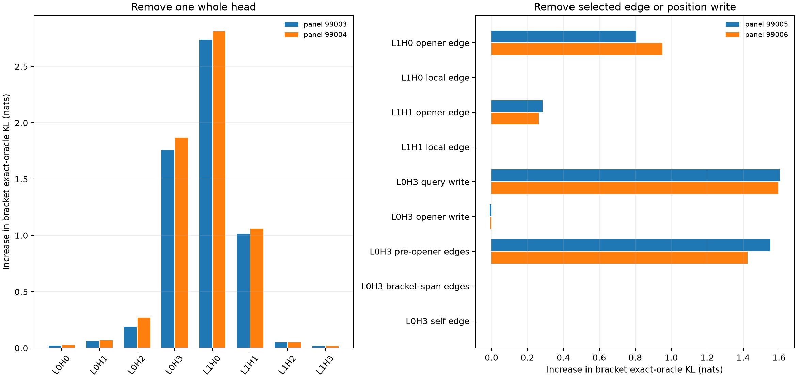

# Two-layer bilinear V10: learned bracket dependency, unlearned source binding

A two-layer, four-head, width-64 bilinear transformer with RMSNorm was trained for 1,000 steps on V10's **provisional lower-rate** sampled stream (batch 32, length 256, seed 1). It used ordinary next-token cross-entropy and no special rule loss. The same DGP rules and vocabulary were used for fresh evaluation; no task family was withheld from model training. The [training receipt](results/v10_linked_depth2_seed1_1000/results.json) and [checkpoint](results/v10_linked_depth2_seed1_1000/model_depth2.pt) are saved.

On two independent 256×256-token panels, the model's exact-oracle KL is about 0.12 nats at bracket-closer sites (395 and 345 sites), versus 2.12–2.13 nats on source answers (88 and 110 sites) and 2.46–2.48 nats at pending-claim object sites (253 and 325 sites). Verb KL is 0.52–0.53 and overall object KL 1.25–1.29. The bracket task is competent; source binding is not.

Supported edits make the separation clearer. Swapping `(` and `[` while keeping the body fixed changes the model's probability of the new closer by **+0.412/+0.409** on the two panels; the exact DGP changes it by **+0.453/+0.464**. Changing a supported source-question key changes the model's new-answer probability by about **0** (`−0.00013/+0.00003`). Changing the earlier claimed object before a related prose object slot likewise produces about **0** model effect (`−0.00010/−0.00009`) against oracle effects of **+0.701/+0.699**. These are supported prefix edits, not arbitrary activation perturbations. Do not interpret a source circuit in this checkpoint. [Fresh panel 1](results/v10_linked_depth2_seed1_fresh99001.json), [panel 2](results/v10_linked_depth2_seed1_fresh99002.json).

Whole-head removal raises bracket KL most for L0H3 (+1.76/+1.87), L1H0 (+2.74/+2.81), and L1H1 (+1.02/+1.06). These are full-model interventions across all positions, so they include downstream effects. Removing only the **opener→closer attention edge** in L1H0 raises bracket KL by +0.81/+0.95; in L1H1, +0.28/+0.26. Removing the adjacent last-content edge in either head changes KL by less than .001. This gives causal evidence that layer 1 retrieves the opener rather than merely reading the final local content token.

The layer-0 role differs. Removing L0H3's write at the **closer query position** raises bracket KL by +1.61/+1.60, but removing its write at the opener position does not hurt. Its own opener, last-content, and self edges at the closer have negligible effects. Removing all L0H3 edges from **before the opener** raises bracket KL by +1.55/+1.43; removing edges inside the bracket span does not. Summing all selected edges reproduces the effect of zeroing L0H3's query-position write. This suggests a query-side contextual signal feeding layer-1 opener retrieval, but the pre-opener region is broad and the experiment does not yet identify its semantic content or a minimal circuit. [Head ablations](results/v10_linked_depth2_seed1_head_ablation99003.json), [replication](results/v10_linked_depth2_seed1_head_ablation99004.json); [edge/position interventions](results/v10_linked_depth2_seed1_opener_edges99005.json), [replication](results/v10_linked_depth2_seed1_opener_edges99006.json).

The [regional and opener-edge mediation follow-up](V10_BRACKET_MEDIATION_RESULTS.md) now finds that the pre-opener L0H3 write is directionally specific, changes L1 opener scores, and has 82–84% of its induced bracket KL damage rescued by restoring the two layer-1 opener-edge vectors. This is a bounded causal target, not a unique circuit. Next compare weight-only versus dataset-weighted decomposition at fixed bracket KL and causal-edit tolerance, then test sparse reparameterization against this native circuit. A low-KL sparse student could compute the same bracket function by a different algorithm; it should not automatically be called a recovered native circuit.

The DGP itself remains a controlled toy. The [V10 form audit](V10_LINKED_EVENT_DGP.md) shows substantial mismatch to FineWeb, and section-to-prose sharing has not yet been added. This checkpoint answers a mechanistic question about a planted bracket rule, not whether the model understands natural-language parentheses.
