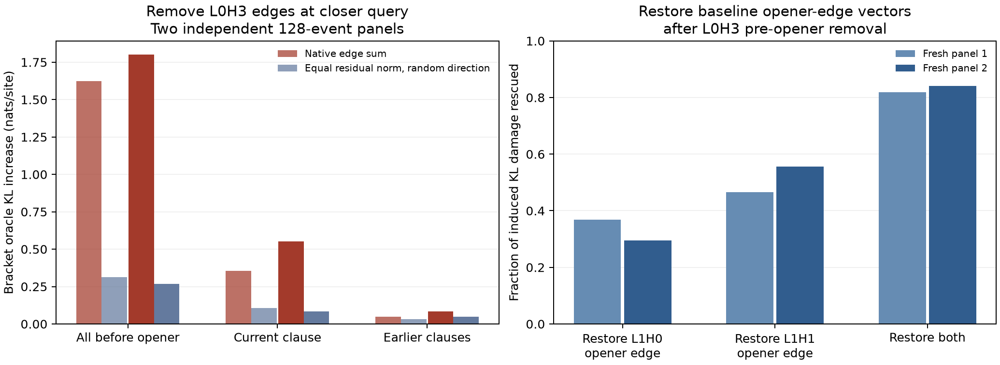

# V10 bracket circuit: regional source and opener-edge mediation

This follow-up uses the [same trained V10 two-layer bilinear model](V10_BILINEAR_BRACKET_CIRCUIT.md), not a newly trained or pruned student. Each assay selects 128 bracket-close events from a fresh 256×256-token panel. The two regional panels use seeds 99007/99008; the two rescue panels use 99009/99010. All interventions occur at the selected closer query and are evaluated against the exact visible-prefix oracle.

For layer 0 head 3 (L0H3), subtracting its exact sum of attention edges **before the opener** raises bracket oracle KL by **+1.62/+1.80 nats/site**. The portion after the most recent period but before the opener causes +0.36/+0.55; earlier clauses alone cause +0.05/+0.08. These effects are not additive because downstream computations and KL are nonlinear. Equal-post-output-projection-norm random directions orthogonal to each native head-space sum cause only +0.31/+0.27 for the full pre-opener region and +0.11/+0.08 for the current clause. Thus the native direction matters beyond its residual-write norm. These random controls are off-manifold, so they do not identify the lexical rule or prove the native intervention is uniquely meaningful.

The regional removal shifts the signed L1H0/L1H1 opener attention scores by approximately **+1.30/−2.11** and **+1.23/−2.27** in the two panels. A more direct path test restores the baseline **opener→closer edge vector** immediately before each layer-1 head's output projection after removing L0H3's pre-opener edges. Restoring H0 alone rescues **37%/30%** of the induced KL damage, H1 alone **47%/56%**, and both **82%/84%**. The paired restoration overshoots the native closer probability (about .59/.60 versus .41/.40) and leaves KL above baseline; the percentage is specific to this intervention and loss, not a complete circuit-recovery score.

The regional and rescue implementations independently reproduce baseline and pre-opener-removal KL on the same seed-99009 panel within **8×10⁻⁸ nats/site**. The regional scripts also match random-direction perturbations by the norm **after** L0H3's output projection. Exact edge sums use both QK factors, the value vector, RoPE, and native model weights; they do not approximate a softmax attention pattern.

This closes the local pre-opener-to-opener-edge hypothesis enough to define a causal target for compression. It does **not** establish which particular pre-opener tokens carry the signal, a minimal or unique bracket circuit, source-binding competence, or behavior in another model seed. The next method comparison should reduce the same model with weight-only and unlabeled-data-weighted priors at matched retained dimension, measuring bracket oracle KL, supported opener-swap fidelity, and this path-specific mediation separately. Only after a faithful reduction should sparse reparameterization be called an interpretation of the native circuit. The original v3 [sparse-rule graphs](ORIGINAL_V3_SPARSE_RULE_GRAPHS.md) remain a distinct baseline; V10 has no sparse checkpoint yet.

Reproduce with [`eval_v10_bracket_region_mediation.py`](eval_v10_bracket_region_mediation.py), [`eval_v10_bracket_opener_rescue.py`](eval_v10_bracket_opener_rescue.py), and [`plot_v10_bracket_mediation.py`](plot_v10_bracket_mediation.py). Numeric results are the `v10_linked_depth2_seed1_region_mediation99007/99008/99009.json` and `v10_linked_depth2_seed1_opener_rescue99009/99010.json` files in [`results/`](results/).
