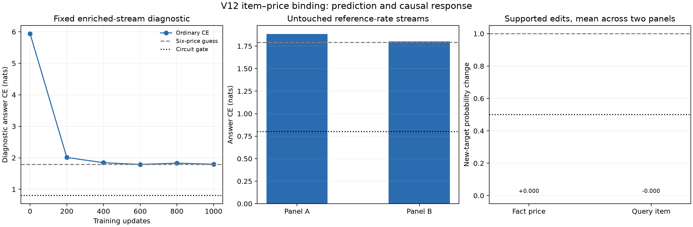
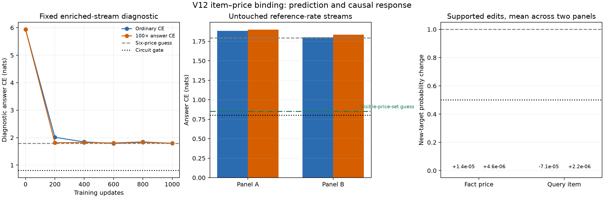

# V12: item facts, ordinary mentions, and cost questions in one stream

The [V12 generator](surface_mixture_v12_price_faq.py) extends V10's
jointly sampled narrative/source/section/bracket stream with item–price facts.
For example, one sampled 256-token stream contains these completed clauses,
with other clauses between them:

> The laptop costs 15 dollars.
>
> Afterward, Sam stores the temporary laptop outside the school after the exhibition because Priya had asked about it earlier.
>
> How much does the laptop cost? Answer: 15 dollars.

The middle ordinary narrative object slot receives a named `priced_item`
mixture component when a completed fact has not yet appeared in prose. The
later question can select any previously priced item, favoring those already
mentioned, and its answer is the item's visible price. Six products and six
prices are sampled without replacement within a stream, so a product's usual
price cannot solve the task. The generator also retains V10's source-linked
prose and question rules, ordinary competing verb/object proposals, and
bracket spans. All choices are made through one exact visible-prefix
`next_distribution`; the generator does not secretly schedule a three-clause
template.

The [audit](audit_v12_price_faq.py) samples two independent 100×256-token
panels per regime. It checks normalization, every sampled token's positive
oracle probability, exact replay of every recorded next-token distribution,
the named object-component sum, exact answers, and support-preserving earlier
fact-price edits. An edit changes the fact's number to one unused elsewhere in
the visible history and checks support at **every** later prefix before the
answer. Query-key edits to another still-answerable item receive the same
support check. Both edits change the exact answer. A separate 100×256 smoke
with the older `How many` count questions enabled found 79 count answers and
38 cost answers with exact replay at every sampled token, so the shared `How`
start correctly forks between the two forms.

| Per 100 streams | Reference 99611/99612 | Enriched 99601/99602 |
|---|---:|---:|
| Any completed price fact | 65 / 67 | 94 / 88 |
| Priced item participates in ordinary object selection | 20 / 31 | 35 / 43 |
| Complete price answer | 4 / 4 | 18 / 27 |
| Fact, ordinary object component, and price answer in one stream | 3 / 4 | 14 / 25 |
| Price answer and bracket close in one stream | 2 / 2 | 7 / 11 |
| Audited priced-object component sites | 24 / 39 | 42 / 52 |
| Support-preserving earlier price edits | 4 / 4 | 26 / 40 |
| Support-preserving queried-item edits | 4 / 4 | 24 / 34 |

The [reference audit](results/v12_price_faq_reference_candidate_n100_l256_seed99611.json)
and [enriched audit](results/v12_price_faq_diagnostic_n100_l256_seed99601.json)
store all counts. These rates are design choices, **not estimates of natural
language prevalence**. The low reference answer density motivates training
on the explicitly enriched stream and evaluating on untouched reference-rate
streams. Training on an enriched process changes the task distribution.

## FineWeb check: broader relation exists, exact template remains synthetic

A [new form screen](compare_v12_fineweb_fresh.py) streamed FineWeb
`sample-10BT` rows 15,000–15,063, disjoint from the earlier cached 7,000 and
11,000 offsets. At the prespecified 100-word cutoff, 59/64 document–toy
pairs were eligible. Question marks were present in 16.9% of FineWeb versus
15.3% of V12 crops, but colons were 39.0% versus 52.5%, parentheses 33.9%
versus 13.6%, and repeated-word fraction in the first 40 words 17.8% versus
26.1%. The [aggregate record](results/v12_price_faq_fineweb_fresh_skip15000_n64.json)
contains hashes of the selected documents, never their prose. Tokenizers and
document lengths differ; these numbers are diagnostic form checks.

A separate [manual review](review_v12_fineweb_dependencies.py) selected 16
of those 64 documents without using text cues. In the first 160 words,
7 showed a visible field–value relation and 8 a numeric binding. Examples
included a product pack with a template count and print resolution, and a
listing with a price and mileage. **None** contained V12's exact
item-price → intervening ordinary mention → later cost-question sequence in
the crop. The [coded review](results/v12_price_faq_fineweb_dependency_review_n16.json)
does not establish the sequence is absent from the corpus; it does show why
V12 should be treated as a causally auditable synthetic stress test, rather
than a realistic model of document frequencies or prose.

## Model gate

The [resumable trainer](train_v12_price_faq.py) uses a two-layer, four-head,
width-64 bilinear transformer with RMSNorm and ordinary next-token CE on the
enriched joint stream. A CPU interrupted-versus-uninterrupted four-step check
matched final weights exactly. The [fresh evaluator](eval_v12_price_faq_model.py)
will score both enriched and reference-rate streams, including exact price
answer CE, earlier-price edits, and query-key edits. Its smoke test passed
support checks; the untrained model appropriately failed the causal task.
The prospective circuit gate is price-answer CE below 0.8 nats and mean
new-target probability response above 0.5 for **both** earlier-price and
query-key edits on each of two untouched reference-rate panels, with at
least 30 edited answers per panel. No circuit or sparsification
interpretation should be attempted until the trained model passes this gate;
if a 512-stream panel is too sparse, increase the panel size rather than
relaxing the threshold. An **unconditional** six-price product-only guess
has CE `log(6)=1.79` nats; a guess restricted to the set of prices already
visible in the document is a stronger non-binding control.

The ordinary-CE seed-2 run finished 1,000 updates. Its fixed diagnostic
price-answer CE went from 5.94 at initialization to 1.80 nats, essentially
the six-price guess. On two **untouched** 1,024-stream reference-rate panels,
the answer CE was 1.884/1.801 nats across 68/65 answers. The mean
new-target response to an earlier fact-price edit was -0.00002/+0.00004;
to a queried-item edit it was +0.00014/-0.00028. The exact oracle response
is 1 for both edit types. The model therefore **fails the prospective
circuit gate** decisively, even though its ordinary verb and object losses
improved. A latest-fact heuristic achieved only 33.8%/30.8% on these panels,
but the model's near-zero edit response gives no evidence it implemented
that heuristic either. See [training record](results/v12_price_faq_depth2_seed2_1000/results.json),
[fresh panel A](results/v12_price_faq_depth2_seed2_1000/fresh_panel_99701.json),
and [fresh panel B](results/v12_price_faq_depth2_seed2_1000/fresh_panel_99711.json).

Replaying those two generator panels gives a stronger non-binding control:
guess uniformly among the **visible price values**. Its CE is 0.844/0.860
nats across the same 68/65 answers, still without identifying the queried
item. The model's 1.884/1.801 CE is worse than that control. The evaluator
now records this baseline explicitly; the published first-pass JSON above
predates that extra field, so it should not be mistaken for a new model run.

A matched answer-weighted arm used 100× loss on `price_answer` positions
with the same seed, architecture, generated minibatches, and number of
updates. It tests whether this simple supervision increase is sufficient
without changing the task distribution or model capacity. No V12 price
circuit analysis follows from the ordinary-CE run.

That arm is now complete. The first GPU process faulted after its saved
step-0 checkpoint; a CPU step-0 interrupted/resumed check matches an
uninterrupted run with **zero weight difference**. The resumed GPU training
record contains two identical step-0 diagnostics and then the planned
200–1,000 updates. On the same untouched panels:

| Objective, panel | Price-answer CE | Earlier-price edit response | Queried-item edit response |
|---|---:|---:|---:|
| Ordinary CE, A | 1.884 | -0.00002 | +0.00014 |
| 100× answer CE, A | 1.899 | +0.00001 | +0.000004 |
| Ordinary CE, B | 1.801 | +0.00004 | -0.00028 |
| 100× answer CE, B | 1.834 | -0.000002 | +0.000001 |
| Visible-price-set non-binding guess | 0.844 / 0.860 | — | — |
| Exact oracle | 0 | 1 | 1 |

The [plotter](plot_v12_price_faq_learning.py), [weighted training record](results/v12_price_faq_depth2_weight100_seed2_1000/results.json),
and [weighted fresh panels A](results/v12_price_faq_depth2_weight100_seed2_1000/fresh_panel_99701.json)
and [B](results/v12_price_faq_depth2_weight100_seed2_1000/fresh_panel_99711.json)
preserve the comparison. At the last fixed diagnostic, weighted versus
ordinary CE was 1.793 versus 1.796 on price answers; weighted mixed-verb CE
was 1.745 versus 1.770 and mixed-object CE 2.618 versus 2.656. So this
weight did not simply destroy the other measured tasks, but it also did not
produce binding. One coefficient, one model seed, and 1,000 steps do not
prove supervision cannot work; they rule out this simple fix at the tested
budget.

**Stop the V12 price-only circuit and loss-weight sweep here.** Neither
checkpoint meets the preregistered competence or edit gate, so their
attention paths would be descriptions of a failed behavior. The next DGP
experiment should broaden the sampled document task mix toward the
field-value, numeric, entity-tracking, attribution, and conditional
relations observed in the new FineWeb review, with less templated FAQ
frequency and stronger lexical/sentence variation. For interpretation
methods in the meantime, use the already competent joint crossed-skip and
multi-genre FAQ/place-recall models, with task-family featurizer holdouts
and separate reconstruction, prediction, causal fidelity, and new-task
discovery measures. This is a course correction toward the original goal,
not a claim that V12 is a realistic language model.
