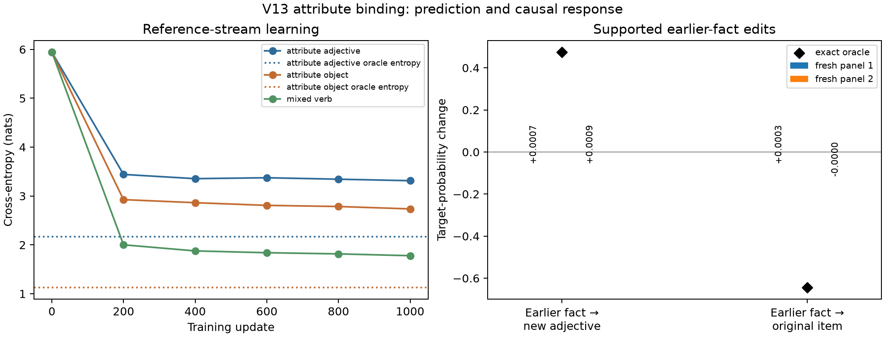

# V13: item attributes reused in ordinary prose

The [V13 generator](surface_mixture_v13_attributes.py) adds an item–attribute
relation to the existing single sampled stream. It keeps the V12 price facts,
V10 source/prose linking, ordinary competing verb and object rules, section
forms, and bracket spans. A sampled stream can contain:

> The tablet is broken.
>
> In the lobby Carol saves the broken tablet after the tour because Abigail had asked about it earlier in the farm after the protest and wanted a written record.

The first fact is completed before it affects the ordinary narrative. At an
adjective slot, the oracle mixes a base adjective distribution with the
attributes of **all** visible item facts not yet reused in a description. At
the following object slot, if the sampled adjective matches one of those
attributes, the corresponding item gets an extra named proposal mass. The
six attributes are assigned without replacement to six items, so a fixed
attribute→item lookup across documents does not solve this binding. The
generator uses visible completed clauses only, no hidden plan for a later
answer. It exposes the exact next-token distribution at every prefix.

The first draft chose only the latest unfinished fact. That created a
recency shortcut; it was stopped at step zero before model training and
replaced by the all-pending mixture. The current version contains genuine
multi-pending sites and must be distinguished from that abandoned draft.

## DGP audit

The [audit](audit_v13_attributes.py) checks every sampled token's support,
normalization, exact oracle replay, reconstruction of the named object
proposal mixture, and earlier-fact edits. For an edit, it changes an item's
attribute to one unused in the visible history, verifies every intervening
token remains in support, and compares the edited next-token distribution.
The adjective target response is exactly `attribute_adjective_mass / number
of pending facts`; an earlier attribute edit removes the corresponding object
boost when the later adjective is held fixed. Counts from two independent
100×256 panels per regime:

| Per 100 streams or sites | Reference 99621 / 99622 | Diagnostic 99631 / 99632 |
|---|---:|---:|
| Streams with attribute fact and descriptive-object reuse | 61 / 67 | 94 / 95 |
| Streams with attribute-object reuse and bracket close | 31 / 31 | 50 / 34 |
| Attribute adjective sites | 232 / 227 | 438 / 372 |
| Adjective sites with multiple pending facts | 68 / 51 | 182 / 142 |
| Attribute object sites | 151 / 137 | 340 / 299 |
| Object sites with multiple pending facts | 51 / 30 | 142 / 117 |
| Supported earlier-fact adjective edits | 225 / 222 | 392 / 346 |
| Supported earlier-fact object edits | 146 / 135 | 305 / 279 |

Some sites have all six attributes already assigned, so no unused replacement
exists; those are excluded from the supported-edit count, not failed edits.
The [reference](results/v13_attributes_reference_n100_l256_seed99621.json)
and [diagnostic](results/v13_attributes_diagnostic_n100_l256_seed99631.json)
JSON record the full counts. Diagnostic rates deliberately increase fact and
reuse density; they are not a natural-frequency estimate. A V12 regression
smoke still passes after its price-state parser was taught to ignore V13's
different `The … is …` fact.

## Natural-language check

A [fresh FineWeb form screen](compare_v13_fineweb_fresh.py) used 64
prespecified `sample-10BT` documents at stream offset 16,000, disjoint from
the earlier 7,000, 11,000, and 15,000 panels. Fifty-five 100-word document
and toy crops met the matched-length requirement. Colon presence was 63.6%
toy versus 32.7% FineWeb; quote presence 43.6% versus 18.2%; repeated-word
fraction in the first 40 words 25.7% versus 16.4%. The form mismatch remains
substantial. See the [aggregate and source hashes](results/v13_attributes_fineweb_skip16000_n64.json).

A separate [one-annotator review](review_v13_fineweb_dependencies_n32.py)
took two successive uniform 16-document draws from those 64 documents,
without text-cue filtering, and examined at most the first 160 words of
each. Of 32 short crops, 13 contained broad item-attribute descriptions;
four clearly repeated an attribute of the same item later in the crop.
Numeric binding appeared in 18, entity tracking in 20, conditional action
in 10, and an explicit question/answer in one. None showed V13's full
multiple-pending-facts followed by descriptive reuse pattern. These
overlapping qualitative tags are not estimates of exact next-token target
prevalence. The broader relation is present in natural text, but **V13
remains a synthetic causal stress test, not a verified realistic language
distribution**. The [coded review](results/v13_attributes_fineweb_dependency_review_n32.json)
exports notes and hashes, no source prose. The [initial 16-crop review](results/v13_attributes_fineweb_dependency_review_n16.json)
is retained for reproducibility; it is included in the 32, not a separate
sample.

## Bilinear baseline and next gate

The [resumable trainer](train_v13_attributes.py) completed 1,000 updates of
a two-layer, four-head, width-64 RMSNorm bilinear LM on the **reference**
stream, using ordinary next-token cross-entropy. One transient GPU exit 139
occurred after step 200; training resumed from its verified optimizer,
generator-RNG, and Torch-RNG checkpoint. A separate four-step CPU
split-versus-uninterrupted check matched final weights exactly. The saved
[training record](results/v13_attribute_binding_reference_depth2_seed3_1000/results.json)
has steps 0, 200, 400, 600, 800, and 1,000 exactly.

The [fresh evaluator](eval_v13_attribute_edits.py) scored two untouched
512-stream reference panels and two diagnostic panels. It stratified edits
between single-pending and multi-pending cases, so each reference panel has
64 multi-pending object edits among 128 supported object edits.
The prospective gate for **attribute-binding circuit analysis** is object
CE at most 0.5 nats above the exact-oracle entropy and mean absolute
earlier-fact object-edit effect error at most 0.25, on each of two untouched
reference panels with at least 50 multi-pending edited cases per panel.

| Untouched reference panel | Object CE / oracle entropy | Model object-edit response / oracle | Object-edit effect error |
|---|---:|---:|---:|
| 99721 | 2.763 / 1.129 | +0.00029 / −0.646 | 0.646 |
| 99731 | 2.738 / 1.132 | −0.000007 / −0.641 | 0.641 |

Adjective CE is 3.211/3.243 versus oracle entropy 2.171/2.159, and its
earlier-fact edit response is +0.00068/+0.00091 versus oracle
+0.472/+0.476. The separate diagnostic-regime panels show the same
near-zero response despite denser facts. Ordinary mixed-verb CE continued
improving to 1.778 on the fixed training diagnostic, so the model did learn
some of the overall stream. See [panel A](results/v13_attribute_binding_reference_depth2_seed3_1000/fresh_panel_99721.json)
and [panel B](results/v13_attribute_binding_reference_depth2_seed3_1000/fresh_panel_99731.json).

**The V13 model fails both parts of the prospective attribute-binding gate.**
The fact-edit effect is essentially absent; no sparse or canonical
attribute circuit should be inferred from this checkpoint. This is one
architecture, seed, ordinary-CE objective, and 1,000-update budget, so it
does not show that the DGP is unlearnable. It does show that simply adding
this relation to a crowded reference stream has not produced a competent
teacher for the interpretation-method comparison.

The next DGP experiment should use the reviewed relation mix—numeric
bindings, conditional actions, entity tracking, and attribute descriptions—
with more varied sentence and document forms. A small, explicitly enriched
binding control could test learnability, but do not extend this single-task
model sweep without a concrete gain in supervision or diagnostic power.
For canonicalization and sparse-featurizer comparisons now, use the already
competent crossed symbolic control and the FAQ/place-recall teacher; keep
whole-task featurizer holdouts and distinguish reconstruction, teacher
prediction, oracle causal fidelity, and genuine new-task discovery.
