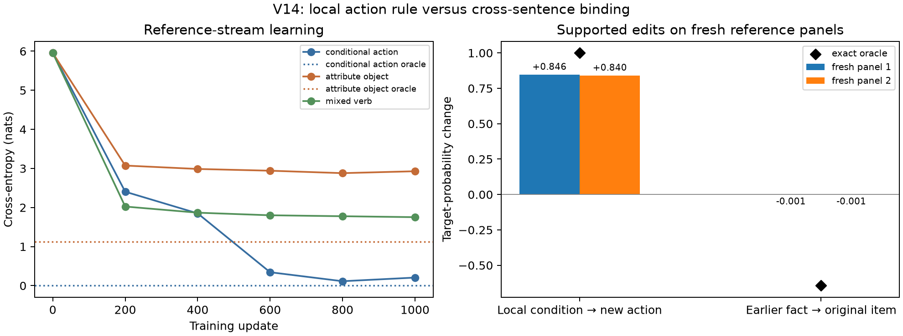
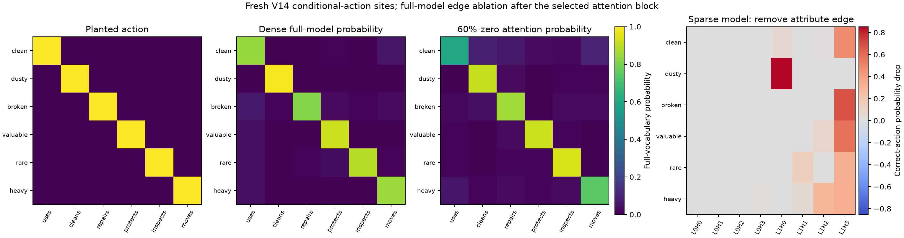

# V14: conditional actions and earlier-fact binding in one sampled stream

The [V14 generator](surface_mixture_v14_conditional.py) extends V13's visible
item–attribute facts with a conditional continuation. For example:

> The package is clean, so Isaac uses it.

The action follows an exact attribute→action rule. The completed clause also
enters the visible item–attribute fact state, so later ordinary narrative
descriptions can reuse it. V14 retains the same sampled price, source,
section, mixed verb/object, and bracket families. The local action should be
easier than cross-sentence item binding; a model can learn one without the
other. The two must be scored separately.

## Oracle and counterfactual audit

The [V14 audit](audit_v14_conditional.py) replays the full V13 exact-prefix,
fact-start mixture, named object-component, and earlier-fact edit checks on
the V14 stream. It also checks every conditional action against the explicit
mapping and tests a supported local edit of the attribute before the action.
For a **later** description, editing an earlier conditional fact requires
repairing its already written action; otherwise the edited document is
outside the generator's support. The audit records these linked two-token
repairs separately from single-token conditional edits.

| Per 100 streams/sites | Reference 99641 / 99642 | Diagnostic 99651 / 99652 |
|---|---:|---:|
| Streams with conditional action | 46 / 35 | 64 / 60 |
| Conditional action sites | 64 / 43 | 107 / 100 |
| Supported local action edits | 64 / 42 | 105 / 96 |
| Conditional action and attribute-object reuse in one stream | 41 / 30 | 64 / 57 |
| Attribute-object sites with multiple pending facts | 40 / 32 | 119 / 107 |
| Linked conditional repairs in inherited later-fact edits | 160 / 113 | 207 / 195 |

The [reference](results/v14_conditional_reference_n100_l256_seed99641.json)
and [diagnostic](results/v14_conditional_diagnostic_n100_l256_seed99651.json)
records include all normalization, replay, fact-kind, collision, and edit
counts. The diagnostic rates intentionally oversample relation sites.
These are synthetic choices. A [fresh form screen](compare_v13_fineweb_fresh.py)
used FineWeb `sample-10BT` offset 17,000, disjoint from earlier panels. In
58 matched 100-word windows, colons occurred in 56.9% of V14 crops versus
25.9% of FineWeb, and repeated-word fraction in the first 40 words was
.273 versus .166. The [aggregate record](results/v14_conditional_fineweb_skip17000_n64.json)
contains hashes, not source prose. The V13 32-crop review motivates
conditional actions as a broad relation (10/32 crops) but does not validate
this exact sentence or rate. **V14 is still not naturalistic.**

An [exploratory layout sweep](sweep_v14_form_coverage.py) then reduced
numbered-line, quote, question, and section rates while leaving the new
attribute/conditional rule unchanged. On the same offset-17,000 development
documents, this reduced toy colon presence from .569 to .241, near the
FineWeb .259. But the repeated-word fraction remained .284 versus .166,
and source-answer sites in 64 full toy streams fell from 20 to 5; scope
answers fell from 1 to 0. The candidate was fixed before scoring a disjoint
offset-18,000 FineWeb panel with an independent toy seed:

| Offset 18,000, 58 matched windows | FineWeb | V14 reference | Prose-heavy candidate |
|---|---:|---:|---:|
| Colon presence | .431 | .500 | .103 |
| Repeated-word fraction, first 40 | .169 | .272 | .272 |
| Source-answer sites in 64 toy streams | — | 16 | 1 |
| Conditional-action sites in 64 toy streams | — | 29 | 33 |

See the [development](results/v14_layout_tradeoff_dev_skip17000_n64.json)
and [held-out](results/v14_layout_tradeoff_holdout_skip18000_n64.json)
records. This is a form diagnostic, not a statistical corpus-matching test:
the two natural panels differ, and 64 toy streams give noisy rare-task
counts. The reduced-layout candidate is **not adopted**. It removes task
coverage without repairing repetition or robustly matching punctuation.

## Model comparison and gates

The [small-model trainer](train_v13_attributes.py) accepts `--generator v14`
and trains a two-layer/four-head/width-64 RMSNorm bilinear LM with ordinary
next-token CE on the V14 reference stream. On two untouched reference panels,
the **local action** gate is conditional-action CE below 0.5 nats and mean
new-action probability response above 0.5 under supported local attribute
edits, with at least 50 edit cases per panel. The **cross-sentence binding**
gate remains attribute-object CE at most oracle entropy+0.5 and earlier-fact
object-edit mean absolute effect error at most 0.25, with at least 50
multi-pending edit cases per panel. These gates are set before inspecting
the trained V14 model.

The 1,000-update reference-stream run completed with saved diagnostics at
steps 0, 200, 400, 600, 800, and 1,000. Its four-step CPU
interrupted-versus-uninterrupted control matched final weights exactly.
The [training record](results/v14_conditional_reference_depth2_seed3_1000/results.json),
[checkpoint](results/v14_conditional_reference_depth2_seed3_1000/model.pt),
and two untouched 512-stream [fresh panels A](results/v14_conditional_reference_depth2_seed3_1000/fresh_panel_99741.json)
and [B](results/v14_conditional_reference_depth2_seed3_1000/fresh_panel_99751.json)
give the result:

| Reference panel | Conditional-action CE | Local new-action edit response | Attribute-object CE / oracle entropy | Earlier-fact object edit response / oracle |
|---|---:|---:|---:|---:|
| 99741 | 0.185 | +0.846 | 2.823 / 1.130 | −0.00073 / −0.647 |
| 99751 | 0.189 | +0.840 | 2.828 / 1.126 | −0.00073 / −0.641 |

Each panel has 128 supported local edits and 128 supported object edits,
including 64 multi-pending object edits. The independent diagnostic-regime
panels show the same qualitative split. Adjective prediction is partial:
reference CE2.522/2.528 versus oracle entropy2.164/2.154, with
earlier-fact adjective-edit response +.258/+.247 versus oracle +.477/+.482.
The object binding remains absent despite this partial set tracking.

**The local conditional action passes its prespecified prediction and edit
gate on both panels; cross-sentence item binding fails both parts of its
gate.** This supports a narrow mechanistic next step: test whether pruning
or canonicalization exposes the learned condition→action computation while
preserving its causal edit response. Stop that branch if a sparse candidate
cannot preserve the local gate at a clearly smaller connection budget;
do not reinterpret the failed historical binding as learned. A local mapping
is not evidence of reusable computation across the other task families.

## Bounded sparse-weight follow-up

The [sparsification run](sparsify_v14_conditional.py) starts from the
competent dense checkpoint. It applies two 80-update L1/magnitude-pruning
rounds to the attention projection matrices (40%, then 60% zero), followed
by 200 masked recovery updates **without L1**. Embedding, unembedding, and
norm weights remain dense. At 60% attention sparsity, 19,661 of 49,152
attention connections remain; total live parameter connections fall from
98,752 to 69,261. The stage-boundary checkpoint/resume control matched
uninterrupted CPU weights and masks exactly. The [stage record](results/v14_conditional_sparse_seed99441/results.json)
shows conditional-action CE .214 dense, .198 at 40% zero, 1.877 just after
60% pruning, and .213 after no-L1 recovery on one fixed diagnostic panel.
These stage scores were not the final gate.

On the two untouched 512-stream reference panels used for the dense model,
the recovered sparse checkpoint has conditional-action CE **.239/.226** and
supported local attribute-edit response **+.735/+.740**, versus dense
**.185/.189** and **+.846/+.840**. Each panel includes 128 local edits; the
sparse model passes the prespecified CE<.5 and response>.5 gate on both,
although its causal response is materially weaker. Historical object
binding remains absent: sparse object CE **2.820/2.817** versus oracle
entropy **1.130/1.126**, and its earlier-fact edit response is near zero
(−.00099/−.00014 versus oracle −.647/−.641). The [fresh panel A](results/v14_conditional_sparse_seed99441/fresh_panel_99741.json)
and [B](results/v14_conditional_sparse_seed99441/fresh_panel_99751.json)
also include diagnostic-regime checks.

The [map and edge-ablation runner](plot_v14_sparse_action_map.py) sampled a
separate 1,024-stream panel, retained 24 conditional-action sites per
attribute, and compared the planted six-way rule with full-model
probabilities. All six planted actions are the largest-probability actions
in the recovered sparse model. The fourth panel removes the earlier
attribute→query attention edge in **one head at a time** and recomputes the
entire model. The largest correct-action probability drop ranges from .323
to .853 across the six rows; five rows peak at L1H3, while `dusty` peaks
at L1H0. The query self-edge control is recorded in the [source matrices](results/v14_conditional_sparse_seed99441/v14_sparse_action_map_and_edges.json).
These end-to-end ablations support selected-edge necessity on these
contexts; they do not establish that the edges are sufficient, unique, or
discoverable without rule labels. This V14 graph is a **local conditional
mapping**, whereas the [crossed skip-rule graph](results/v3_crossed_skip_sparse_graphs_seed99301/bigram_skip_bracket_comparison.png)
tests a separate jointly sampled DGP with noun bigrams, a two-cue
place…adjective rule, and bracket closing.
