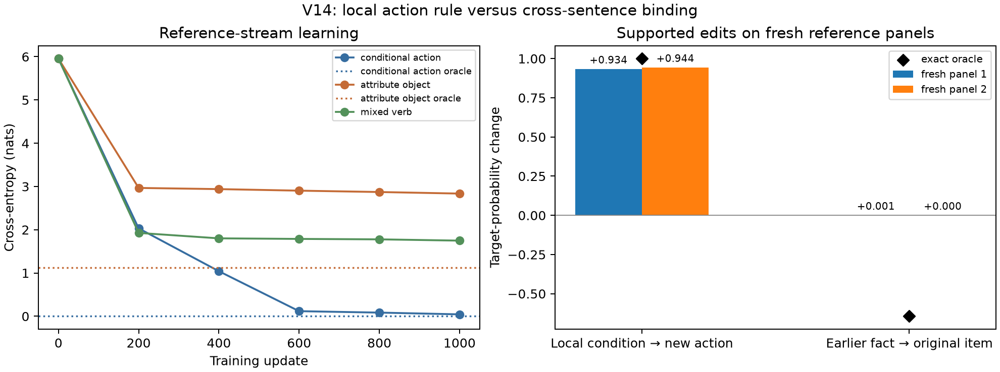

# V14: more attention depth helps the local rule, not historical binding

The V14 stream contains a local attribute→action continuation and a harder
earlier item–attribute→later object dependency in the **same sampled
documents**. To test whether the latter failure was simply insufficient
depth, a four-layer/four-head/width-64 RMSNorm bilinear attention LM was
trained for 1,000 ordinary next-token-CE updates on the same reference
generator, seed, 32×256-token batch size, and optimizer settings as the
earlier two-layer run. Both models have no MLP blocks. The architecture
differs in depth and parameter count, so this is a depth/capacity
comparison, not an isolated causal effect of depth.

At the matched 1,000-update endpoint, two untouched 512-stream reference
panels give:

| Model | Local action CE (A/B) | Local new-action edit response (A/B) | Later object CE (A/B) | Earlier-fact object edit response (A/B) |
|---|---:|---:|---:|---:|
| Two layers | .185 / .189 | +.846 / +.840 | 2.823 / 2.828 | −.00073 / −.00073 |
| Four layers | **.048 / .062** | **+.934 / +.944** | 2.746 / 2.778 | +.00073 / +.00031 |
| Exact oracle | 0 | +1 | entropy 1.130 / 1.126 | −.647 / −.641 |

Every panel has 128 supported local edits and 128 historical object edits,
including 64 multi-pending cases. Thus the four-layer model improves the
already learned local rule, but **still fails both prespecified historical
binding gates**: object CE is much more than oracle entropy+0.5, and edit
effect error remains about .64 rather than ≤.25. Attribute-adjective CE
does improve modestly to 2.481/2.489 from the two-layer 2.522/2.528, but
its earlier-fact edit response is only +.238/+.210 versus oracle
+.477/+.482. More depth at this budget does not establish object binding.

The four-layer [training record](results/v14_conditional_reference_depth4_seed3_1000/results.json),
[checkpoint](results/v14_conditional_reference_depth4_seed3_1000/model.pt),
and [fresh panels A](results/v14_conditional_reference_depth4_seed3_1000/fresh_panel_99741.json)
and [B](results/v14_conditional_reference_depth4_seed3_1000/fresh_panel_99751.json)
support these numbers. The first panel evaluator initially exited 135 while
two CPU evaluators ran together; it was rerun alone and finished. The
diagnostic-regime panels agree on the local-versus-historical split. This
is one model seed per depth, on a stylized distribution. Further
single-task depth tuning is lower priority than broadening the sampled
language and comparing interpretation methods across multiple competent
dependencies.
