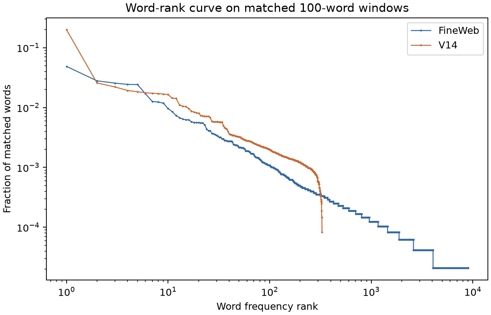

# What the sampled language trains, and its frequency gap

The V14 bilinear model is trained on **ordinary next-token cross-entropy at
every position** in one jointly sampled stream. Labels such as
`conditional_action`, `attribute_object`, and `mixed_verb` are generated
afterward to report task-specific performance; they are not separate
training examples or loss terms. The generator exposes an exact
next-token distribution for every prefix, so we can check both prediction
and supported counterfactual edits.

These are actual samples from the reference-rate V14 generator. Square
brackets mark the scored next token and were not present in training:

* Local attribute→action: `The radio is rare, so Kate [inspects] it.` The
  preceding attribute selects the action; this is the rule the two-layer
  model learned.
* Earlier-fact binding: `The tablet is clean. ... Dave, after the cleanup,
  keeps the clean [tablet] ...` The fact raises the matching item's
  probability at a later ordinary object slot. The two-layer model did
  **not** learn this dependency under its reference-rate training run.
* Source attribution: `As Henry said, "the folder was missing". ... Who
  said the folder was missing? Answer: [Henry]` The visible source claim
  determines the answer; it is sampled in the same stream, but this V14
  result has not passed a source-answer competence gate.
* Numeric fact/question: `The notebook costs 35 dollars. ... How much does
  the notebook cost? Answer: [35]` This also occurs in the stream, but
  earlier V12 tests did not find learned price binding in a small model.
* Mixed local distribution: `When the campaign ended, Elena [brings] the
  ...` At the verb position, lexical, lead-cue, previous-place, and
  induction proposals mix probabilistically. There is no single planted
  deterministic verb for every such prefix.

The older symbolic crossed-skip stream is a **different generator**. One
sample has `... on garden new [to]`, where the earlier place and adjacent
adjective jointly choose the function word. It also samples noun→verb
probabilities and bracket closing. Its code label `skip_trigram` refers to
the bracket closer, not to a general three-word skip-trigram table. See
the [planted-versus-learned sparse graph](results/v3_crossed_skip_sparse_graphs_seed99301/bigram_skip_bracket_comparison.png).

The rejected [V15 pilot](V15_TAIL_VARIATION_PILOT.md) varied only the
`because` tail. Actual sampled alternatives include:

* `... because Dave needed the bottle.`
* `... because Nick wanted a written record.`
* `... because Tara was waiting nearby.`
* `... because Elena had asked about it earlier in the village after the
  game and wanted a written record.`

All four have exact prefix probabilities. They slightly **worsened** the
first-40-word repetition metric on two toy panels, so V15 was not adopted
or used for model training. This means only that one surface edit failed
the specified form screen, not that varied phrasing is undesirable.

## Zipf-like word frequencies

The [rank-frequency audit](audit_v14_zipf.py) compares 480 matched
100-word windows (48,000 word positions per arm) from V14 and an existing
frozen FineWeb panel. It lowercases alphabetic words under the same regex
and saves the [counts and plotted ranks](results/v14_zipf_seed99851_n480/v14_vs_fineweb_word_rank.json).

| Word-frequency diagnostic | V14 | FineWeb panel |
|---|---:|---:|
| Observed distinct words | 328 | 8,975 |
| Most common word's mass | .200 (`the`) | .0486 (`the`) |
| Top ten words' mass | .371 | .214 |
| Words occurring once | 0 | 4,912 |
| Log-rank slope, ranks 10–100 | −.899 | −.948 |

The similar middle-rank slopes are misleading. V14 has an oversized head
and almost no long tail. On a separate fresh 57-window FineWeb comparison,
`the` alone appeared 486 times and repeated 429 times in the first 40
words of V14 windows, versus 102 occurrences and 58 repeats in FineWeb.
Repeated non-stopword counts were much closer (170 versus 146). The issue
is largely the repeated whole-clause grammar, not simply a small list of
content nouns.

A [slot-level replay](audit_v14_the_slots.py) of the same 480 V14 streams
locates all 9,604 occurrences of `the` among the 48,000 words. Place/event
determiner slots account for 5,214 (10.86% of all words); narrative-object
determiners account for 2,621 (5.46%); narrative tails for 986 (2.05%);
and special starts/other clauses for 783 (1.63%). Even if **every**
place/event `the` disappeared, the remaining `the` share would be 9.15%,
almost twice the matched FineWeb share of 4.86%. V14 has just 341 `a`
occurrences and no `an` in these windows, while FineWeb has 1,169 `a`
occurrences. Moving the whole excess to `a` would overshoot its natural
frequency. This is a feasibility bound, not a grammatical edit or a claim
that FineWeb's article rates should be copied directly. The full counts
are in the [slot-attribution JSON](results/v14_the_slot_attribution_seed99851_n480.json).

There is a relevant earlier control: [V2 varied](SURFACE_MIXTURE_V2_VARIED_RESULTS.md)
sampled `the`/`this`/`that` and optional parentheticals while preserving
its exact four-rule verb oracle. Its raw repeated-word successor-copy rate
fell from .606 to about .399, and a trained model still learned the four
rule effects. But its lexical-successor repetition and distinct-word count
remained far from the compared FineWeb panels. That test shows controlled
surface variation can preserve a learned task; it does not show that a
determiner swap fixes V14's distribution. The V14–V2 generators have
different rules and diagnostics, so their repetition numbers are not a
direct before/after comparison.

This matters because a model may spend capacity learning template and
determiner shortcuts that dominate the toy distribution, while rare
long-range relations get little gradient signal. It does **not** prove
that the excess `the` caused any particular task failure. The repeated
word itself is harmless; the concern is that its frequency reveals a
different mixture of sentence structures than natural text.

The next generator revision should target the **whole distribution**:
varied clause frames and lengths, a plausible determiner/short-word head,
and a broader, nonuniform lexical tail. We can sample from a truncated
Zipf-like lexicon with a small batch size; batch size does not set the
data-generating probabilities. But rare words need enough total training
exposures and dedicated evaluation, and all planted task combinations need
minimum coverage. A marginal frequency match alone would not establish
realistic syntax, discourse, or semantic task prevalence. Preserve exact
prefix oracles, supported edits, task-site counts, and held-out natural
form checks while changing the grammar.

Implementation implication: V14 inherits six fixed-position narrative
frames, and later task parsers index into those positions. A genuinely
shorter or reordered clause therefore needs a new versioned representation
of the completed event (subject, object, place, action, source, and fact)
and an explicit prefix state for each realization. Merely appending another
fixed phrase or globally substituting articles will not test the structural
hypothesis. The next candidate should generate two or more distinct clause
lengths from the same latent event, independently replay every sampled
prefix, and measure per-task encounter counts and supported edit effects
before training. Keep whole-form and task-family holdouts for subsequent
featurizer tests.

The frozen FineWeb panel consists of token windows rather than independent
documents, and its tokenizer differs from V14's word tokens. The frequency
curve is a distributional diagnostic, not a claim that matching it would
reproduce FineWeb or train the same model behavior.
