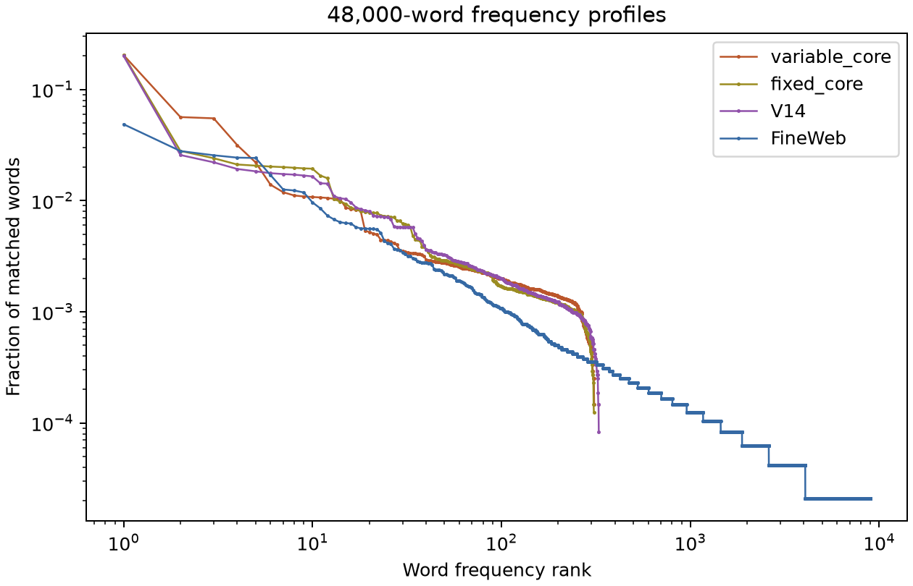

# Variable-clause pilot and Zipf gate

This is a bounded test of whether a shorter sentence can preserve the
original jointly sampled verb/object rules. It does **not** replace the V14
document-task generator and it is **not** a language-realistic training
distribution.

V3 has six mostly fixed long frames. The new branch starts with an ordinary
subject and samples a shorter clause with probability 0.55 at narrative
starts. Examples from seed 99851 are:

* `Grace brings a warm parcel near the city after the training.`
* `Oscar picks a quiet container near the garden after the launch.`
* `Iris finds the cool headphones near the hallway after the parade.`
* `Rosa moves an unusual invoice near the lobby after the trip.`

The article is sampled by marginalizing over the later adjective and object:
`a`/`an` for singular objects, `the` for `headphones`. This keeps the
original V3 object mixture after marginalizing the article choice. Every
field used by later induction and skip rules is visible. Once complete, a
short clause is translated into the corresponding V3 `At` event record for
future history lookups. The current short-form verb/object distributions are
the V3 mixtures conditional on the visible fields. The `At` cue is a fixed
property of this new form, which makes this a controlled form test rather
than a claim to natural causal syntax.

The [auditor](audit_v3_variable_form.py) replayed 122,880 sampled prefixes,
checked probability normalization and support, tested the article/object
joint against the V3 object distribution, and confirmed 20 seed-matched
streams are exactly identical to V3 when short-form mass is zero. It also
checks that the formal placeholder for the not-yet-visible current place
does not affect verb or object probabilities. In 480×256 streams, it saw
4,409 complete short clauses and 3,435 complete long clauses. These counts
show that the form change is common enough to affect the sample, not just
an anecdotal branch. This is an oracle/grammar result; it is not a trained
bilinear-model competence result.

## Frequency result

The audit compares the first 100 alphabetic words in 480 streams (48,000
word positions) with the same fixed V3 seed, and displays V14 and the
previously frozen FineWeb panel for context. The generators have different
tasks and tokenization, so the cross-generator comparison is about surface
form only.

| Diagnostic | Fixed V3 | Variable V3 | V14 | FineWeb panel |
|---|---:|---:|---:|---:|
| Distinct word types | 309 | 310 | 328 | 8,975 |
| `the` share | 20.34% | 20.37% | 20.01% | 4.86% |
| Top-ten share | 39.61% | 42.73% | 37.09% | 21.41% |
| Words seen once | 0 | 0 | 0 | 4,912 |

The short form **fails** the Zipf/realism gate. It raises the top-ten
concentration and barely changes `the`. Its 310-word lexicon has no
meaningful rare-word tail. A fitted slope over ranks 10–100 would be
misleading: a truncated, repetitive template can have a plausible local
slope without matching the head, long tail, or sentence structure. We
should not train this branch as the new realism-calibrated task stream.

The next DGP revision needs two separate controls. First, realize the same
visible event through several whole-clause and discourse structures so
function-word and length frequencies change. Second, sample a **much
larger, class-appropriate lexicon** with a nonuniform rank prior, such as
`p(r) ∝ (r+b)^(-s)`, while keeping enough exposure to every causal task
combination. Tune on a development natural-text panel and check a separate
panel without retuning. Report the top words, top-ten mass, type count,
singletons, rank curve, length/repetition statistics, and task-site
coverage. A Zipf-like marginal alone cannot establish semantic or
dependency realism. Only after the exact oracle, supported edits, form
checks, and task coverage pass should we train 1–4-layer bilinear models
and test canonicalization or sparse featurizers on learned tasks.
