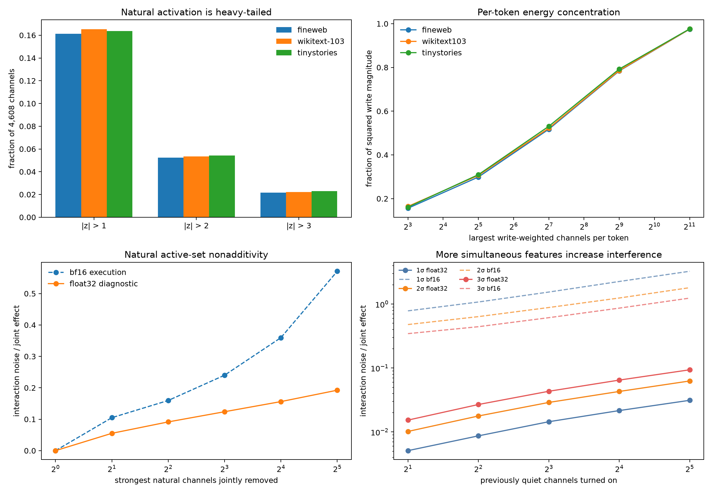

# Sparse activity and interference on the layer-1 → layer-2 path

## Bottom line

The current model uses a **sparse-per-token but broadly reused population code**. On an average token, 5.3% of the 4,608 layer-1 channels—about 246—are more than two positional standard deviations from their mean, and 2.2%—about 103—exceed three. Write-weighted effective participation is about 194 channels per token. Yet the identity of those channels changes substantially across tokens: top-32 sets have median pairwise Jaccard zero, while usage entropy spans roughly 2,800–3,700 distinct effective neurons across each corpus.

Turning on more computations does increase algebraic interference, but much less than the native bf16 measurements initially suggested. In a float32 diagnostic, adding 32 previously quiet channels at `2σ` produces interaction noise equal to only 6.3% of their joint layer-2 effect. Under checkpoint-native bf16 execution, the same statistic is 181%. The amplitude sweep shows that most of that gap is finite-precision nonadditivity rather than bilinear feature collision.



## Operational definition

For a set of changed layer-1 channels `S`, let `Δh₂(S)` be the standardized change in all 4,608 layer-2 MLP products. Interaction noise is

```text
n(S) = Δh₂(S) − Σᵢ Δh₂({i}).
```

The main statistic is `||n(S)|| / ||Δh₂(S)||`. Zero means singleton effects add perfectly. One means the nonadditive component is as large as the observed joint effect. This is a local superposition test, not task-performance loss or random background activation.

The calculation was repeated for:

- the direct `MLP1 → MLP2` path, freezing attention-2's write;
- `MLP1 → attention2 → MLP2`, freezing the direct residual input;
- both paths together.

## How sparse is natural activity?

| Corpus | `|z|>1` | `|z|>2` | `|z|>3` | Effective write participants | Top-32 write energy | Top-128 write energy |
|---|---:|---:|---:|---:|---:|---:|
| fineweb | 16.1% | 5.2% | 2.2% | 200 | 29.9% | 51.8% |
| wikitext103 | 16.5% | 5.4% | 2.2% | 193 | 30.6% | 52.2% |
| tinystories | 16.4% | 5.4% | 2.3% | 188 | 31.0% | 53.1% |


The top 32 channels carry about 30% of write-weighted energy; 128 carry about 52%; 512 carry about 79%. This is neither a one-hot code nor a dense uniform code.

Top-set diversity is high:

| Corpus | Effective neurons used by top-32 selections | Mean pairwise top-32 Jaccard |
|---|---:|---:|
| fineweb | 3712 | 0.007 |
| wikitext103 | 3210 | 0.015 |
| tinystories | 2815 | 0.012 |


This is the expected qualitative pattern for superposition: only a minority of channels dominate any token, but many different channels participate across the dataset.

## Naturally active channels

We jointly mean-ablated each site's strongest write-weighted channels and compared the result with the sum of their singleton ablations.

| Removed channels | bf16 noise/joint | float32 noise/joint |
|---:|---:|---:|
| 1 | 0.000 | 0.000 |
| 2 | 0.105 | 0.055 |
| 4 | 0.160 | 0.091 |
| 8 | 0.240 | 0.124 |
| 16 | 0.360 | 0.156 |
| 32 | 0.571 | 0.192 |


At 32 channels, the bf16 median is 0.571 with bootstrap 95% interval 0.533–0.620. The float32 diagnostic is 0.192, interval 0.187–0.209. The float32 result is consistent across FineWeb, WikiText, and TinyStories: approximately 0.19–0.20.

Thus strong natural channels do interact, but their joint effect remains mostly predicted by summing singleton effects: at 32 channels the float32 linear-versus-joint cosine is about 0.982.

## Counterfactually turning quiet channels on

Channels with `|z|<0.25` were selected before intervention, assigned fixed random signs, and set to one, two, or three standard deviations. The same nested channel order was used as `K` increased.

### Float32 algebraic interaction

| Added channels | `1σ` | `2σ` | `3σ` |
|---:|---:|---:|---:|
| 1 | 0.000 | 0.000 | 0.000 |
| 2 | 0.005 | 0.010 | 0.015 |
| 4 | 0.009 | 0.018 | 0.027 |
| 8 | 0.014 | 0.029 | 0.043 |
| 16 | 0.022 | 0.043 | 0.065 |
| 32 | 0.031 | 0.063 | 0.094 |


At fixed `K=32`, absolute interaction norm scales approximately quadratically with amplitude: 0.117 at `1σ`, 0.460 at `2σ`, and 1.038 at `3σ`. This is the expected signature of bilinear cross-terms. Relative noise grows roughly linearly with amplitude because the first-order signal grows linearly while pair interactions grow quadratically.

### Native bf16 execution

| Added channels | `1σ` | `2σ` | `3σ` |
|---:|---:|---:|---:|
| 1 | 0.000 | 0.000 | 0.000 |
| 2 | 0.784 | 0.479 | 0.345 |
| 4 | 1.078 | 0.637 | 0.443 |
| 8 | 1.543 | 0.884 | 0.613 |
| 16 | 2.258 | 1.245 | 0.865 |
| 32 | 3.262 | 1.806 | 1.241 |


In bf16, absolute interaction norm at `K=32` is nearly amplitude-independent: approximately 12.3, 13.0, and 13.4. Consequently the relative statistic is worst for the smallest injected signals. This is a rounding/noise floor, not the scaling law expected from representational collisions.

## Direct and attention-mediated paths

In the float32 diagnostic at `K=32`, `2σ` extra activation gives:

- direct path noise/joint: 0.060;
- attention-only path: 0.041;
- both paths: 0.063.

The direct route has about 0.96–0.98 times the combined-effect norm. The attention route has about 0.28–0.32 times the combined norm and points partly outside the direct direction. The direct×attention cross-term reaches about 9.7% for removing the 32 strongest natural channels, but only 2.5% for adding 32 random quiet channels at `2σ`.

Attention therefore adds a distinct route, but it is not the main source of mathematical interference in this layer transition.

## What this says about superposition

The evidence supports a qualified version of the hypothesis:

1. **Activity is sparse relative to width.** Roughly 100–250 channels are unusually active per token, depending on threshold, and effective write participation is about 190–200 of 4,608.
2. **The active identity is highly multiplexed.** Thousands of different channels enter top sets across tokens.
3. **Algebraic interference grows with both active count and amplitude.** This matches bilinear cross-term predictions.
4. **The current regime is not near an immediate algebraic capacity wall.** Thirty-two added `2σ` features produce only 6.3% float32 interaction relative to their joint effect.
5. **Native bf16 arithmetic introduces a much larger nonadditivity floor.** Whether the trained model treats this as harmful noise, useful discretization, or compensated error requires task-level tests; it must not be mislabeled as representational superposition.

The strongest current picture is therefore not “features must be nearly one-hot or they catastrophically collide.” It is a heavy-tailed population code where tens to hundreds of features coexist, pairwise bilinear interactions grow predictably, and the model has substantial algebraic headroom. Finite precision is a larger measured source of local nonadditivity than feature collision for the random quiet-channel intervention.

## Limitations

- The extra-on intervention is deliberately synthetic and may leave the natural activation manifold.
- “On” is threshold-dependent because bilinear products are signed and rarely exactly zero.
- Float32 is a diagnostic evaluation of bf16-trained weights, not the checkpoint's native execution.
- Interaction norm is not automatically harmful task noise; some interactions may implement useful conjunctions.
- The experiment ends at MLP2 products and intentionally ignores later residual-stream consequences.
- Natural removals target the largest write-weighted channels and therefore differ from random quiet-channel additions.

## Reproduction

```bash
uv run python scripts/run_bilin18_activation_interference.py
uv run python scripts/run_bilin18_activation_interference.py --float32
MPLBACKEND=Agg uv run python scripts/report_bilin18_activation_interference.py
```
