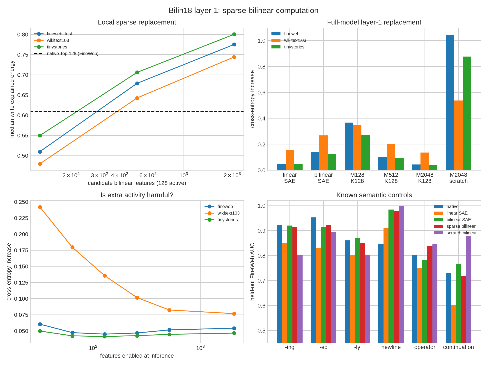

# Bilinear SAE and sparse bilinear layer — layer 1

## Result in one sentence

A bilinear feature parameterization recovers semantic discriminators, but the best
practical compression is a **2,048-candidate sparse bilinear layer with 128 active
features per token**: it uses 7,081,088
parameters instead of 15,926,400, explains
77.5%
of held-out layer-write energy, and increases full-model FineWeb cross-entropy by
only 0.045 nats.

## What was trained

The bilinear SAE uses

`z_k(x) = gain_k (a_k·x)(b_k·x)`

followed by signed Top-K selection and a normalized decoder into the original
4,608-dimensional product code. It has 2,048 candidate features and K=128.

The sparse replacement uses the same encoder but decodes directly into the
1,152-dimensional residual write. Models with 128, 512, and 2,048 candidate
features were trained; at most 128 features are retained for each token. The largest
replacement is 44.5% of the original MLP parameter count. It still computes all
candidate projections in this prototype, so the parameter and active-code reductions
must not be confused with a realized 36× wall-clock speedup.

Factor comparisons quotient out reciprocal scaling, left/right swap, simultaneous
sign changes, and feature permutation by comparing normalized symmetric bilinear
forms.

## Local reconstruction

| Model | FineWeb write fidelity | WikiText-103 | TinyStories |
|---|---:|---:|---:|
| Native per-token Top-128 | 0.608 | 0.602 | 0.628 |
| Linear SAE, K=128 | 0.755 | 0.712 | 0.786 |
| Sparse bilinear M128/K128 | 0.510 | 0.480 | 0.550 |
| Sparse bilinear M512/K128 | 0.679 | 0.642 | 0.706 |
| Sparse bilinear M2048/K128 | 0.775 | 0.744 | 0.800 |
| M2048/K128 from scratch | 0.394 | 0.369 | 0.436 |

The bilinear SAE itself reconstructs the product activation less accurately than the
linear SAE: 0.433
versus 0.530.
Its advantage is structural and semantic, not raw MSE.

## Full-model replacement

Cross-entropy increases relative to the unmodified 18-layer model, over 8,192 tokens
per corpus:

| Replacement | FineWeb | WikiText-103 | TinyStories |
|---|---:|---:|---:|
| `linear_sae` | 0.050 | 0.156 | 0.049 |
| `bilinear_sae` | 0.139 | 0.269 | 0.128 |
| `m128_k128` | 0.368 | 0.346 | 0.272 |
| `m512_k128` | 0.102 | 0.204 | 0.093 |
| `m2048_k128` | 0.045 | 0.136 | 0.041 |
| `m2048_k128_scratch` | 1.045 | 0.538 | 0.876 |

M2048/K128 slightly beats the linear SAE on all three panels while bypassing the
original 4,608-channel product and Down projection. M512/K128 is a more aggressive
11.1%-parameter replacement, but its FineWeb penalty rises to
0.102 nats.

The random-initialization control fails despite receiving 2,000 rather than 1,600
updates: its FineWeb write fidelity is only
0.394, and
its full-model cross-entropy penalty is
1.045 nats.
The two scratch runs agree in performance but have median symmetry-corrected
cross-seed form cosine 0.009.

## Is the code actually sparse?

On 16,384 held-out FineWeb positions, all
2,048 of 2,048 candidates are used at least once.
The corpus-level effective support is 1523;
the 32 most frequently selected features account for only
6.0% of selections. Each token is sparse,
but the vocabulary of available computations is broad across the corpus.

Changing only inference-time K gives:

| Active K | FineWeb ΔCE | WikiText-103 ΔCE | TinyStories ΔCE |
|---:|---:|---:|---:|
| 32 | 0.060 | 0.242 | 0.050 |
| 64 | 0.047 | 0.180 | 0.042 |
| 128 | 0.045 | 0.136 | 0.041 |
| 256 | 0.047 | 0.102 | 0.043 |
| 512 | 0.052 | 0.082 | 0.045 |
| 2048 | 0.054 | 0.077 | 0.047 |

There is no catastrophic “too many neurons on” transition. FineWeb is best near the
trained K=64–128 region, while WikiText benefits from enabling more features. The
amount of useful sparsity is distribution-dependent; extra activation produces a
small mismatch/noise cost on FineWeb and TinyStories, not explosive interference.

## Meaning and identifiability

The random-initialized bilinear SAE recovers much clearer morphology than the linear
SAE: held-out FineWeb `-ing` AUC is
0.921
and `-ed` is
0.915.
Those are close to the native controls (0.924
and 0.952).

But individual bilinear SAE features are still non-identifiable. Across two seeds,
the median best symmetry-corrected bilinear-form cosine is
0.120, with
0.0% above 0.8. Their best
matches to native neuron forms have median cosine
0.019. The learned
features can implement similar semantic partitions without converging to the same
quadratic forms.

The successful sparse replacement is different: it was initialized from high-impact native
neurons, and 75.3%
of its learned forms remain above 0.8 cosine with some native form. Its interpretability
is partly inherited, not independently rediscovered. The scratch model's median best
native-form cosine is only
0.008.

## Red-team conclusions

- **Validated:** a substantially smaller sparse bilinear layer can replace layer 1
  with a modest language-model penalty, including on two corpus shifts.
- **Validated:** bilinear features recover known morphology better than the linear
  SAE at the same coarse audit, despite worse activation MSE.
- **Falsified:** simply matching the bilinear primitive does not make the learned
  feature basis unique across seeds.
- **Not yet established:** that M2048/K128 preserves rare behaviors, long contexts,
  or generation quality. The full-model panels contain only 8,192 tokens each.
- **Falsified under this recipe:** “the compact result is readily rediscovered from
  scratch.” With the same architecture, data, objective, and comparable training
  budget, the scratch model is dramatically worse locally and end-to-end.
- **Metric caution:** Top-K selection is sparse in activation space, but all 2,048
  factor pairs are evaluated before selection in this implementation.

## Interpretation

This supports a hybrid picture. Native bilinear neurons are meaningful discriminators;
a larger collection of them is reused across contexts, while only a small subset is
important for any one token. A learned sparse layer can rotate and compress the
aggregate computation, but there is no evidence that its individual coordinates are
the uniquely correct ontology. For reverse engineering, the stable object is likely
the bilinear function/subspace plus its causal input-output behavior—not whichever
sparse basis one optimizer happens to choose.
