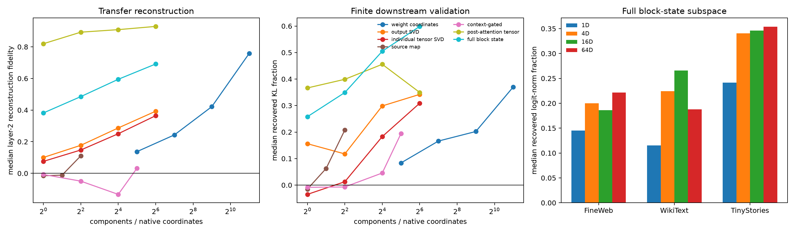

# Canonicalizing the dense layer-1 → layer-2 `-ing` circuit

## Result in one paragraph

The experiment found a better intermediate representation, but not yet a complete short circuit. Native layer-2 neurons are a poor compression basis. The four layer-1 amplitudes alone do not predict the downstream population, and a simple context-gated regression overfits. In contrast, the intervention-induced **post-attention input change to the layer-2 bilinear MLP is nearly one-dimensional**: one fitted direction reconstructs 82% of the held-out MLP-product change and four reconstruct 89%. However, the MLP is only one branch of the block. Restoring it repairs about 19–30% of the final logit effect. At the correct module boundary—the complete post-layer-2 residual state—a 4D subspace repairs about 20–34% of the final logit effect, while 16D repairs about 19–35% and roughly half of the distributional KL effect. So a short intermediate description exists, but downstream sensitivity and numerical amplification prevent it from being a faithful end-to-end circuit yet.



## Frozen protocol

- Source: the previously frozen layer-1 `-ing` neurons `896, 2780, 3712, 1846`.
- Fitting data: 64 FineWeb sites uniformly sampled across the frozen decoder's positive score quantiles.
- Transfer data: separate 64-site FineWeb, WikiText-103, and TinyStories panels.
- Finite validation: 24 preregistered quantile-spanning sites per transfer corpus.
- Intervention: replace all four source products by positional FineWeb means.
- Primary standard: reproduce the intervention's downstream effect after recomputing layers 3–17.

## Five attempted descriptions

### 1. Weight-ranked native coordinates

The exact layer-1 Down → layer-2 Left/Right weights rank changed neurons better than chance, but compression remains weak. A 2,048-of-4,608 coordinate description reconstructs median 76% of the layer-2 product change yet recovers only 37% of downstream KL and 20% of logit norm. Sparse native wiring is not the short algorithm.

### 2. Ordinary low-rank output subspace

A 64D SVD fitted to joint layer-2 product changes transfers with only 39% median reconstruction fidelity. Its median finite logit recovery is 17%. The individual-neuron causal tensor basis is slightly worse, so decomposing the four source interventions separately does not uncover cleaner shared destination components.

### 3. Source-code reduced-rank map

Mapping the four source activation changes directly to 4,608 targets reaches only 11% median reconstruction fidelity at full rank four and 10% median logit recovery. The same four-neuron semantic code has context-dependent consequences; its amplitudes are insufficient state variables.

### 4. Context-gated tensor-product map

Adding interactions between the four source changes and eight baseline-context PCs does not solve this. Its 32-rank version has only 3% median transfer fidelity and 11% logit recovery. With 64 fitting examples, this version is underdetermined and overfits; it is evidence against this particular gate vocabulary, not against contextual gating in general.

### 5. Post-attention bilinear input tensor

This is the strong local result. Project the post-attention normalized layer-2 input change into a fitted low-rank basis, then use the model's exact `Left`, `Right`, and bilinear product to reconstruct the target-neuron change.

| Input dimensions | Transfer product fidelity | Median logit recovery FW / WT / TS | Median KL recovery FW / WT / TS |
|---:|---:|---:|---:|
| 1 | 0.82 | 0.21 / 0.19 / 0.26 | 0.38 / 0.43 / 0.29 |
| 4 | 0.89 | 0.19 / 0.20 / 0.30 | 0.44 / 0.36 / 0.40 |
| 16 | 0.91 | 0.18 / 0.22 / 0.29 | 0.40 / 0.53 / 0.44 |

Sixteen input directions explain 96.5% of fitting-set input-change energy and reconstruct about 91% of held-out product change. This is a genuine shorter description of the MLP branch. It does not restore the residual/attention branch, which imposes a low end-to-end ceiling.

## Iteration prompted by the failure: use the block state

The causally complete boundary is the residual state after all of layer 2, not its MLP neurons. Overwriting that exact state restores 100% of logits, KL, and CE on all three corpora. A transferred low-rank state description gives:

| State dimensions | Transfer state fidelity | Median logit recovery FW / WT / TS | Median KL recovery FW / WT / TS |
|---:|---:|---:|---:|
| 1 | 0.38 | 0.15 / 0.12 / 0.24 | 0.21 / 0.26 / 0.31 |
| 4 | 0.49 | 0.20 / 0.22 / 0.34 | 0.24 / 0.30 / 0.51 |
| 16 | 0.59 | 0.19 / 0.27 / 0.35 | 0.53 / 0.49 / 0.49 |
| 64 | 0.69 | 0.22 / 0.19 / 0.35 | 0.62 / 0.54 / 0.64 |

This is better viewed as a compact message carried across a block boundary than as a small set of layer-2 neurons.

## Attention and residual routing

At layer 2, the attention-write change has median norm about 0.37–0.39 times the direct mixed-residual change and is nearly orthogonal to it (median cosine 0.001–0.017). Thus the source perturbation reaches the block through two distinguishable routes rather than a single dense MLP fan-out. The post-attention one-dimensional result says those routes are strongly canonicalized by the time they enter the bilinear MLP.

## Red-team findings

1. **Activation fidelity is not causal fidelity.** One input direction reconstructs 82% of the MLP-product change but restores only about 19–26% of logit norm.
2. **The module boundary matters.** Exact MLP-product restoration is incomplete because residual and attention effects bypass it. Exact post-block-state overwrite is sufficient.
3. **bf16 is mechanistically relevant.** Replaying the recorded exact state *delta* restores only 60–79% of logit norm, while overwriting the exact state restores 100%. A typical replay leaves roughly one bf16 coordinate different—about `2e-5` relative state error—which later layers amplify. Algebraically recomputing the state delta from `pre + Down(product)` differs from the observed bf16 delta by about 2–2.5% in norm because large bilinear terms cancel under finite precision.
4. **More components are not monotonically better downstream.** PCA optimizes state reconstruction, not final behavior, and numerical sensitivity can make an additional reconstructed direction harmful.
5. **CE is noisy.** Per-token CE changes can have either sign and small denominators. KL and logit-norm recovery are more stable here; all three are retained in the raw results.
6. **This is one circuit and one layer transition.** The low-dimensional post-attention input result needs replication on `-ed`, capitalization, and later contextual circuits.

## Current interpretation

The best intermediate object is not “which layer-2 neurons receive `-ing`?” It is closer to:

```text
four-neuron morphological predicate
        ↓
direct residual route + nearly orthogonal attention response
        ↓
very low-dimensional post-attention MLP input change
        ↓ exact bilinear tensor weights
dense layer-2 product population
        ↓
moderately low-dimensional post-block message
```

This supports the CPU analogy: native neurons resemble gates or local predicates, while residual-stream messages are closer to registers or buses. It does **not** yet give a short end-to-end program, because later layers strongly amplify omitted state components.

## Reproduction

```bash
uv run python scripts/collect_bilin18_canonicalization.py
uv run python scripts/fit_bilin18_canonicalizations.py
uv run python scripts/validate_bilin18_canonicalizations.py
MPLBACKEND=Agg uv run python scripts/report_bilin18_canonicalizations.py
```
