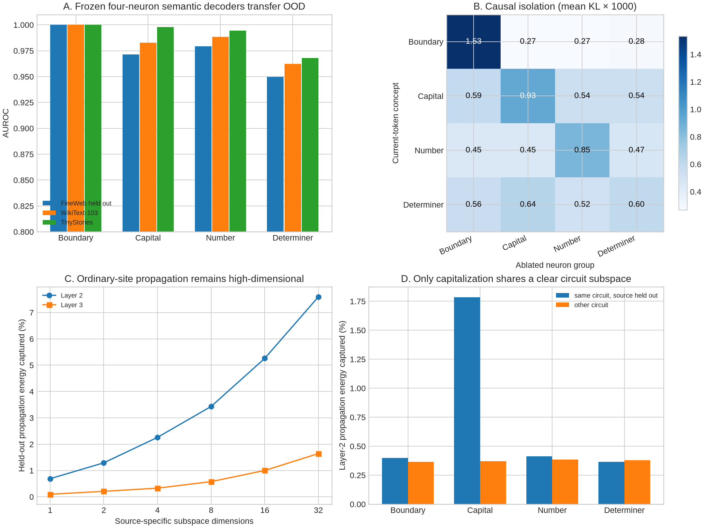

# Four candidate circuits and ordinary-site propagation subspaces

## Verdict

The four frozen neuron groups are excellent and OOD-stable **input discriminators**, but only three are causally isolated by the present test, and only one—capitalization—shares a detectable propagation subspace across different source neurons. This sharply separates knowing what activates a neuron from knowing the reusable computation it participates in.

The strongest supported picture is:

- neuron-level token predicates can be remarkably clean;
- attention routes into those neurons are partly predictable from QK×OV weights;
- each neuron produces a reproducible but high-dimensional downstream fingerprint;
- neurons with the same apparent semantic label usually do **not** share the same downstream implementation;
- semantic patching therefore needs context-conditioned directions and coefficients, not just a list of neurons with similar activation tails.

## Experimental scale

The experiment freezes 16 layer-1 neurons in four groups. It collects 2,048 finite interventions: 64 discovery and 64 document-held-out sites per neuron. Every activation is an ordinary 0.5–1.5 positional-SD deviation, balanced by sign; no tail examples are used to fit the subspaces. Layer-2 and layer-3 product changes contain all 4,608 native channels.

Semantic decoders are trained on 102,400 FineWeb positions and evaluated on disjoint FineWeb, WikiText-103, and TinyStories panels of 102,400 positions each. Causal circuit tests use 64 concept-positive and 64 concept-negative sites per circuit.

## Circuit-by-circuit results

|Candidate|Frozen layer-1 neurons|FineWeb/WikiText/TinyStories AUROC|Matching-group KL advantage|Verdict|
|---|---|---:|---:|---|
|Boundary/reset|1825, 291, 2590, 4574|1.000 / 1.000 / 1.000|5.66×|Strong input and causal isolation|
|Capital/word start|1690, 2976, 175, 210|0.971 / 0.983 / 0.998|1.67×|Input/causal isolation and shared subspace|
|Number format|1535, 3448, 4562, 2812|0.979 / 0.988 / 0.994|1.87×|Strong input and causal isolation; output role unresolved|
|Determiner syntax|4361, 1775, 3691, 3996|0.950 / 0.962 / 0.968|1.05×|Clean detector, but not an isolated causal circuit|

The KL advantage compares ablating the matching four-neuron group with the average of ablating the other three groups on the exact same concept-positive examples. Boundary, capitalization, and number formatting have the largest diagonal effect. For determiners, the capitalization group is slightly more disruptive than the putative determiner group. Calling the fourth group a distinct circuit would therefore overstate the evidence.

All four matching ablations have larger mean KL on concept-positive than concept-negative sites, but their absolute effects are small (roughly 0.0005–0.0015 KL) and almost never change top-1. These are real contributors, not complete task circuits.

## What the neuron interpretations do and do not establish

The lexical interpretations survive two genuine distribution shifts. Several individual neurons are also strong detectors by themselves, sometimes with reversed sign. Thus the four-neuron results are not merely an overfit linear probe.

Their output roles are much less clean. Boundary/reset ablation most clearly removes support for common new-span word starts. Determiner neurons weakly support adjective-like continuations. The number detectors do not simply promote number tokens, and capitalization writes are heterogeneous. A clean input predicate can therefore feed a conditional or distributed output computation rather than have one fixed semantic write.

The boundary result is also the easiest case: its label is the literal GPT-2 end-of-text token. It validates the machinery but should not be treated as evidence for a subtle abstract boundary concept by itself.

## Ordinary-site subspaces

A 16-dimensional source-specific subspace captures only 5.26% of held-out layer-2 propagation energy and 1.00% at layer 3. Even 32 dimensions capture 7.60% and 1.64%. This is far below the earlier extreme-tail result and shows that tail interventions made propagation look more low-dimensional than ordinary operation really is.

Holding out the source neuron within each semantic family is stricter:

|Family, layer 2|Matching 16D span|Other-family span|Per-site wins|
|---|---:|---:|---:|
|Boundary|0.40%|0.37%|52.7%|
|Capital|1.78%|0.37%|97.7%|
|Number|0.41%|0.38%|52.3%|
|Determiner|0.37%|0.38%|45.7%|

Only capitalization shows a clear shared implementation: the same-family span captures about five times as much energy as other-family spans and wins on 97.7% of sites. Boundary and number neurons agree semantically at their inputs but have neuron-specific downstream fingerprints. Determiner propagation is likewise indistinguishable from the mismatch control.

## Finite causal validation of the subspaces

On 128 held-out sites, the 16D source-specific projection contains 5.08% of layer-2 propagation energy. Replaying it produces a mean output-delta cosine of 0.498, compared with 0.438 for a mismatched circuit span.

But removing that projected component from the ablated run recovers only 3.2% of logit-change norm at the median, and the mean recovery is negative. The leave-source-out circuit span has essentially zero restoration benefit. These PCA-like spans describe a repeatable part of internal motion; they are not yet sufficient causal modules.

A likely reason the replay cosine remains moderately positive even for mismatched spans is that downstream normalization and the output map contain broadly shared sensitive directions. Directional logit agreement alone is therefore too permissive; restoration and matched-span controls are essential.

## Attention-route check

One representative neuron per candidate circuit was separately tested with finite attention-edge removal. On the transfer panel, QK×OV prediction has r=0.466 and 75.0% sign agreement. It beats a uniform random edge on 95.8% of sites. The routing-only comparison is weaker—62.5% wins, with a neuron-cluster interval that includes zero—so the incremental benefit of OV alignment is not established for these four representatives alone.

## What is still missing

1. **Coefficient prediction.** The causal patch uses the recipient's observed finite propagation delta and projects it. A real reverse-engineered mechanism must predict the subspace coefficients from the prompt and weights before performing the intervention.
2. **Semantic counterfactuals.** Current-token labels verify discrimination, not that a capitalization or number change transfers correctly between matched prompts.
3. **Output-role explanations.** Three groups are causally specific, but only boundary/reset has a readily recognizable average vocabulary effect.
4. **Later-layer routing.** Source identity decays sharply by layer 3; attention and residual paths beyond the immediate layer remain unresolved.
5. **A fourth isolated circuit.** Determiner syntax is a valid detector family but failed the cross-ablation isolation criterion. Searching for a replacement after seeing this result would be exploratory and should use fresh data.

## Best next experiment

Train a context-conditioned low-rank predictor from the receiving residual state, source activation change, and QK×OV route features to the layer-2 propagation delta. Freeze it, then evaluate reconstruction, finite restoration, and semantic patch transfer on new documents and entirely held-out source neurons. In parallel, predeclare a fresh candidate for the fourth circuit—such as subword continuation—and evaluate it on untouched corpus rows rather than replacing the failed determiner result post hoc.

## Artifacts

- `manifest.json`: all 2,048 ordinary sites and output effects
- `ordinary_propagation.npz`: complete layer-2/3 propagation vectors
- `semantic_panels.npz`: four 102,400-position activation panels
- `analysis.json`: semantic, subspace, finite-patch, and cross-ablation results
- `qkov/`: representative incoming-attention intervention results
