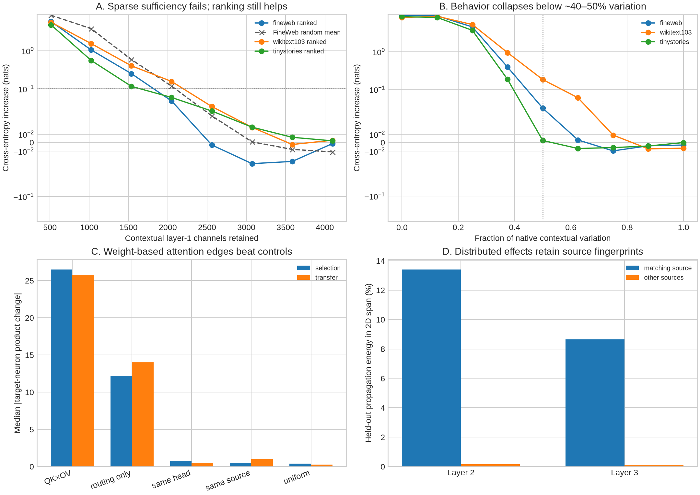

# Bilin18 layer-1 deep dive: three iterations

## Bottom line

Layer 1 is not well described as a small set of individually essential neurons. Its computation is spread across a broad native basis, but that basis is not structureless: input-conditioned QK×OV calculations identify causal attention routes, and individual source neurons leave reproducible distributed fingerprints in later layers. The right explanatory objects are therefore conditional edges and small propagation subspaces, not isolated downstream neurons.

## Iteration 1 — Is layer 1 carried by a sparse neuron set?

**Result: the strong sparse version is falsified.** Channels were frozen-ranked on 256 FineWeb examples by `|gradient × (activation − positional mean)|`, then tested with full downstream recomputation on 256 disjoint examples from each corpus.

- Retaining the best 1,024/4,608 channels still costs +1.23 FineWeb CE; 2,048 channels reduce this to +0.11.
- Removing the best 2,048 channels also costs only +0.09 CE. Thus two complementary large subsets can each sustain most behavior.
- The coarse first panel put 2,048 channels just above 0.1 nat (+0.11); the independent refined panel put the same width at +0.05. Thus roughly half the layer, not a few dozen neurons, is the stable scale for this engineering threshold.
- FineWeb importance ranks transfer moderately to WikiText (Spearman 0.66) and TinyStories (0.57).

Individual top-channel ablations are often neutral or slightly beneficial for the sampled next tokens. Absolute local sensitivity is useful for ordering a large set, but it does not imply that the leading neuron is independently necessary.

## Iteration 2 — Is the result only a mean-replacement artifact?

**Result: mean replacement exaggerates the failure, but cannot explain it away.**

- Ranked subsets consistently outperform random subsets below roughly 2,500 channels, so the ranking contains real information.
- Either ranking becomes adequate only after retaining a large fraction of the layer; there is no hidden 32–128-neuron solution in this native basis.
- Replacing the complete layer by its mean costs +9.22 CE. Swapping a real joint product vector from another example costs +3.63, and assigning real vectors to the wrong positions costs +2.56.
- Attenuating `(activation − mean)` shows a nonlinear operating regime: half-strength is mostly tolerated, while one-quarter strength is not. Layer 1 depends on aggregate contextual variation and downstream normalization, not merely a list of symbolic bits.

The shuffled states are marginally real but conditionally mismatched to their receiving residual streams, so they are a stronger control—not a perfect on-manifold intervention.

## Iteration 3 — Can weight structure recover causal routes and reusable downstream form?

### Incoming attention

For eight high-sensitivity neurons, three positive and three negative tail sites were tested on both discovery and transfer panels. Removing the QK×OV-predicted attention edge gave, on transfer:

- prediction/finite-effect correlation 0.64;
- sign agreement 70.8%;
- the predicted edge beat the routing-only edge on 70.8% of sites;
- it beat a uniform random edge on 95.8% of sites.

This validates a conditional weight-based explanation: the relevant edge changes with the input, but the same QK×OV formula predicts it on held-out examples. Only about 27% of the edge's additive logit effect is mediated by the selected neuron, because an attention edge writes a full residual vector read by many channels.

### Propagation into layers 2–3

A one-channel layer-1 intervention affects about 2059 layer-2 and 2100 layer-3 channels by effective support. The direct weight contraction predicts the immediate layer-2 pattern moderately (median Spearman 0.43) but degrades by layer 3 (0.13).

Exact downstream neuron identities are only weakly stable: median discovery/transfer top-64 overlap is 23.4% in layer 2 and 11.7% in layer 3. Restoring the top 32 affected channels recovers only 7.7% and 4.0% of logit-change norm at the median.

However, the distributed pattern retains source identity. A two-dimensional span fit from each source neuron's two discovery interventions captures, on average:

- 13.4% of its own held-out layer-2 propagation energy versus 0.16% for other sources;
- 8.6% in layer 3 versus 0.10% for other sources.

The matching source wins for all eight tested neurons in both layers. This is preliminary because each span has only two discovery and two transfer sites, but it is the clearest positive result: a neuron can act like a reusable verb while its downstream realization is a broad, context-varying population fingerprint.

## Revised model of the regime

1. **Native neuron level:** some activation conditions are semantically legible, but single neurons are rarely necessary.
2. **Conditional edge level:** QK×OV weight structure predicts which attention message drives a chosen discriminator on a given input.
3. **Population level:** the resulting effect fans out through thousands of channels, while a small source-specific subspace remains detectable across examples.
4. **Output level:** many of these changes cancel or are normalized away, explaining why large internal motion can coexist with a small CE effect.

This is neither a clean one-concept-per-neuron model nor an uninterpretable random code. It is closer to a distributed implementation of reusable operations whose identity is more stable as a conditional direction/subspace than as a fixed list of neurons.

## Next highest-value experiment

Fit propagation subspaces from hundreds of ordinary—not only extreme-tail—sites, hold out both documents and source neurons, and test whether those subspaces support finite patch transfer. Compare native coordinates with learned sparse/rotated dictionaries. That will distinguish a genuinely reusable low-dimensional operation from an artifact of repeatedly intervening on the same source neuron.

## Files

- `iteration1_channels.json`: rankings and finite necessity/sufficiency curves
- `iteration2_redteam.json`: random-subset, scaling, and shuffled-state controls
- `iteration3_qkov/`: finite incoming-edge tests and paired-control analysis
- `iteration3_propagation.json`: layer-2/3 propagation, mediation, and subspaces
