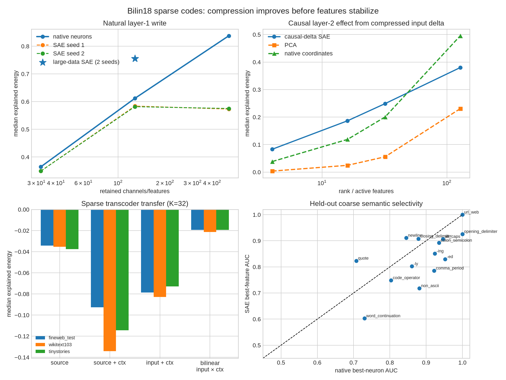

# Sparse codes for the Bilin18 layer-1→2 path

## Bottom line

The result is **compression without a canonical concept basis**. The 8,192-position
pilot initially favored native neurons. After scaling to 131,072 training positions,
a Top-K SAE with 128 active features explains **75.5%**
of the layer-1 downstream write energy, versus **60.8%**
for the best 128 native neurons. So a learned sparse oblique basis is genuinely more
efficient at reconstruction.

However, two SAE seeds achieve essentially identical fidelity while learning very
different dictionaries: median best decoder cosine is only
**0.148**, and the fraction above 0.8 is
**0.0%**. Native neurons also retain cleaner
known morphology controls. The SAE has found interchangeable compression coordinates,
not a unique list of neuron-like concepts.

There is nevertheless a useful intermediate code. A Top-K SAE of the *causal
post-attention input change* explains **24.9%** of the
next bilinear MLP's finite product change with 32 features. That beats 32 native
input coordinates (20.0%) and rank-32 PCA
(5.6%), but it is far from a circuit-level
replacement. It is a lossy causal coordinate system, not a solved interpretation.

The weight-derived equation is the decisive positive control: it predicts the
saved finite layer-2 product change with median explained energy
**0.999206** and cosine **0.999606**.
Thus we understand the local computation exactly, while failing to compress its
many context-dependent outcomes into a small fixed dictionary. Even a rank-512
output PCA subspace explains only **13.6%** on held-out
FineWeb.

## What was compared

- Natural layer-1 product activations: native coordinate Top-K versus a 6,144-feature
  Top-K SAE trained at K=128, with two seeds.
- Causal input changes entering layer 2: native-coordinate Top-K, PCA, and a
  2,048-feature Top-K SAE, evaluated by the *finite downstream bilinear effect*.
- Sparse K=32 transcoders: layer-1 source only, source plus context, post-attention
  input plus context, and an interaction-aware transcoder with explicit
  `input_delta × context` gates.
- FineWeb holdout and two corpus shifts: WikiText-103 and TinyStories.

All explained-energy numbers use `1 - ||target-prediction||² / ||target||²` per
example, then take the median. Zero means predicting no change; negative means
worse than predicting no change. This is stricter than cosine because it penalizes
the wrong magnitude.

## Natural activation result

### Large-data replication (primary)

| 128-feature comparison | FineWeb | WikiText-103 | TinyStories |
|---|---:|---:|---:|
| Native neurons, downstream write | 0.608 | 0.602 | 0.628 |
| SAE seed 101, downstream write | 0.755 | 0.712 | 0.786 |

Both SAE seeds agree within 0.1 percentage point on all three corpora. Their feature
directions do not agree. This is the central multiplexing result: the represented
subspace/computation is reproducible, but its sparse factorization is not.

For known token morphology, the best native channel remains better on held-out
FineWeb: `-ing` AUC is 0.924 native versus 0.851 SAE, and `-ed` is 0.952 versus
0.829. The SAE improves `newline` (0.911 versus 0.845), so neither basis dominates
every semantic partition.

### Small-data pilot (red-team history)

| 128-feature comparison | FineWeb | WikiText-103 | TinyStories |
|---|---:|---:|---:|
| Native neurons, downstream write | 0.612 | 0.595 | 0.629 |
| SAE seed 1, downstream write | 0.584 | 0.519 | 0.608 |

This pilot conclusion does not survive the larger-data reconstruction test: the SAE
reverses the write-fidelity ordering. Keeping the pilot visible is important because
it demonstrates how an undertrained SAE can falsely make a native basis look optimal.

## Causal compression result

At K=32 on held-out FineWeb:

| Representation of post-attention input change | Input explained energy | Finite product-effect explained energy |
|---|---:|---:|
| PCA | 0.060 | 0.056 |
| Native coordinates | 0.182 | 0.200 |
| Causal-delta SAE | 0.223 | 0.249 |

The SAE advantage over coordinate sparsity is real but modest. It says causal
changes are somewhat more compressible in a learned oblique basis. It does not say
that the resulting features have stable meanings.

| Intervention family | K=32 product fidelity | Product cosine |
|---|---:|---:|
| top1_remove | 0.321 | 0.567 |
| top4_remove | 0.325 | 0.571 |
| top16_remove | 0.311 | 0.560 |
| quiet8_add_2z | 0.138 | 0.374 |

## Transcoder result

| K=32 model | FineWeb | WikiText-103 | TinyStories |
|---|---:|---:|---:|
| `source_only` | -0.034 | -0.035 | -0.038 |
| `context_conditioned` | -0.093 | -0.134 | -0.115 |
| `input_context_additive` | -0.079 | -0.083 | -0.073 |
| `input_context_bilinear` | -0.019 | -0.021 | -0.019 |

The interaction-aware model is less wrong than the additive models, but none
generalizes. This is consistent with severe undersampling and a genuinely broad
context-dependent output family. It is **not** evidence that bilinear sparse
features cannot work with more data or a weight-tied construction.

## What this means for multiplexed codes

The useful decomposition is now clearer:

1. **Native discriminators:** layer-1 bilinear neurons are already sparse and often
   semantically legible. The SAE compresses their aggregate write more efficiently,
   but does not replace their stable individual identities.
2. **A low-dimensional transported perturbation:** earlier canonicalization found
   that one post-attention input direction captures much of a particular causal
   perturbation family. The causal-delta SAE extends this into several sparse
   perturbation directions.
3. **A context-indexed expansion:** the next bilinear layer turns those directions
   into many different output-channel changes depending on the base context. This
   family is high-rank across examples. A single small, context-independent output
   dictionary is therefore the wrong explanatory object.

So the multiplexing is not best described as “one SAE feature equals one hidden
concept.” The SAE result is compatible with many equally good sparse rotations.
A better causal object is a **conditional operator**: a sparse upstream event,
the context directions it interacts with, and the native downstream discriminators
that receive the product. This is closer to a sparse tensor factorization or a
weight-tied bilinear transcoder than a vanilla SAE.

## Red-team limits

- The primary natural SAE saw 131,072 positions and 512,000 sampled training
  exposures for roughly 57M dictionary parameters. This resolves the grossly
  undertrained pilot, but a million-token run, validation-based checkpointing, and
  a feature-count/sparsity sweep are still warranted.
- The SAE was trained at K=128. K=32 and K=512 curves are diagnostic extrapolations;
  the matched claim is the K=128 comparison.
- Coarse token-label AUC is a narrow semantic audit with multiple feature search.
  It is useful for known controls such as suffixes, not a general monosemanticity
  score.
- The transcoders have millions of parameters but only 4,096 causal training
  examples. Their negative held-out fidelity diagnoses this implementation, not
  the whole method class.
- The interventions are deliberate removals/additions, not the full distribution
  of naturally occurring upstream differences.
- Exact local algebra does not yet provide a short global account of which circuits
  matter for model loss or behavior.

## Next decisive experiment

Fit a **weight-tied conditional dictionary**:
reuse the actual layer-2 Left/Right directions, cluster or factor their input pairs,
and learn only a sparse router over upstream perturbations and contexts. Evaluate
the router by held-out finite effects and cross-corpus loss recovery. In parallel,
increase the natural SAE to roughly one million positions and test whether feature
instability persists under feature-count, K, regularization, and seed sweeps. The
present evidence says SAE compression is real; the unresolved question is whether
any data/regularization regime makes its individual features canonical.
