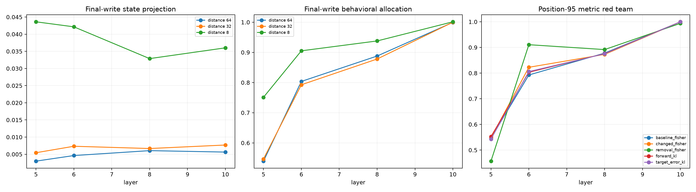

# Destination metric and distance red team

At edit positions 63, 95, and 119, every recurrent-backbone attention delta is split into the edited destination itself, all subsequent context destinations, and the final prediction destination. The three exact write parts are evaluated under base-context insertion, changed-context removal, two Fisher references, and two exact-KL cooperative games.

## Locked hypotheses

- **V1_destination_partition_is_numerically_exact: supported.**
- **V2_final_write_has_little_state_energy: not supported.**
- **V3_final_write_dominates_baseline_fisher_behavior: not supported.**
- **V4_final_write_dominates_all_behavioral_metrics: not supported.**
- **V5_insertion_and_removal_preserve_final_dominance: not supported.**
- **V6_state_behavior_inversion_is_large: supported.**
- **V7_final_bottleneck_strengthens_with_depth: supported.**
- **V8_dominant_destination_transfers_ood: not supported.**

| Corpus | Position | Layer | Final state | Final base-Fisher / changed-Fisher / removal | Final forward-KL / target-error-KL |
|---|---:|---:|---:|---:|---:|
| fineweb | 63 | 5 | 0.003 | 0.623 / 0.611 / 0.591 | 0.625 / 0.610 |
| fineweb | 63 | 6 | 0.006 | 0.803 / 0.809 / 0.982 | 0.804 / 0.803 |
| fineweb | 63 | 8 | 0.005 | 0.875 / 0.877 / 0.847 | 0.874 / 0.878 |
| fineweb | 63 | 10 | 0.005 | 0.989 / 0.984 / 0.991 | 0.988 / 0.986 |
| fineweb | 95 | 5 | 0.004 | 0.421 / 0.435 / 0.346 | 0.429 / 0.429 |
| fineweb | 95 | 6 | 0.007 | 0.892 / 0.883 / 0.919 | 0.887 / 0.886 |
| fineweb | 95 | 8 | 0.008 | 0.887 / 0.870 / 0.890 | 0.878 / 0.878 |
| fineweb | 95 | 10 | 0.006 | 0.990 / 0.990 / 0.985 | 0.990 / 0.990 |
| fineweb | 119 | 5 | 0.051 | 0.783 / 0.768 / 0.594 | 0.771 / 0.781 |
| fineweb | 119 | 6 | 0.052 | 0.934 / 0.925 / 0.864 | 0.933 / 0.928 |
| fineweb | 119 | 8 | 0.034 | 0.933 / 0.918 / 0.884 | 0.926 / 0.925 |
| fineweb | 119 | 10 | 0.048 | 1.000 / 0.998 / 0.998 | 0.998 / 1.000 |
| wikitext | 63 | 5 | 0.003 | 0.540 / 0.547 / 0.608 | 0.546 / 0.541 |
| wikitext | 63 | 6 | 0.003 | 0.740 / 0.723 / 0.744 | 0.736 / 0.727 |
| wikitext | 63 | 8 | 0.004 | 0.824 / 0.831 / 0.852 | 0.825 / 0.829 |
| wikitext | 63 | 10 | 0.006 | 1.000 / 0.998 / 0.994 | 0.999 / 0.998 |
| wikitext | 95 | 5 | 0.008 | 0.751 / 0.743 / 0.689 | 0.751 / 0.743 |
| wikitext | 95 | 6 | 0.009 | 0.723 / 0.785 / 0.955 | 0.742 / 0.756 |
| wikitext | 95 | 8 | 0.006 | 0.888 / 0.883 / 0.864 | 0.884 / 0.887 |
| wikitext | 95 | 10 | 0.011 | 1.010 / 1.006 / 0.993 | 1.009 / 1.008 |
| wikitext | 119 | 5 | 0.036 | 0.753 / 0.758 / 0.719 | 0.757 / 0.754 |
| wikitext | 119 | 6 | 0.033 | 0.878 / 0.882 / 0.875 | 0.880 / 0.881 |
| wikitext | 119 | 8 | 0.030 | 0.942 / 0.934 / 0.898 | 0.939 / 0.938 |
| wikitext | 119 | 10 | 0.045 | 1.003 / 1.005 / 1.008 | 1.004 / 1.004 |
| tinystories | 63 | 5 | 0.003 | 0.455 / 0.471 / 0.439 | 0.471 / 0.456 |
| tinystories | 63 | 6 | 0.005 | 0.868 / 0.877 / 0.870 | 0.871 / 0.874 |
| tinystories | 63 | 8 | 0.009 | 0.964 / 0.953 / 0.926 | 0.962 / 0.961 |
| tinystories | 63 | 10 | 0.006 | 1.009 / 1.008 / 1.005 | 1.008 / 1.009 |
| tinystories | 95 | 5 | 0.005 | 0.468 / 0.466 / 0.335 | 0.476 / 0.457 |
| tinystories | 95 | 6 | 0.006 | 0.763 / 0.800 / 0.858 | 0.781 / 0.776 |
| tinystories | 95 | 8 | 0.005 | 0.859 / 0.865 / 0.921 | 0.865 / 0.860 |
| tinystories | 95 | 10 | 0.006 | 1.000 / 1.003 / 1.004 | 1.001 / 1.001 |
| tinystories | 119 | 5 | 0.044 | 0.718 / 0.710 / 0.647 | 0.716 / 0.712 |
| tinystories | 119 | 6 | 0.042 | 0.903 / 0.907 / 0.919 | 0.913 / 0.905 |
| tinystories | 119 | 8 | 0.034 | 0.938 / 0.924 / 0.928 | 0.931 / 0.932 |
| tinystories | 119 | 10 | 0.015 | 1.001 / 1.001 / 1.011 | 1.001 / 1.001 |

A destination allocation answers which part of one layer's native attention-message change controls the selected final distribution. It does not imply that the final destination locally stores the original token: its query, keys, and values already depend on the entire prior computation.
