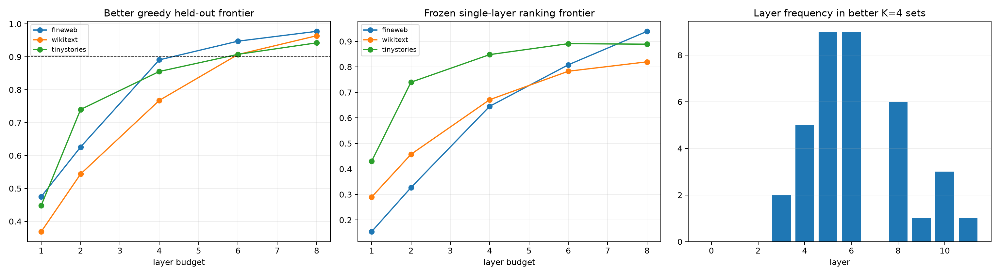

# Held-out search for compact attention-layer routes

Forward selection and backward elimination optimize replacement-insertion Fisher fidelity on eight examples, then frozen subsets are evaluated on sixteen disjoint examples. A third frontier uses the earlier single-layer ranking without search on this panel.

## Locked hypotheses

- **G1_forward_greedy_four_layers_are_sufficient: not supported.**
- **G2_some_four_layer_search_is_sufficient: not supported.**
- **G3_six_layers_recover_nearly_all_behavior: not supported.**
- **G4_search_improves_frozen_single_layer_ranking: supported.**
- **G5_forward_and_backward_find_a_shared_core: supported.**
- **G6_middle_layers_form_a_recurrent_core: supported.**
- **G7_heldout_search_frontiers_are_monotone: supported.**
- **G8_no_single_universal_four_layer_subset: supported.**

| Corpus | Position | Forward K4 set/fidelity | Backward K4 set/fidelity | Frozen K4 fidelity | Better K6 fidelity |
|---|---:|---:|---:|---:|---:|
| fineweb | 63 | [6, 5, 8, 10] / 0.879 | [5, 6, 8, 10] / 0.879 | 0.710 | 0.956 |
| fineweb | 95 | [6, 8, 5, 11] / 0.921 | [5, 6, 8, 11] / 0.921 | 0.455 | 0.970 |
| fineweb | 119 | [5, 4, 3, 6] / 0.760 | [4, 5, 6, 8] / 0.873 | 0.772 | 0.917 |
| wikitext | 63 | [6, 5, 8, 10] / 0.778 | [5, 6, 8, 10] / 0.778 | 0.570 | 0.945 |
| wikitext | 95 | [5, 6, 8, 10] / 0.771 | [5, 6, 8, 10] / 0.771 | 0.718 | 0.894 |
| wikitext | 119 | [6, 4, 5, 3] / 0.754 | [3, 4, 5, 6] / 0.754 | 0.726 | 0.883 |
| tinystories | 63 | [5, 6, 4, 8] / 0.901 | [4, 5, 6, 8] / 0.901 | 0.915 | 0.949 |
| tinystories | 95 | [5, 6, 9, 4] / 0.724 | [4, 5, 6, 8] / 0.695 | 0.698 | 0.810 |
| tinystories | 119 | [6, 5, 4, 3] / 0.941 | [3, 4, 5, 6] / 0.941 | 0.932 | 0.965 |

Search identifies a sufficient interface set, not unique ownership. Forward and backward procedures can find different sets because changing one attention write alters the states consumed by every later block. Held-out evaluation limits direct selection overfit but does not remove the off-manifold nature of partial write replacement.
