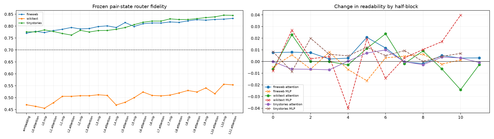

# Attention/MLP readability telescope

A single FineWeb-trained pair-state ridge readout is fit independently at the embedding boundary and after each attention or MLP half-block. Its target is the pooled rank-32 final-MLP write coefficient vector; predictions are scored by finite intervention, including on two OOD corpora.

## Locked hypotheses

- **A0_trace_is_valid: supported.**
- **A1_final_attention_repairs_wikitext: not supported.**
- **A2_attention_often_increases_readability: not supported.**
- **A3_mlp_often_increases_readability: not supported.**
- **A4_both_operator_types_have_material_jumps: not supported.**
- **A5_final_pre_mlp_state_is_universally_readable: not supported.**
- **A6_half_block_profile_transfers_ood: supported.**

| Corpus | Embedding | L5 attention/MLP | L10 attention/MLP | L11 attention | Oracle | Max attention/MLP jump |
|---|---:|---:|---:|---:|---:|---:|
| fineweb | 0.770 | 0.815/0.798 | 0.828/0.829 | 0.832 | 0.881 | 0.021/0.008 |
| wikitext | 0.470 | 0.480/0.500 | 0.516/0.556 | 0.554 | 0.817 | 0.024/0.040 |
| tinystories | 0.776 | 0.794/0.806 | 0.839/0.846 | 0.845 | 0.873 | 0.010/0.020 |

These are accessibility changes under separately trained frozen readouts, not additive causal credit. An attention jump means that the post-attention destination state makes the eventual program easier to predict; it does not prove that the newly readable information originated solely in that attention layer.
