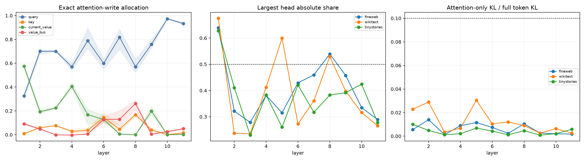

# Squared-attention QK/OV audit across depth

For the final-token-to-newline edit, each native squared-attention write is reconstructed from normalized rotary queries and keys, row-normalized squared scores, the current layer's value projection, and the persistent Layer-0 value bus. All 16 Q/K/current-value/bus hybrids are evaluated exactly. Their local write allocation is separated from insertion into a base block and removal inside a changed block. Native per-head OV writes provide a second decomposition.

## Locked hypotheses

- **Q1_manual_attention_and_factor_recomposition_are_exact: supported.**
- **Q2_query_routing_dominates_self_key_routing: supported.**
- **Q3_routing_dominates_values: supported.**
- **Q4_persistent_bus_is_not_the_main_value_source: not supported.**
- **Q5_insertion_and_removal_agree_on_top_factor: not supported.**
- **Q6_attention_effect_is_head_concentrated: supported.**
- **Q7_isolated_heads_add_approximately: not supported.**
- **Q8_attention_only_behavior_is_small: supported.**

| Corpus | Layer | Q / K / current-V / bus local | Q / K / current-V / bus insert | Top head/share | Head-sum fidelity | Attention/full KL |
|---|---:|---:|---:|---:|---:|---:|
| fineweb | 1 | 0.328 / 0.014 / 0.567 / 0.091 | 0.181 / 0.058 / 0.641 / 0.120 | 5 / 0.639 | 0.831 | 0.0055 |
| fineweb | 2 | 0.672 / 0.060 / 0.214 / 0.054 | 0.755 / 0.026 / 0.165 / 0.053 | 4 / 0.322 | 0.795 | 0.0139 |
| fineweb | 3 | 0.698 / 0.077 / 0.226 / -0.001 | 0.674 / 0.051 / 0.279 / -0.004 | 3 / 0.279 | 0.871 | 0.0013 |
| fineweb | 4 | 0.601 / 0.014 / 0.387 / -0.003 | 0.874 / -0.012 / 0.140 / -0.003 | 1 / 0.382 | 0.965 | 0.0089 |
| fineweb | 5 | 0.746 / 0.041 / 0.206 / 0.007 | 0.862 / 0.001 / 0.135 / 0.001 | 2 / 0.315 | 0.978 | 0.0115 |
| fineweb | 6 | 0.608 / 0.150 / 0.113 / 0.129 | 0.684 / 0.099 / 0.107 / 0.110 | 0 / 0.429 | 0.983 | 0.0074 |
| fineweb | 7 | 0.716 / 0.076 / 0.005 / 0.203 | 0.589 / 0.138 / -0.005 / 0.278 | 1 / 0.460 | 0.989 | 0.0024 |
| fineweb | 8 | 0.524 / 0.187 / -0.002 / 0.290 | 0.320 / 0.275 / -0.009 / 0.414 | 4 / 0.539 | 0.966 | 0.0104 |
| fineweb | 9 | 0.751 / 0.058 / 0.188 / 0.003 | 0.891 / 0.013 / 0.092 / 0.004 | 1 / 0.457 | 0.987 | 0.0026 |
| fineweb | 10 | 0.973 / 0.004 / 0.000 / 0.023 | 0.950 / 0.014 / 0.002 / 0.035 | 0 / 0.335 | 0.991 | 0.0020 |
| fineweb | 11 | 0.923 / 0.020 / 0.002 / 0.054 | 0.932 / 0.003 / 0.000 / 0.064 | 2 / 0.289 | 0.998 | 0.0018 |
| wikitext | 1 | 0.301 / 0.002 / 0.599 / 0.098 | 0.264 / 0.053 / 0.625 / 0.058 | 5 / 0.675 | 0.898 | 0.0229 |
| wikitext | 2 | 0.714 / 0.053 / 0.189 / 0.044 | 0.853 / 0.006 / 0.122 / 0.019 | 3 / 0.237 | 0.768 | 0.0289 |
| wikitext | 3 | 0.696 / 0.075 / 0.229 / -0.001 | 0.813 / 0.041 / 0.147 / -0.001 | 3 / 0.235 | 0.928 | 0.0034 |
| wikitext | 4 | 0.568 / 0.043 / 0.392 / -0.003 | 0.530 / 0.045 / 0.428 / -0.003 | 1 / 0.412 | 0.948 | 0.0067 |
| wikitext | 5 | 0.896 / 0.016 / 0.085 / 0.002 | 0.977 / -0.002 / 0.026 / -0.001 | 5 / 0.600 | 0.980 | 0.0304 |
| wikitext | 6 | 0.636 / 0.099 / 0.161 / 0.103 | 0.729 / 0.083 / 0.107 / 0.081 | 0 / 0.273 | 0.976 | 0.0104 |
| wikitext | 7 | 0.885 / 0.026 / 0.007 / 0.082 | 0.942 / 0.018 / -0.003 / 0.044 | 5 / 0.361 | 0.986 | 0.0120 |
| wikitext | 8 | 0.551 / 0.165 / -0.000 / 0.284 | 0.444 / 0.181 / -0.002 / 0.377 | 4 / 0.530 | 0.977 | 0.0090 |
| wikitext | 9 | 0.724 / 0.034 / 0.236 / 0.006 | 0.714 / 0.026 / 0.262 / -0.002 | 1 / 0.397 | 0.999 | 0.0026 |
| wikitext | 10 | 0.969 / -0.002 / 0.000 / 0.032 | 0.961 / 0.004 / 0.000 / 0.035 | 0 / 0.316 | 0.996 | 0.0064 |
| wikitext | 11 | 0.929 / 0.015 / 0.002 / 0.054 | 0.972 / 0.006 / 0.003 / 0.019 | 3 / 0.266 | 0.999 | 0.0026 |
| tinystories | 1 | 0.349 / 0.011 / 0.557 / 0.084 | 0.338 / 0.108 / 0.467 / 0.087 | 5 / 0.627 | 0.843 | 0.0100 |
| tinystories | 2 | 0.715 / 0.065 / 0.176 / 0.045 | 0.859 / 0.027 / 0.096 / 0.018 | 4 / 0.411 | 0.804 | 0.0048 |
| tinystories | 3 | 0.706 / 0.076 / 0.220 / -0.002 | 0.831 / 0.009 / 0.169 / -0.009 | 3 / 0.230 | 0.930 | 0.0012 |
| tinystories | 4 | 0.542 / 0.026 / 0.436 / -0.003 | 0.624 / 0.072 / 0.308 / -0.004 | 1 / 0.383 | 0.961 | 0.0021 |
| tinystories | 5 | 0.724 / 0.055 / 0.213 / 0.008 | 0.872 / 0.038 / 0.089 / 0.002 | 5 / 0.260 | 0.984 | 0.0068 |
| tinystories | 6 | 0.552 / 0.185 / 0.109 / 0.153 | 0.599 / 0.181 / 0.086 / 0.134 | 0 / 0.421 | 0.971 | 0.0043 |
| tinystories | 7 | 0.853 / 0.037 / 0.005 / 0.105 | 0.805 / 0.032 / -0.003 / 0.166 | 1 / 0.317 | 0.994 | 0.0012 |
| tinystories | 8 | 0.636 / 0.153 / 0.001 / 0.211 | 0.444 / 0.206 / -0.014 / 0.364 | 4 / 0.383 | 0.987 | 0.0046 |
| tinystories | 9 | 0.798 / 0.029 / 0.168 / 0.004 | 0.774 / 0.034 / 0.193 / -0.002 | 0 / 0.392 | 0.998 | 0.0009 |
| tinystories | 10 | 0.977 / 0.001 / 0.000 / 0.022 | 0.914 / 0.011 / -0.000 / 0.075 | 0 / 0.424 | 0.991 | 0.0020 |
| tinystories | 11 | 0.946 / 0.011 / 0.000 / 0.042 | 1.006 / -0.006 / -0.000 / 0.001 | 0 / 0.278 | 0.997 | 0.0059 |

The local allocation explains the attention operator itself. Insertion and removal ask whether the same factorization survives MLP recomputation and the remaining nonlinear suffix. A factor can dominate the local write yet have little end-to-end importance if attention is not the bottleneck for this edit.
