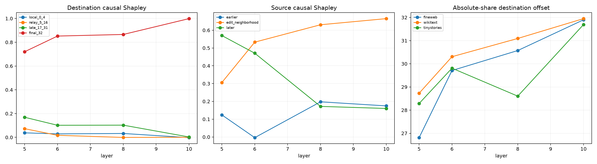

# Attention relay-topology audit

For the position-95 newline edit, each recurrent-backbone attention-write delta is partitioned two ways. Destination groups ask where the message is written: positions 95--99, 100--111, 112--126, or the final position 127. Source groups ask where its attended value originated: before 93, the edited neighborhood 93--97, or later positions 98--127. Every subset is propagated through the exact MLP and suffix.

## Locked hypotheses

- **T1_edge_partitions_recompose_attention: not supported.**
- **T2_direct_final_write_is_not_the_main_route: not supported.**
- **T3_early_backbone_writes_locally: not supported.**
- **T4_relay_front_moves_forward_with_depth: supported.**
- **T5_edited_source_neighborhood_seeds_the_backbone: not supported.**
- **T6_later_sources_grow_after_relay: not supported.**
- **T7_state_energy_and_behavioral_routing_differ: supported.**
- **T8_dominant_topology_transfers_ood: not supported.**

| Corpus | Layer | Destination local / relay / late / final | Source earlier / edit-near / later |
|---|---:|---:|---:|
| fineweb | 5 | 0.058 / 0.086 / 0.198 / 0.657 | 0.049 / 0.365 / 0.586 |
| fineweb | 6 | 0.023 / 0.022 / 0.140 / 0.815 | -0.019 / 0.503 / 0.516 |
| fineweb | 8 | 0.002 / -0.010 / 0.148 / 0.859 | 0.125 / 0.762 / 0.113 |
| fineweb | 10 | 0.001 / 0.001 / 0.006 / 0.992 | 0.132 / 0.705 / 0.163 |
| wikitext | 5 | 0.028 / 0.041 / 0.194 / 0.737 | 0.255 / 0.069 / 0.676 |
| wikitext | 6 | 0.025 / 0.009 / 0.094 / 0.872 | 0.085 / 0.481 / 0.434 |
| wikitext | 8 | 0.002 / 0.007 / 0.086 / 0.905 | 0.244 / 0.515 / 0.241 |
| wikitext | 10 | 0.001 / 0.001 / 0.001 / 0.997 | 0.383 / 0.311 / 0.307 |
| tinystories | 5 | 0.027 / 0.092 / 0.115 / 0.766 | 0.068 / 0.484 / 0.448 |
| tinystories | 6 | 0.039 / 0.021 / 0.071 / 0.869 | -0.077 / 0.614 / 0.463 |
| tinystories | 8 | 0.093 / 0.000 / 0.074 / 0.833 | 0.224 / 0.615 / 0.162 |
| tinystories | 10 | -0.009 / 0.001 / 0.002 / 1.007 | 0.010 / 0.980 / 0.010 |

Destination and source partitions are message-topology explanations, not semantic labels. A local destination write can be behaviorally important because later layers relay it; a later source can already contain information copied from the original edit. Exact edge provenance and original information provenance are therefore different notions.
