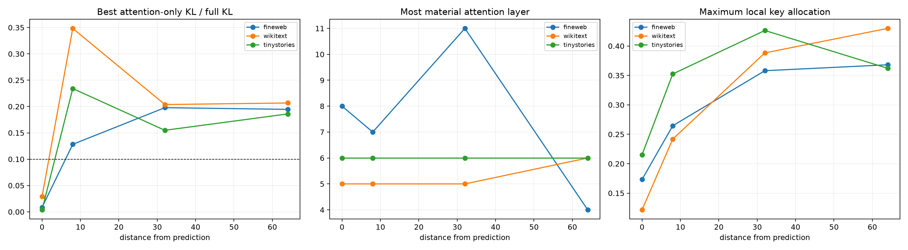

# Source-distance red team for squared attention

The ordinary-token-to-newline edit is moved 8, 32, and 64 positions before the final prediction, with the original final-position edit retained as a reference. Q/K/current-value/value-bus hybrids replace the entire changed attention-write sequence at each layer, and native head deltas are patched at every affected destination.

## Locked hypotheses

- **S1_earlier_edits_change_final_behavior: supported.**
- **S2_attention_is_material_for_earlier_edits: supported.**
- **S3_earlier_edits_depend_more_on_attention: supported.**
- **S4_source_key_role_grows_with_distance: supported.**
- **S5_persistent_value_bus_is_used_for_long_range_edits: supported.**
- **S6_material_attention_depth_transfers_ood: not supported.**
- **S7_material_attention_has_a_stable_factor: not supported.**
- **S8_head_additivity_survives_long_range_routing: supported.**

| Corpus | Edit position / distance | Full KL | Best layer | Best attention/full KL | Best-layer Q / K / current-V / bus | Top head/share | Head-sum fidelity |
|---|---:|---:|---:|---:|---:|---:|---:|
| fineweb | 63 / 64 | 0.0048 | 4 | 0.195 | 0.143 / 0.198 / 0.659 / -0.000 | 1 / 0.482 | 0.986 |
| fineweb | 95 / 32 | 0.0186 | 11 | 0.198 | -0.050 / 0.488 / 0.009 / 0.553 | 3 / 0.296 | 1.000 |
| fineweb | 119 / 8 | 0.1883 | 7 | 0.128 | 0.199 / 0.229 / 0.154 / 0.417 | 1 / 0.367 | 0.998 |
| fineweb | 127 / 0 | 8.8795 | 8 | 0.009 | 0.165 / 0.302 / 0.001 / 0.531 | 4 / 0.418 | 0.984 |
| wikitext | 63 / 64 | 0.0094 | 6 | 0.207 | 0.114 / 0.458 / 0.370 / 0.059 | 0 / 0.292 | 0.997 |
| wikitext | 95 / 32 | 0.0149 | 5 | 0.204 | 0.081 / 0.204 / 0.706 / 0.009 | 2 / 0.477 | 0.991 |
| wikitext | 119 / 8 | 0.2781 | 5 | 0.348 | 0.142 / 0.322 / 0.537 / -0.001 | 2 / 0.450 | 0.986 |
| wikitext | 127 / 0 | 6.0753 | 5 | 0.029 | 0.934 / 0.049 / 0.009 / 0.008 | 5 / 0.456 | 0.941 |
| tinystories | 63 / 64 | 0.0044 | 6 | 0.186 | 0.102 / 0.328 / 0.533 / 0.038 | 5 / 0.386 | 0.999 |
| tinystories | 95 / 32 | 0.0163 | 6 | 0.155 | 0.137 / 0.342 / 0.490 / 0.030 | 5 / 0.230 | 0.997 |
| tinystories | 119 / 8 | 0.0225 | 6 | 0.234 | 0.027 / 0.295 / 0.590 / 0.088 | 0 / 0.414 | 0.998 |
| tinystories | 127 / 0 | 9.9878 | 6 | 0.004 | 0.470 / 0.221 / 0.149 / 0.160 | 0 / 0.452 | 0.966 |

A single-layer attention insertion is not a percentage of information stored. For earlier edits, however, cross-position attention is structurally required somewhere in the full path. Failure of a single layer to reproduce the full edit can therefore indicate distributed routing across layers rather than an attention-free mechanism.
