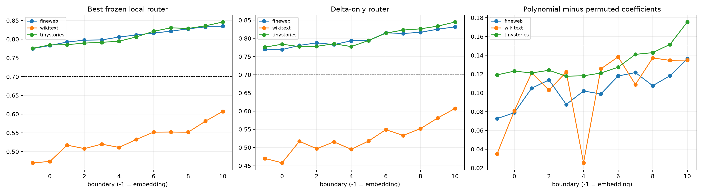

# Depth of the compact late-write router

A pooled FineWeb rank-32 final-MLP write basis is frozen across four token edits. For token-to-newline edits, ridge maps trained only on FineWeb predict its coefficients from the embedding boundary and residual boundaries after Layers 0--10. Every prediction is evaluated by a finite write intervention in the original final layer.

## Locked hypotheses

- **R0_trace_and_basis_are_valid: not supported.**
- **R1_pre_final_local_router_is_sufficient: not supported.**
- **R2_mid_depth_router_is_sufficient: not supported.**
- **R3_context_specific_coefficients_matter: not supported.**
- **R4_nonlinear_local_features_add_value: not supported.**
- **R5_router_quality_generally_increases_with_depth: supported.**
- **R6_one_frozen_router_transfers_ood: not supported.**

| Corpus | Oracle/random fidelity | Earliest passing depth/family | Best fidelity at embedding / L3 / L6 / L10 | L10 winning family |
|---|---:|---:|---:|---:|
| fineweb | 0.881/0.088 | (-1, 'delta') | 0.775 (polynomial) / 0.798 (pair) / 0.817 (carriers) / 0.835 (polynomial) | polynomial |
| wikitext | 0.817/0.106 | none | 0.470 (carriers) / 0.520 (carriers) / 0.552 (carriers) / 0.607 (delta) | delta |
| tinystories | 0.873/0.088 | (-1, 'delta') | 0.776 (delta) / 0.792 (carriers) / 0.821 (pair) / 0.846 (pair) | pair |

A successful local router is a readable interface, not proof that the model itself uses that coordinate system. A failure is also scoped: it rejects these frozen low-complexity destination-state maps, not all possible distributed or source-aware explanations. Permuting predicted coefficients within corpus tests whether per-example routing adds causal value beyond a generic mean edit.
