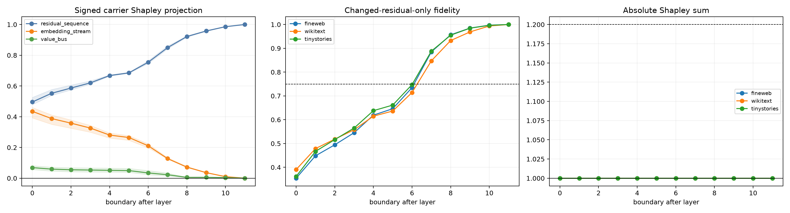

# Full-token carrier decomposition across depth

An ordinary final token is replaced by a newline. At every layer boundary, all eight base/changed combinations of the complete residual sequence, the original normalized embedding stream, and the persistent Layer-0 attention value bus are propagated through the untouched model suffix. Exact vector Shapley effects are projected onto the complete changed-logit direction in the baseline Fisher metric.

## Locked hypotheses

- **C1_exact_hybrid_recomposition: supported.**
- **C2_nonresidual_carriers_are_material: supported.**
- **C3_embedding_stream_is_material: supported.**
- **C4_value_bus_is_material: not supported.**
- **C5_late_residual_is_nearly_sufficient: supported.**
- **C6_carrier_depth_profiles_transfer_ood: supported.**
- **C7_carrier_interaction_or_cancellation_is_material: not supported.**
- **C8_final_boundary_collapses_to_residual: supported.**

| Corpus | Boundary | Residual fidelity | Residual / embed / bus Shapley | Abs. sum | Residual target-error KL |
|---|---:|---:|---:|---:|---:|
| fineweb | 0 | 0.354 | 0.483 / 0.460 / 0.056 | 1.000 | 0.451 |
| fineweb | 1 | 0.448 | 0.542 / 0.412 / 0.046 | 1.000 | 0.346 |
| fineweb | 2 | 0.495 | 0.579 / 0.379 / 0.042 | 1.000 | 0.298 |
| fineweb | 3 | 0.545 | 0.616 / 0.344 / 0.041 | 1.000 | 0.249 |
| fineweb | 4 | 0.619 | 0.666 / 0.294 / 0.039 | 1.000 | 0.176 |
| fineweb | 5 | 0.646 | 0.684 / 0.277 / 0.038 | 1.000 | 0.153 |
| fineweb | 6 | 0.735 | 0.746 / 0.224 / 0.030 | 1.000 | 0.086 |
| fineweb | 7 | 0.885 | 0.846 / 0.134 / 0.020 | 1.000 | 0.023 |
| fineweb | 8 | 0.957 | 0.918 / 0.076 / 0.006 | 1.000 | 0.008 |
| fineweb | 9 | 0.985 | 0.955 / 0.039 / 0.006 | 1.000 | 0.003 |
| fineweb | 10 | 0.997 | 0.985 / 0.011 / 0.004 | 1.000 | 0.001 |
| fineweb | 11 | 1.000 | 1.000 / 0.000 / 0.000 | 1.000 | 0.000 |
| wikitext | 0 | 0.391 | 0.526 / 0.392 / 0.082 | 1.000 | 0.571 |
| wikitext | 1 | 0.479 | 0.577 / 0.351 / 0.072 | 1.000 | 0.499 |
| wikitext | 2 | 0.518 | 0.606 / 0.325 / 0.069 | 1.000 | 0.466 |
| wikitext | 3 | 0.558 | 0.633 / 0.300 / 0.067 | 1.000 | 0.434 |
| wikitext | 4 | 0.615 | 0.673 / 0.261 / 0.066 | 1.000 | 0.383 |
| wikitext | 5 | 0.636 | 0.689 / 0.247 / 0.064 | 1.000 | 0.363 |
| wikitext | 6 | 0.714 | 0.753 / 0.197 / 0.050 | 1.000 | 0.284 |
| wikitext | 7 | 0.847 | 0.841 / 0.125 / 0.034 | 1.000 | 0.130 |
| wikitext | 8 | 0.933 | 0.923 / 0.071 / 0.006 | 1.000 | 0.047 |
| wikitext | 9 | 0.969 | 0.959 / 0.035 / 0.006 | 1.000 | 0.015 |
| wikitext | 10 | 0.994 | 0.987 / 0.009 / 0.003 | 1.000 | 0.002 |
| wikitext | 11 | 1.000 | 1.000 / 0.000 / 0.000 | 1.000 | 0.000 |
| tinystories | 0 | 0.362 | 0.479 / 0.452 / 0.069 | 1.000 | 0.487 |
| tinystories | 1 | 0.467 | 0.539 / 0.402 / 0.059 | 1.000 | 0.392 |
| tinystories | 2 | 0.516 | 0.574 / 0.371 / 0.055 | 1.000 | 0.347 |
| tinystories | 3 | 0.565 | 0.612 / 0.336 / 0.052 | 1.000 | 0.297 |
| tinystories | 4 | 0.638 | 0.664 / 0.287 / 0.049 | 1.000 | 0.214 |
| tinystories | 5 | 0.661 | 0.683 / 0.271 / 0.047 | 1.000 | 0.189 |
| tinystories | 6 | 0.747 | 0.765 / 0.212 / 0.023 | 1.000 | 0.106 |
| tinystories | 7 | 0.888 | 0.861 / 0.125 / 0.014 | 1.000 | 0.028 |
| tinystories | 8 | 0.955 | 0.925 / 0.070 / 0.005 | 1.000 | 0.009 |
| tinystories | 9 | 0.985 | 0.960 / 0.035 / 0.005 | 1.000 | 0.003 |
| tinystories | 10 | 0.996 | 0.985 / 0.010 / 0.004 | 1.000 | 0.001 |
| tinystories | 11 | 1.000 | 1.000 / 0.000 / 0.000 | 1.000 | 0.000 |

## OOD depth-profile correlations

| Carrier | FineWeb↔WikiText | FineWeb↔TinyStories |
|---|---:|---:|
| residual_sequence | 1.000 | 1.000 |
| embedding_stream | 1.000 | 1.000 |
| value_bus | 0.993 | 1.000 |

A boundary carrier is an interface, not a storage location. Signed Shapley projection answers how a base/changed hybrid participates in this particular finite edit under a declared suffix and metric. Values above one or below zero reveal cancellation or interaction; they are not percentages of information. The final boundary is a deliberate sanity check: after all blocks have run, embedding and value-bus effects have already been compiled into the residual.
