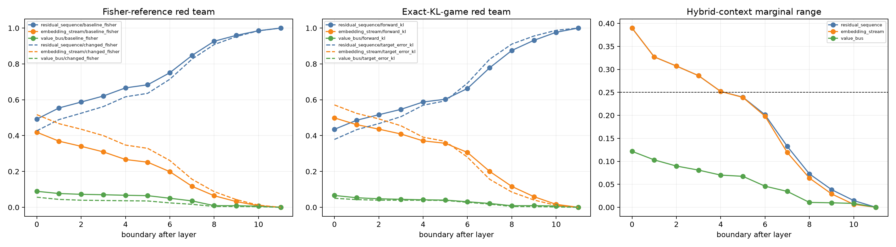

# Carrier metric and hybrid-order red team

This fresh 48-example-per-corpus panel repeats the exact eight-world carrier decomposition under four definitions of behavioral credit: baseline Fisher projection, changed-distribution Fisher projection, forward KL accumulated from the base model, and reduction of reverse KL error to the changed model. It also reports every carrier's marginal projection in all four contexts formed by the other two carriers.

## Locked hypotheses

- **R1_marginal_signs_are_context_stable: not supported.**
- **R2_fisher_reference_is_not_decisive: not supported.**
- **R3_embedding_is_material_under_kl_games: supported.**
- **R4_value_bus_remains_a_minor_route: supported.**
- **R5_layer10_residual_dominates_all_metrics: supported.**
- **R6_kl_direction_is_not_decisive: supported.**
- **R7_hybrid_order_dependence_is_small: not supported.**
- **R8_fresh_data_replicates_progressive_compilation: supported.**

| Corpus | Layer | Carrier | Base-Fisher | Changed-Fisher | Forward KL | Target-error KL | Marginal range | All signs + |
|---|---:|---|---:|---:|---:|---:|---:|---:|
| fineweb | 0 | residual_sequence | 0.452 | 0.453 | 0.419 | 0.374 | 0.421 | True |
| fineweb | 0 | embedding_stream | 0.451 | 0.484 | 0.522 | 0.574 | 0.421 | True |
| fineweb | 0 | value_bus | 0.097 | 0.063 | 0.059 | 0.052 | 0.147 | True |
| fineweb | 4 | residual_sequence | 0.628 | 0.647 | 0.566 | 0.584 | 0.258 | True |
| fineweb | 4 | embedding_stream | 0.296 | 0.309 | 0.393 | 0.378 | 0.258 | True |
| fineweb | 4 | value_bus | 0.077 | 0.044 | 0.040 | 0.038 | 0.111 | True |
| fineweb | 7 | residual_sequence | 0.824 | 0.861 | 0.792 | 0.833 | 0.135 | True |
| fineweb | 7 | embedding_stream | 0.128 | 0.121 | 0.188 | 0.148 | 0.111 | True |
| fineweb | 7 | value_bus | 0.048 | 0.018 | 0.020 | 0.019 | 0.059 | True |
| fineweb | 10 | residual_sequence | 0.986 | 0.991 | 0.983 | 0.988 | 0.007 | True |
| fineweb | 10 | embedding_stream | 0.010 | 0.008 | 0.013 | 0.010 | 0.004 | True |
| fineweb | 10 | value_bus | 0.005 | 0.001 | 0.003 | 0.001 | 0.003 | True |
| fineweb | 11 | residual_sequence | 1.000 | 1.000 | 1.000 | 1.000 | 0.000 | True |
| fineweb | 11 | embedding_stream | 0.000 | 0.000 | 0.000 | 0.000 | 0.000 | True |
| fineweb | 11 | value_bus | 0.000 | 0.000 | 0.000 | 0.000 | 0.000 | True |
| wikitext | 0 | residual_sequence | 0.515 | 0.358 | 0.451 | 0.374 | 0.286 | True |
| wikitext | 0 | embedding_stream | 0.373 | 0.593 | 0.453 | 0.568 | 0.286 | True |
| wikitext | 0 | value_bus | 0.112 | 0.050 | 0.096 | 0.058 | 0.114 | True |
| wikitext | 4 | residual_sequence | 0.655 | 0.505 | 0.589 | 0.513 | 0.193 | True |
| wikitext | 4 | embedding_stream | 0.254 | 0.460 | 0.345 | 0.433 | 0.193 | True |
| wikitext | 4 | value_bus | 0.091 | 0.035 | 0.066 | 0.054 | 0.058 | True |
| wikitext | 7 | residual_sequence | 0.830 | 0.742 | 0.746 | 0.786 | 0.104 | True |
| wikitext | 7 | embedding_stream | 0.120 | 0.242 | 0.219 | 0.187 | 0.098 | True |
| wikitext | 7 | value_bus | 0.050 | 0.017 | 0.035 | 0.027 | 0.025 | True |
| wikitext | 10 | residual_sequence | 0.978 | 0.974 | 0.965 | 0.985 | 0.025 | True |
| wikitext | 10 | embedding_stream | 0.011 | 0.019 | 0.021 | 0.012 | 0.007 | True |
| wikitext | 10 | value_bus | 0.012 | 0.006 | 0.014 | 0.003 | 0.018 | True |
| wikitext | 11 | residual_sequence | 1.000 | 1.000 | 1.000 | 1.000 | 0.000 | True |
| wikitext | 11 | embedding_stream | 0.000 | 0.000 | 0.000 | 0.000 | 0.000 | True |
| wikitext | 11 | value_bus | 0.000 | 0.000 | 0.000 | 0.000 | 0.000 | True |
| tinystories | 0 | residual_sequence | 0.509 | 0.470 | 0.436 | 0.387 | 0.463 | True |
| tinystories | 0 | embedding_stream | 0.433 | 0.474 | 0.521 | 0.572 | 0.463 | True |
| tinystories | 0 | value_bus | 0.058 | 0.056 | 0.043 | 0.041 | 0.104 | True |
| tinystories | 4 | residual_sequence | 0.716 | 0.696 | 0.608 | 0.611 | 0.305 | True |
| tinystories | 4 | embedding_stream | 0.250 | 0.273 | 0.373 | 0.363 | 0.305 | True |
| tinystories | 4 | value_bus | 0.034 | 0.031 | 0.019 | 0.026 | 0.041 | True |
| tinystories | 7 | residual_sequence | 0.887 | 0.878 | 0.796 | 0.858 | 0.159 | True |
| tinystories | 7 | embedding_stream | 0.104 | 0.107 | 0.195 | 0.134 | 0.150 | True |
| tinystories | 7 | value_bus | 0.010 | 0.015 | 0.009 | 0.008 | 0.019 | True |
| tinystories | 10 | residual_sequence | 0.991 | 0.990 | 0.981 | 0.989 | 0.012 | True |
| tinystories | 10 | embedding_stream | 0.007 | 0.008 | 0.015 | 0.010 | 0.008 | True |
| tinystories | 10 | value_bus | 0.002 | 0.002 | 0.004 | 0.001 | 0.004 | True |
| tinystories | 11 | residual_sequence | 1.000 | 1.000 | 1.000 | 1.000 | 0.000 | True |
| tinystories | 11 | embedding_stream | 0.000 | 0.000 | 0.000 | 0.000 | 0.000 | True |
| tinystories | 11 | value_bus | 0.000 | 0.000 | 0.000 | 0.000 | 0.000 | True |

Fisher projection attributes a logit-vector direction, whereas the two KL games attribute nonlinear distributional change. Agreement supports a robust carrier story; disagreement identifies a use-case distinction rather than one metric being universally correct. Hybrid marginals diagnose whether the result depends on inserting a carrier into an inconsistent base/changed context.
